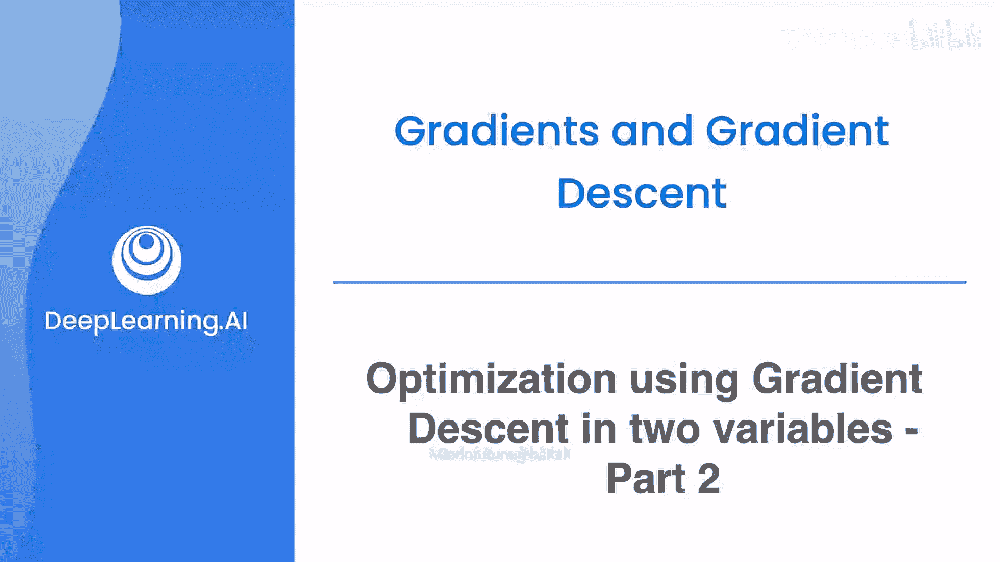
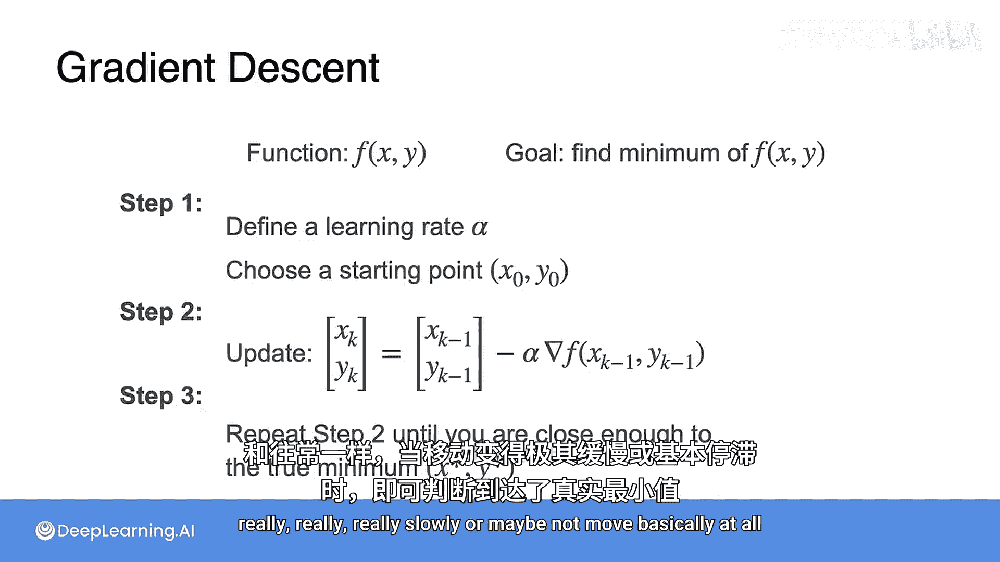
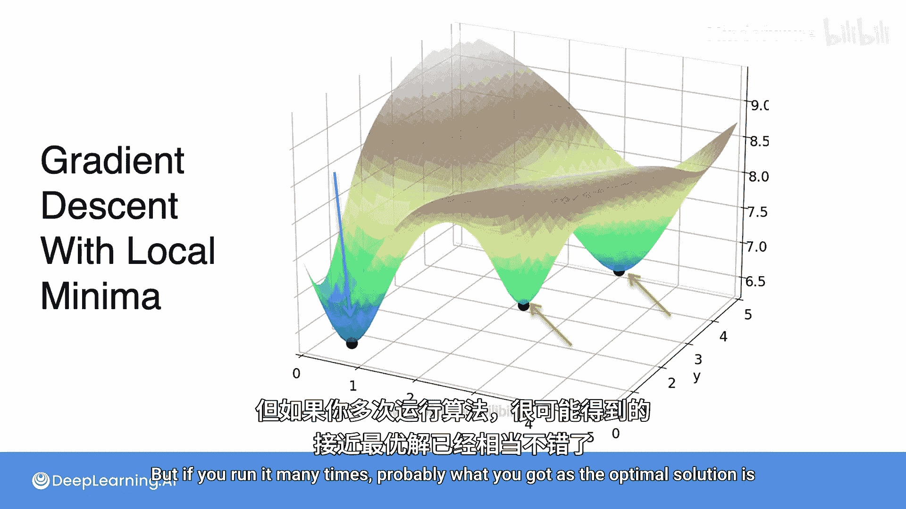

# 【Deeplearning】吴恩达：机器学习和数据科学微积分2 ｜ Machine Learning Calculus p40 P40_双变量梯度下降优化第二部分_02_02_05 -BV19M6LBeEkZ_p40-

So again， in the previous video， you saw an okay way to take you closer to the coldest place in the sauna。

 However， there was a lot of random steps in that algorithm。

 so we're going to do it more exactly and more mathematically just like we did before with one variable。

 we're going to define gradients sent in two variables So it's very similar。

 you start with an initial position except now the initial position has two coordinates x0 and y0 and before you use to draw the tangent or the derivative but now we're in two variables So we have two tangents this one over here and notice that it is pretty steep we're going to draw that magnitude in the floor in the direction that the derivative is increasing。

So because it's deep， it's a big vector and now we're going to do the same thing with the other component of the gradient。

 so we get a smaller vector on the floor because the second gradient is much flatter than the previous one。

Now let's take the sound least two vectors or the vector where the two coordinates and that is the gradient now the gradient has an interesting peculiarity is the direction of greatest ascent。

 so if you want to take a small step and get to the hottest place you can on a small step you want to take in the direction of the gradient。

But we don't want to get hotter， we want to get colder so we take it in the direction off the negative gradient and the direction of the negative gradient is the direction that if you take one step takes you to the coldest possible place that you can get to in one tiny step so we're going to take that step in the direction of the negative gradient and it's going to be a small step so we multiply by the learning rate again and so we get x0 y0 minus learning rate times gradient and that's our new point x1 y1 and that's a better point so notice that this is exactly the same as gradient descent in one variable except instead of the derivative we simply take the gradient。

So now let's see how this works for the previous example。

 this is the formula for the temperature it's 85 minus1 over 90 x squared times x minus6 times y squared times y minus6。

And let's run a couple of steps of the gradientding thecent algorithm， let's start with the 0 0。50。6。

Well now we have to calculate the gradient， which is the partial derivative with respect to x and the partial derivative with respect to y put together in a vector。

 we've already calculated these derivatives previously so here they are and all we need to do to find the gradient is to put them together in a vector。

Now let's plug x equals 0。5 and y equals 0。6 into this vector to get the gradient over here at this point。

And now simply take a step， you move in the direction of the gradient times the learning rate with a learning rate of 0。

05 that gives you a new point is not 0。50。6 anymore now it's 0。5057 and 0。

6047 so you move in that direction now you're just a little bit closer to the minimum point。

And now let's run this algorithm again。So we calculate the gradient and we move in the direction of that gradient。

So we had a new point。And you simply repeat this many， many times， and if you repeat this many。

 many times， then you are going to get really， really close to the minimum really， really fast。

So in short the gradientcent algorithm is very similar to the one we did in one variable。

 now we have a function f of xy， the goal is to the minimum。

 so the first step is to define a learning rate alpha and to choose a starting point x0 y0。

Step 2 is to update the case position by taking the k minus first position and subtracting the learning rate times the gradient at the k minus first position and then step3 says repeat step two until close enough to the true minimum and as usual you know when the true minimum is happening because it's when you move really。

 really， really slowly or maybe not move basically at all。

So now， just like gradient sent in one variable， gradient sent in two or more variables still has the same drawbacks。

 for example， you want to get to this global minimum but you may accidentally get into these local minimums over here。

And the way to overcome this， at least with high probability， is to start at very different places。

 notice that here we start at three different places and each one of them took us to a different local minimum with one actually reaching the global minimum。

But just like with one variable， there's no way to tell for sure if you got to a global minimum。

 but if you run it many times， probably what you got as the optimal solution is pretty good。

