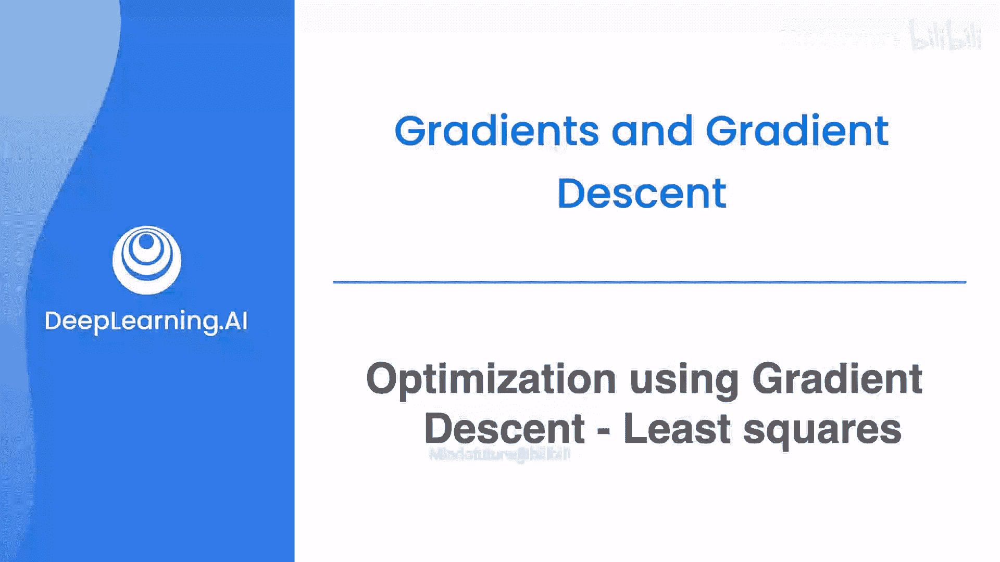
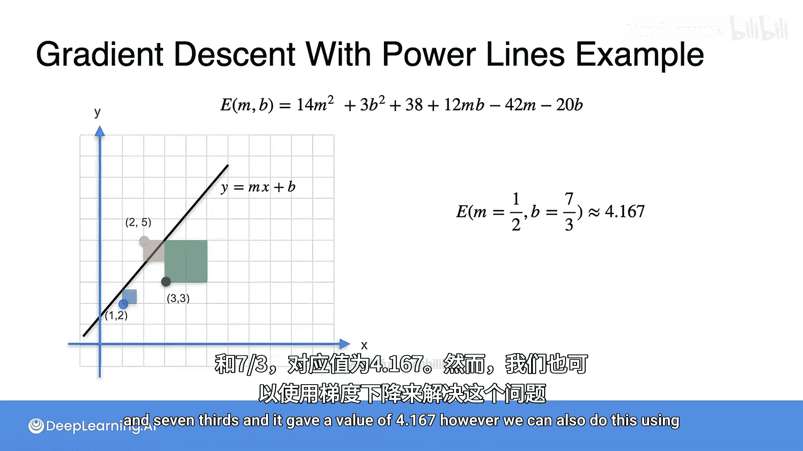
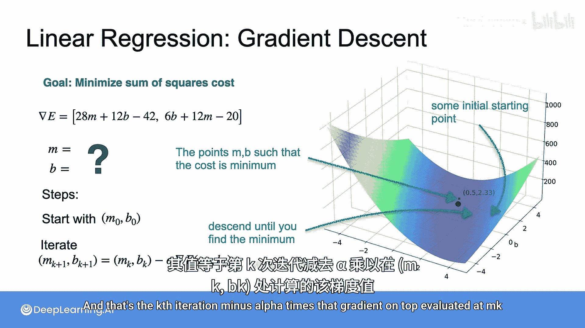

# 【Deeplearning】吴恩达：机器学习和数据科学微积分2 ｜ Machine Learning Calculus p41 P41_梯度下降优化-最小二乘法_02_02_06 -BV19M6LBeEkZ_p41-

You may remember from earlier this week that you solved a linear regression problem using power lines。

But even with two variables and a simple problem， this turned out to be pretty cumbersome。

In this video， I'm going to show you how to solve the exact same problem using grading descent and you're going to see how fast and easy it is。

😊，So the power lines example was the following， you wanted to try to find a best fiber line that reduces the cost of connecting to the power lines。

And the per boiled down to minimizing this function so finding the optimal M and B that will find the smallest value for E of M and B and analytically you found that it was1 half and7 thirds and it gave a value of 4。

167 however we can also do is using gradient descent The idea is to minimize the sum of squares cost and this was the gradient so all you need to do is find the optimal M and B。

For this， you have to first start at some initial starting point and then。

The points M B such that the cost is minimum is over here。

So what you do is you take tiny steps descending until you find the minimum mathematicalmaticly。

 the steps are the following。First， you start with some point m0 b0。

 that's some random slope and some random y to secac。

 and then you iterate mk plus 1 bk plus1 is the K plus1 iteration and that's the K iteration minus alpha times。

That gradient on top evaluated at MK Bk。

