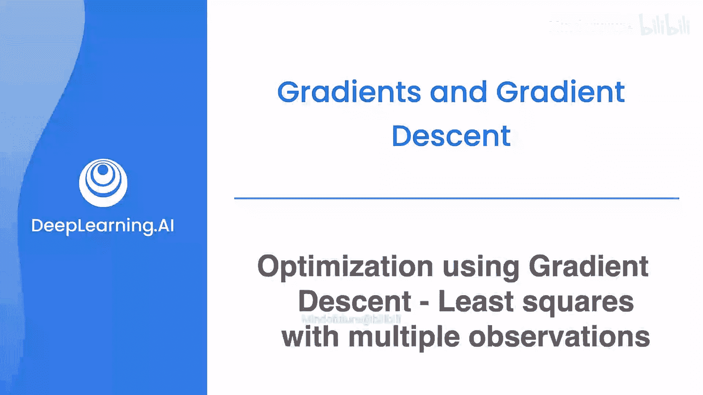
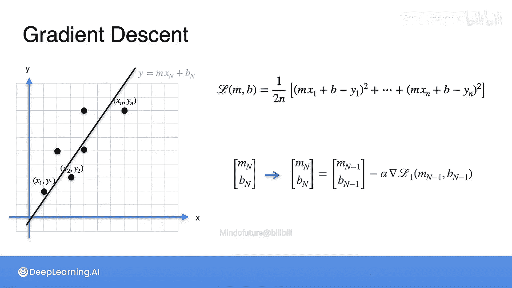

# 【Deeplearning】吴恩达：机器学习和数据科学微积分2 ｜ Machine Learning Calculus p42 P42_梯度下降优化-多观测值最小二乘法_02_02_07 -BV19M6LBeEkZ_p42-

So let's take a look at the power and problem again。

 here are the three power lines and here is the line that tries to fit them really close。

The equation is y equals M x plus B。 Now we're going to relate that to this plot at the right。

 the plot at the right is the cost of the power lines。 Let me show you how。Over here。

 we're calculating the areas of the squares and recall that the sum of these areas was the cost of that fiber line。

Now let's say that this was an numerical value given by this segment。

 so what's going to happen is that the plot in the right is going to measure the square loss here in the vertical axis。

The way it's going to do it is the following。This line is parameterized by the slope and the y intercept M and B。

 so let's put M and B in the two axises here in the floor。Now。

In the point M we're going to plot the height of the cost function and this point over here is going to be corresponding to the line on the left。

 Now this is a pretty good line fit so it's going to have a small error。 Let's look another point。

 Let's look at an awful line This one doesn't fit the points really well because it has a really high loss。

And therefore， it's going to be at a point over here in the error function plot。

And the idea is the following。In the plot in the right。

 you're going to use gradientding descent to get to the very bottom and to be able to minimize the cost function and as you do that you're going to be changing M and B and as you change M and B。

 then the plot on the left is going to have a better line fit。

And that's how you solve linear regression using gradientding descent Now let's see another example。

 one related to advertising， let's say that you work at an agency and you have in a TV advertisement budget and that relates to number of sales and of course if you increase the budget the number of sales increases and if you decrease the budget the number of sales decreases and you would like to be able to predict the number of sales given a certain advertisement budget so you start looking at your data and the goal would be to predict the sales in terms of the TV budget and the first tool you would try to use is linear regression。

In other words， try to find a line y equals MX plus B such that if you plug in X the TV budget。

 then you get Y or at least something pretty close The idea is that you have a lot of observations so let me show you how to do gradientd in descent with a lot of observations。

So let's go back to a plot and let's say the TV budget is in the horizontal axis and number of sales in the vertical axis and you have a bunch of points。

 let's say n of them。Here we have x1， y1， x to y2 up to x N， Y N。

 so let's calculate the cost function。Let's look only at the first point x1， y1。

What is the cost at that point？Well， is this length squared now what is this length？Well。

The point on the line has the form x1， mx1 plus B， and the reason is that the x coordinate should be the same as in x1 y1。

So what is that distance well it's simply y1 minus mx1 plus B？

Or we can also write it as Mx1 plus b minus y1 because at the end of the day we're going to be squaring it so it doesn't really matter if it's negative or positive。

So when we square it， we get the loss at that point。

Now we're going to add all the losses of all the points and let's actually take the average so we divided by m and there's an extra2 there and the reason that two is there is that when we take the derivative the2 and the exponent cancels with this one。

 but it doesn't really matter that could be a2 there or not。

 because if we multiply the function by2 are divided by2 the minimum point is still going to be at the same m and B。

So our total cost function is L of M and B given by this average of all the losses。

And now all we're going to do is create descent， we start a point m0 B0 that gives us some random line that may or may not be a good fit。

 and then using that we calculate the next iteration M11 which is M0b0 minus the learning rate times the loss。

That gives us a slightly better line。And now we can iterate， we can now find。

And 2 B2 using the same thing except plugging M1 B1 and then M3B3 and do it many， many， many times。

 let's say we do it capital n times until we get a pretty good fit。

And that's the formal version of the grading Descent algorithm。

