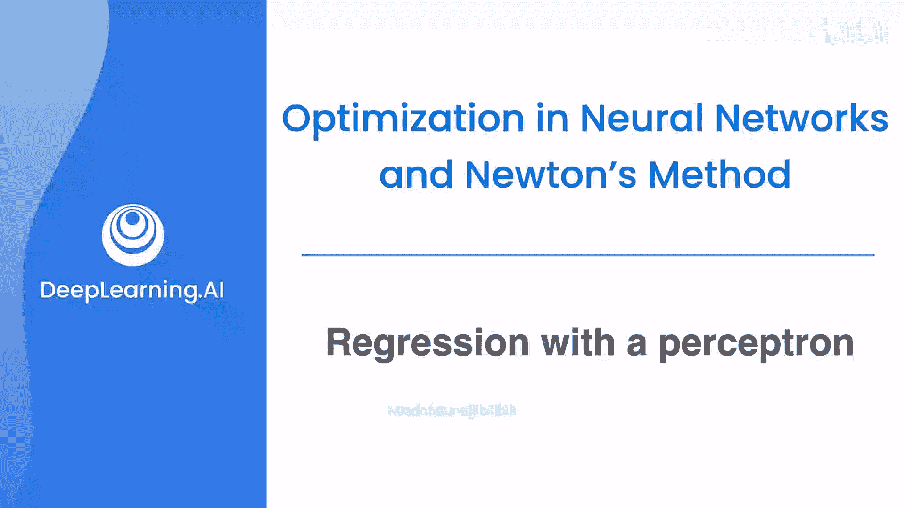
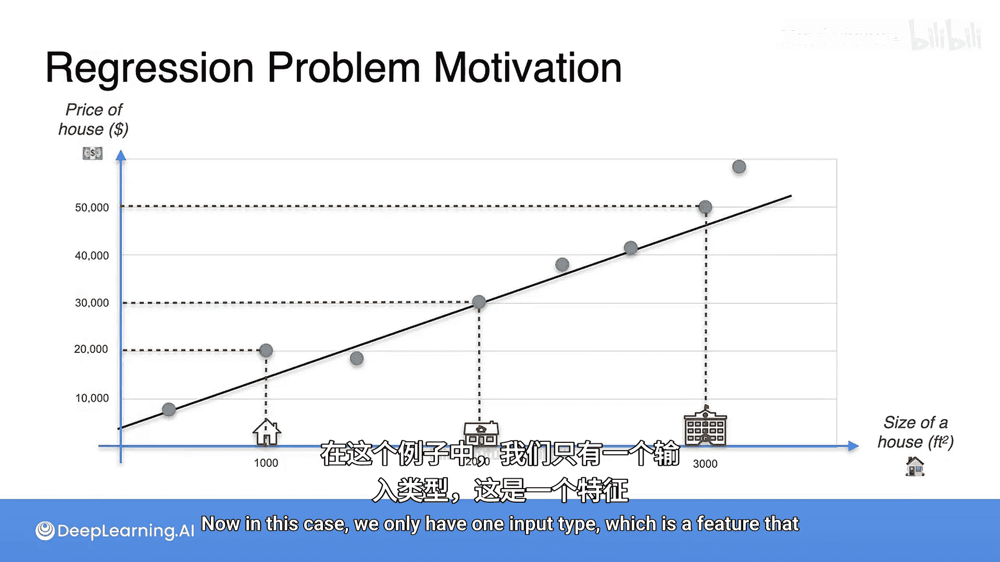
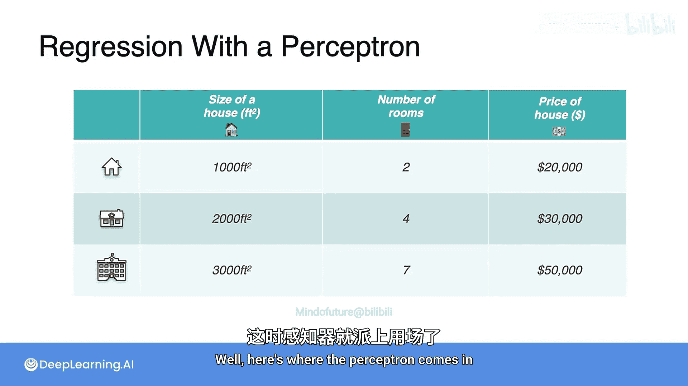
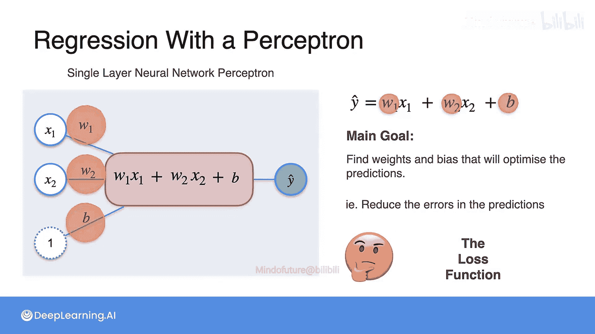

# 【Deeplearning】吴恩达：机器学习和数据科学微积分2 ｜ Machine Learning Calculus p44 P44_感知机回归_03_01_01 -BV19M6LBeEkZ_p44-

Welcome to week3 in this week you're going to learn what a neural network is and how to train them using grading descent you're also going to learn an alternate method to grading descent called Newton's method which is also very fast and very useful。

But let's start with the first video in this video。

 you're going to learn the fundamental unit of neural networks called a perceptron that may sound like a foreign term to you。

 but you've actually seen one already because linear regression can be expressed as a perceptron。😊。

So let's cover the motivation behind a regression problem。

 we'll be using one of the most classical examples used in linear regression predicting the price of a house given the size of the house。

 so let's say you have data on three houses， the first one has $1，000 square feet and it costs $20。

000。The second one， 2，000 square feet， and a cost of $30，000。And the third house has a size of 3。

000 square feet and costs $50，000。And let's say that you have more data points which you plot on this graph。

 so these are other houses on the market with their sizes and their prices。

And the goal is to take this data of inputs， which is the size of the house and find in this case a line because they look like they form some sort of a line。

 so we're going to find a line used to predict the price of the house。

And the goal is to find the best possible line Now in this case， we only have one input type。

 which is a feature that we're going to use to predict the prices What if we threw in a second feature。

So let's throw in another feature， let's say the number of rooms， now the houses have two。

 four and seven rooms respectively。With this added feature。

 the problem is not so simple anymore and we need to consider how both features affect the output。

 then how do we build and train a model that is able to make predictions of the house prices。

And more， what if we had more features， what if I have like 10 features or 100 features？Well。

 here's where the conceptcept perceptioncept comes in。

So this regression problem can be modeled with a single perceptor。

The perception is going to take some inputs into some unknown outputs that we want to predict。

So first we're going to start by exploring the perceptron mathematically。

 so let's start with the inputs， the inputs here are going to be x1 and x2 corresponding to the size of a house and number of rooms。

 but I want you to imagine this if there were 100 inputs。

 it would simply be100 nodes x1 all the way to x100。

So we start with the inputs and then they plug into a summation function。

 I'll explain more about this in a little bit out of the summation function comes the output Y hat and that's going to be what we predict to be the price of the house so a good model will come out with pretty good predictions and the idea is to build the best possible model。

So what is happening in this summation step， let me do it more in detail Each of these features x1 and x2 is multiplied by a corresponding weight。

To determine how important it is for the output so for example。

 if the size of a house is way more important to predict the price of a house than the number of rooms。

 then this will have a higher weight than the number of rooms。

So let's call the corresponding weights W1 and W2 and to combine these weights and the input we simply add them。

 so we multiply W1， the weight times x1 the feature and we add W2 times x2。And we're almost there。

 we're not quite done because there's also a biased term that gets added to the summation function。

And now， we add this。And that is the output。In this model there's no activation function。

 I will tell you later when an activation function is。

 but here the output is simply y hat that's w1x1 plus w2x2 plus b that the predicted price of the house and the goal is to find the best w1w2 and be the weights and bias that will optimize predictions so the ones that will when we plug in x1 and x2 give us the closest to the actual price。

For the entire data set now， how do we do this， how do we find these perfect weights。

 the idea is that we want to minimize some kind of error。

 The error is basically how far are you from the price of the house。

 And so if you minimize that error， then that's all we need so。For that。

 we introduce something called the loss function， the loss function is a little function that's going to tell us how far are we from predicting the prices well。

 so that's on the next video。

