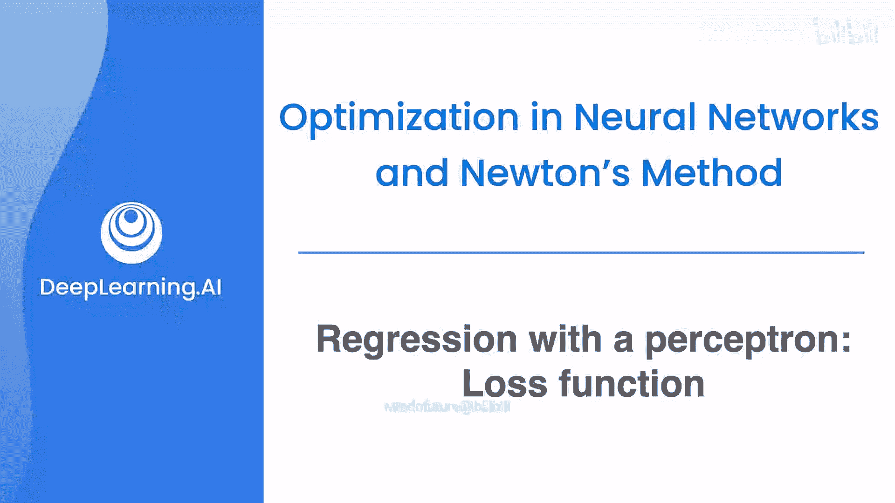
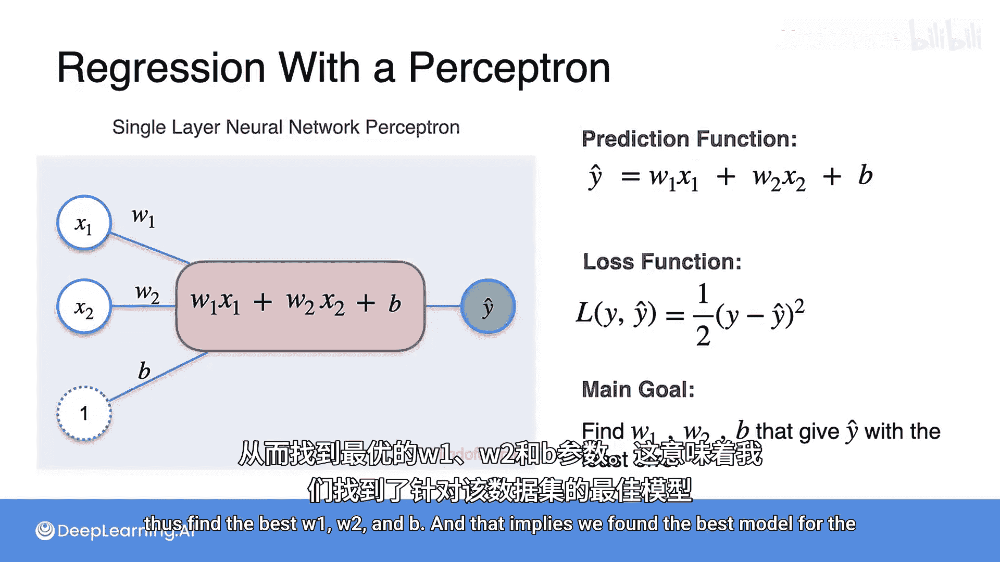

# 【Deeplearning】吴恩达：机器学习和数据科学微积分2 ｜ Machine Learning Calculus p45 P45_感知机回归损失函数_03_01_02 -BV19M6LBeEkZ_p45-

So in the previous video you saw a data set with a bunch of houses and their prices and also their sizes in square feet。

 so the idea was to fit the best possible line to these point。

 so the line that passes the closest possible to this points and that would be what makes a good prediction。

So this line over here is precisely the model and we need to find a way to evaluate the model to see how well it's doing and based on that。

 to see how can we improve it to get a better one。So first， let's see what the model predicts。

 so the model predicts this column， how well？The point corresponding to the first house is at height 15。

000 and the one corresponding for the second house at heights 30。

000 and for the first one is at 45000。 so this looks like a pretty good model。

 we may be able to do better， but this so far looks like a pretty good model。

 at least you can see it correctly predicted the price of the second house and it was not so far from the first and the third。

But let's quantify how far it was。By that， we need to subtract the predictions from the actual value。

 and we're going to call that the error。And that error is indicated by these vertical broken lines over here。

So clearly the shorter the line， the better the model because that means the predictions are close to the actual values。

 However， there's a small problem with y minus y hat if the point is above the line。

 then this is positive and if the point is below the line then this is negative and a negative error is also bad as well as a positive error。

 but if we add them we can get0 or small number so this can get confusing。 So for that。

We square the error y minus y hat square is the actual measure that we want and in machine learning we actually multipied by a half and the reason is really more cosmetic because in reality when you take the derivative of y minus y hat squared then you get a lingering two so we put a1 half there to cancel with that two and then we have left numbers to keep trackken but at the end of the day you can multiply this error by any constant you want and you still don't change anything at the end。

So now we have a prediction function that outputs some kind of prediction y and is given by this formula and the loss function we're going to call L and for every point is12 times y minus y hat squared。

So iss the distance between the prediction and the value squared。

 multiply by half and we're going to call that L of y y hat。

 and our goal now is to minimize this so to find the W1w to andB that give y with the y hat with the least error。

And in the last week you learned a lot about minimizing functions including methods like grading descent。

 so as you can imagine， this is what we're going to use next。

 we're going to use grading descent to minimize L the loss and thus find the best W12 and B。

 and that implies we found the best model for the dataset。

