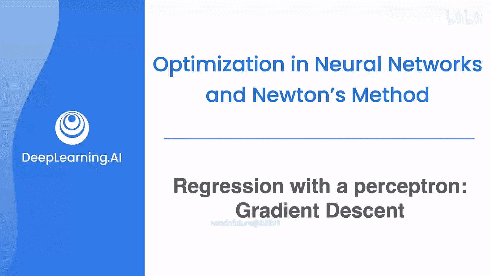
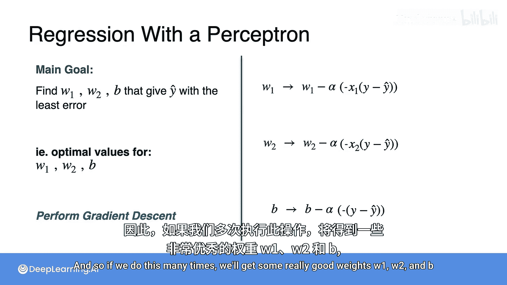

# 【Deeplearning】吴恩达：机器学习和数据科学微积分2 ｜ Machine Learning Calculus p46 P46_感知机回归梯度下降_03_01_03 -BV19M6LBeEkZ_p46-

So now we know what the problem is， we want to find the prediction function with the best weights and bias that minimizes the loss function L。

 Y， Y hat。So in other words， we want to find the best model that makes the smallest mistakes now。

How do we find these optimal values， we're going to minimize L using gradient descent。

 so we're going to find the best W1 W2 and B using gradient descent and recall that the gradient descent formula updates W1 this way in order to minimize L recall that alpha is the learning rate and then this is how it updates W2 and this is how it updates B。

So in other words， you have some W 1， W2 and B， some starting values。

 and then all you need to do is calculate this three gradients。And。

You can update them and get new W1W2 and B that are better。

 than a better model because it has a smaller loss function， and if you do this for a long。

 long time， you can imagine。That you're going to get to end up with pretty good weights that have a very low loss function。

 and that implies a good model。So now I'm going to tell you how to calculate these derivatives。

 there's going to be a lot of chain rule， so on the left we have the functions for reference and on the right I'm going to calculate the partial derivatives so first of all。

 what is di L over di B。Well。Take a look at L。L depends on。The variable Y hat。

 so we need to do di L over di Y hat， and then Y hat depends on B。So die y hat over die B。

 this is nothing more than the chain rule that we learned last week。

And the same thing happens for di over di w1 L depends on y hat。

 so we have dil over di y hat and y hat depends on w1， so times di y hat over di W1。

And the same thing for dil over diw2。D L over di y hat as L depends on Y hat。

Times die Y hat over T W2。So now we know what we have to do and all we have to do is calculate these four derivatives because notice that di l over di1 hat repeats three times。

 So we need to calculate that one and then the three partial derivatives of y hat with respect to w1 W2 and B。

 and these are much easier than actually plugging the whole thing。

 So it's kind of like breaking the problem into easier sub problems。

 So let's calculate each one of these separately。 Let's start with di l over hat。

 This is the derivative we have to calculate with respect to Y hat。

 So using the chain rule this is one half times something squared and its derivative is the something。

Y minus y hat， but we still need something more because we have to take the derivative of the inside with respect to y hat and the derivative of y minus y hat respect to Y hat is simply negative one。

 So we have that minus1 over there。 So the first derivative is simply negative y minus y hat。

 We could write as negative y plus y hat， but we're going to keep it like this。

Because it's going to make math easier later。Now let's move to the other three。

 which are much easier actually， what's die y hat by di B？Well。

Notice that this is a constant with respect to B has nothing to do with B。

 so really it's going to be1 because it's the derivative of the remaining which is B by di B。

 so that's a1。What about the next one， die y hat over diw1？Well。

 notice that this part is a constant respect to W1， so this may as well be w1 x1 plus 7。

And its derivative is simply x1， which is the constant that accompanies w1。And similarly。

 die 1 hat over diw2， this part's a constant， so it's just x2， the constant accompanying W2。

So now that we have these ones， let's plug them back in I'm going to put them here on the right as reference and all remember the chain which we already calculated dial over di B is dial over di y hat。

 which is。Minus y minus y hat times T y hat over type B， which is1。So that's the first derivative。

For the second one， dil over diw1， it's the usual minus y minus y hat。

 which is diall over di y hat times di y hat over diw1， which is x1。And for the final one。

 dil over diw2， it's going to be the usual diall over diy hat negative y minus y hat times diy hat over diw2。

 which is x2。So these are our three derivatives。Now let's go back and remember our main goal。

 recall that the main goal was to find the optimal values of W1。

 W2 and B that give us the predictions we have with the smallest possible error。

And we're going to use the tool that we developed last week， gradient descent。

So recall that gradientding descent uses these updating formulas to get the new W1。

 so you start with somew1 and update it as w1 minus learning rate times the derivative of the loss but we want to minimize with respect to W1 Now what is this we already calculated it it's going to be negative x1 times y minus y hat for w2。

Again， this is the gradient descent step and we know this derivative， we already calculated it。

 we get this and for B b is going to be updated as b minus alpha dial over die B。

 which gets calculated as minus y minus y hat， so this is the gradient descent step。

And so if we do this many times。We get some really good weights W1W2 and B that are going to have a really small error and therefore a really good model。

