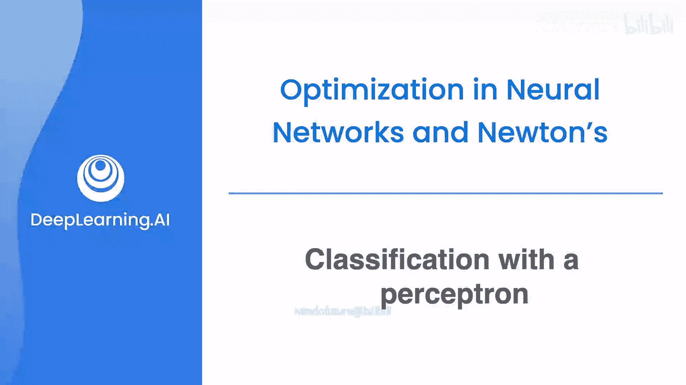
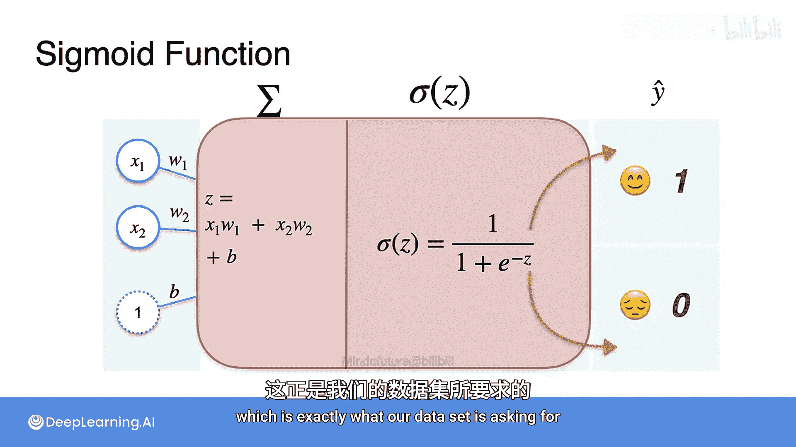

# 【Deeplearning】吴恩达：机器学习和数据科学微积分2 ｜ Machine Learning Calculus p47 P47_感知机分类_03_01_04 -BV19M6LBeEkZ_p47-

You've already seen how to use perceptrons as linear regression problems。

 but a perceptron can also represent a classification problem in particular。

 a binary classification problem All you have to do is change the activation function in this video I show you how。

So now that you know how to solve the regression problem with a perceptron and with gradientding descent。

Classification is actually very similar。 It only has one little complication， but it's not that bad。

 So let's look at an example that you've already seen earlier in the class。

 You meet an alien civilization and you start listening to the way of speaking。

 So you take note of four sentences in their language that are these four。

 They only have two words in their language so it's pretty simple。

 but what you want to do is be able to tell the mood of each sentence。

Now when the alien said the first sentence， you can notice that they were happy for the second sentence they were sad for the third one。

 they were sad and for the fourth one， they were happy。

 so the idea is to be able to infer from new sentences the mood if they're happy or set so we're going make a model that will predict the mood based on the sentence now since we want numbers because models take numbers and not words then we're going to make the following table where the number of times the word act and the number of times the word beep are recorded so the first sentence has three times the word act and0 times the word beep。

 so it's 30 for the second one is02 for third ones1，3 and for the fourth one is21。

So that's the data set for the sentiment analysis classification problem that we're going to solve in this lesson so the first thing we do is plot the points。

 so here are the points。And as you can see， the happy points tends to be on the bottom right and the sad points on the top left。

 so that's probably what the model is going to tell us。But let's turn it into upperceptron。

 so for the preceptrum we have our inputs labeled x1 and x2 and x1 in the number of times the word a appears and x2 is the number of times Bep appears。

And again， this is going to go through a prediction function just like before with a summation and a bias。

 etc。And the prediction we had is going to tell us if the model thinks the sentence is happy or sad。

 Now， what goes in the center node of the highlighted in red indicates the placement of this line that's going to classify different sentences are happy or sad based on the number of times a particular word appears。

 the sentence is the one that divides the happy zone in the bottom right from the sad zone in the top left。

So let's explore this center node more carefully and the entire classification perceptron further it's going to be very similar to the regression perceptron but with a little addition so again we're going to have weights W1 and W2 then determine how important any of the features are say the word act is really correlated with happiness then w1 is going to be a large number if B is very irrelevant then W2 is going to be a small number however if B to be B happens to be inversely correlated with happiness say it's a very sad word then W2 is going to be a negative weight。

And again， we're going to have a bias input B。So。What's going to happen inside the node。

 we are going to have a summation， so the summation is again going to be x1 w1 plus x2 w2 so the features times the weights added plus the bias B so that's just like before and this produces a continuous number that's going to be called set and as I said that's a continuous number that could be anywhere in the number line this number can be minus a million it could be plus 7000 it could be 0 it can be 1 it could be whatever。

However， that's not the output we want。 That's the output we want an in regression because we wanted any number to be the price。

 but now we want a number between 1 and0 because we want it to tell if it's happy。

 That's a1 or if it's sad。 That's a0。 So how do we turn the entire number line into the numbers 10 or at least some number in between 10 we're gonna to use what's called the activation function。

 the by the letter sigmoid of z and the activation function it's actually very useful it's going to take all the numbers in the number line and crunch them into the interval01。

 Now you can still get numbers in between 01， that's okay。 if you get a 0。

5 can be that the model doesn't know if the sentence is happy sad。 if you get 0。

9 means the model thinks the sentence is happy if you get 0。01。

 then it means that the model thinks the sentence is pretty sad。 So the sigmoid function is a huge。

 huge component of。This perception。Now， let me explore the sigmoid function a little more in detail。

 The sigmoid function is given by the formula 1 over 1 plus E to the Z。

 and that's going to give us a number between 0 and 1。

So in the next video we're going to get into the sigmoid function in more detail。

 but for now just know that it's a very important piece of the perception and the summation in the left gets passed through the sigmoid function in order for our output to be something between 01。

 which is exactly what our dataset is asking for。

