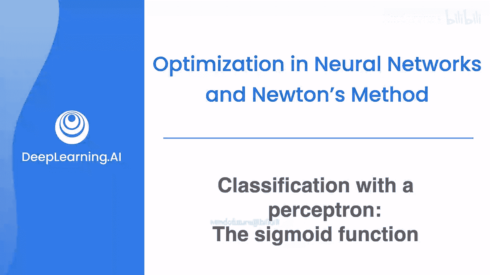
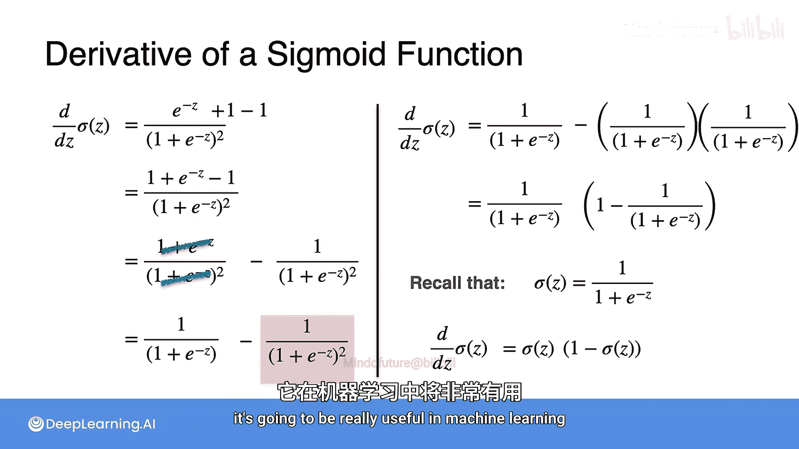

# 【Deeplearning】吴恩达：机器学习和数据科学微积分2 ｜ Machine Learning Calculus p48 P48_感知机分类-Sigmoid函数_03_01_05 -BV19M6LBeEkZ_p48-

So in the previous video learn the sigmoid function and how it's super useful in machine learning and the reason is because it takes the entire number line and crunches it into the interval 01。

 which is what we want for the output the formula is 1 plus1 over1 plus e to the minus Z and here is the graph。

The graph is。This one over here and notice that the input is the number line and the output is the interval 01。

 so the input is the horizontal axis and the output is the vertical axis。

Notice that it has asymptotes at 0 and 1， which means it never really touches the number 0 and1。

 but every number has an output strictly between0 and 1。And for example。

 sigmoid of 0 is 12 because if you plug in a 0 and1 over 1 plus e to the minus 0。

 you get 1 over1 plus 1， which is 12。If a number is very， very large positive， like  a1 thousand00。

 then sigmoid of 1000 is very， very close to one。And if it's a very large negative number like minus 1000。

 then sigmoid of minus 100 is very， very close to zero。However。The sigmoid function has a very。

 very nice property other than the fact that it crunches the entire number lining to the interval 01 and is that its derivative is really nice。

So now we're going to calculate the derivative and why is it important that it's a nice derivative because in machine learning。

 we're going to use derivatives a lot， so it's very important that a function is easy to differentiate so let's take the derivative in great detail。

Sigoid of set is 1 over 1 plus e to the negative set which can be written like this1 plus e to this negative set to the negative 1。

Now we're going to take the derivative of this。So we're going to use the chain rule。

For the chain rule we have d over d z of something to the minus1 is minus1 times something to the minus2。

And then we take the derivative of the something inside that's exactly chain rule。

 so let's rewrite it as negative 1，1 plus e to the negative set to the negative 2。Times。Now。

 d over d z of 1 plus E to the negative set is d over set of 1 plus d over the set of e to the negative set。

And that's going to be rewritten as0 because the derivative of a constant that 1 is 0。

 and here we have the derivative of e to the negative set。

 which is e to the negative set derivative of negative set by the chain rule and that last part is going to be。

Minus1。So we're about halfway there。Notice that this negative 1 gets canceled with this negative 1 and we have 1 plus e to the negative set to the negative 2 times e to the negative set。

 which is this Now this can be rewritten even nicer。

Let's write it as e to the negative set over 1 plus e to the negative set squared。

And so this is where we are。Now notice that we can add unsubtract1。

 why do we want to un sububtract one you'll see， but let's write it like this and now let's split it as the first one plus E to the negative set over the dominator minus 1 over the denominator now this cancels with one of these two and we get  one over 1 plus e to the negative set。

Minus 1 over 1 plus E to the9 of set squared。And that can be written as this。Minus。

1 over1 plus e to the negative Z times itself。And now we're just going to factor the 1 over 1 plus e to the negative Z。

Times 1 minus 1 over 1 plus1 to the negative z and why do we want to do that Well recall that this is exactly the sigmoid so the first term is sigmoid and the second term is 1 minus sigmoid so isn't that beautiful the derivative of sigmoid is sigmoid times 1 minus sigmoid。

And the fact that this derivative is so easy to calculate means that it's going to be really useful in machine learning。

