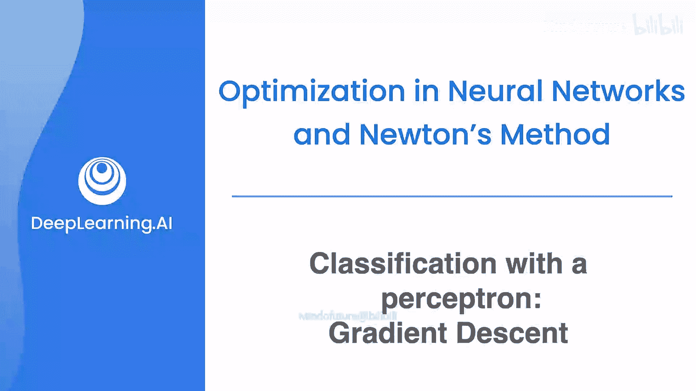
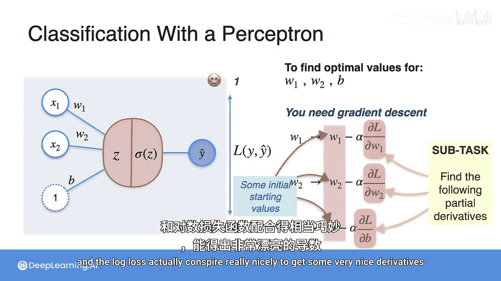

# 【Deeplearning】吴恩达：机器学习和数据科学微积分2 ｜ Machine Learning Calculus p49 P49_感知机分类梯度下降_03_01_06 -BV19M6LBeEkZ_p49-

So now that you know all there is to know about the sigmoid function。

 let's go back to the perceptron， let's take， for example。

 the sentence act beep beep beep as an example， This one has the word act 1 times so x1 is 1 and the word Bep3 times so x2 is3 and let's say that we're in the middle of training the algorithm and the weight that we have are 4。

5 for w1 1。5 for w2 and the bias of2 So what the perceptron does is it takes this inputs multiplies them by the weight act functions and applies the sum and then the sigmoid function in order to get a prediction Y hat。

And the idea is that we're going to use Y hat together with a loss function that tells us how far Y hat is from what it should be in order to update the weights。

So let's say that y is 0。 So the sentence is set。 Then we're going to use that to update W 1 W2 and B。

 So basically we're going to measure how far y hat is from y and that's the error。

 Now you may think Y hat minus y works really well Y hat minus y squared or1 half times y hat minus y squared all the error functions we've seen before。

 Those work。But for classification， the one that works best is called the log loss。

 so next I'm going to show you how the log loss is calculated。

Log loss is going to be called now L of Y Y hat， and we're going to use that error to update the three weights and bring the error down。

So let's recap we have a prediction function Y hat with an activation of sigmoid that is applied on the summation coming out of the perceptron and we have a loss function that is the log loss Now the log loss is something you've already seen before Do you remember that example we saw in the previous section。

Where we were trying to find the ideal coin to be able to fit some data set。

 it was a coin that you needed to flip 10 times and you needed to obtain head7 times and tails three times。

 and you need to find the perfect coin for that and the perfect coin was obtained by minimizing some loss function with a logarithm It's precisely this。

So this is actually the loss function for this problem， and you can see that if y is0。

Then this is small when white hat is small and large when why hat is large。

And if y is1 then the opposite happens when y hat is close to one。

 this function is small and y hat is close to 0 this function is large， In other words。

 this L of yy hat is a large number if y and y hat are far away from each other and small number if they are close to each other and there are many reasons why want to use log loss for this function one is that the math works out really nicely。

 but the other one is that this function has a probabilistic nature to it and the reason is the same reason that it came out of that example with the coins and classification problems are highly probabilistic because you can think of the output Y hat as a probability。

Let's say that Y hat is 80% or 0。8， that means that the model gives the sentence an 80% probability of being happy。

So let's go back to the main goal， the main goal is to find the perfect weights W1W2M that will give us Y hat with the least amount of log loss LYY hat error。

So in order to be able to do this， we need to go back to gradient descent。

We call the gradient descent formula that updates the weights W1 as the old W1 minus a learning rate times the derivative of the log loss with respect to W1 and W2 as W2 minus learning rate times derivative of log loss by w2 and the same thing for B bias equals bias minus alpha derivative of log loss by derivative of B。

Now， in order to start the algorithm， we simply start with some arbitrary values for the weights and biases。

 and we're going to start the decent process。 So we started random variables。

 Then we calculate the partial derivatives and then。

We update so in the next video I'm going to show you how to find these partial derivatives and you're going to see that the sigmoid and the log loss actually conspire really nicely to get some very nice derivatives。

