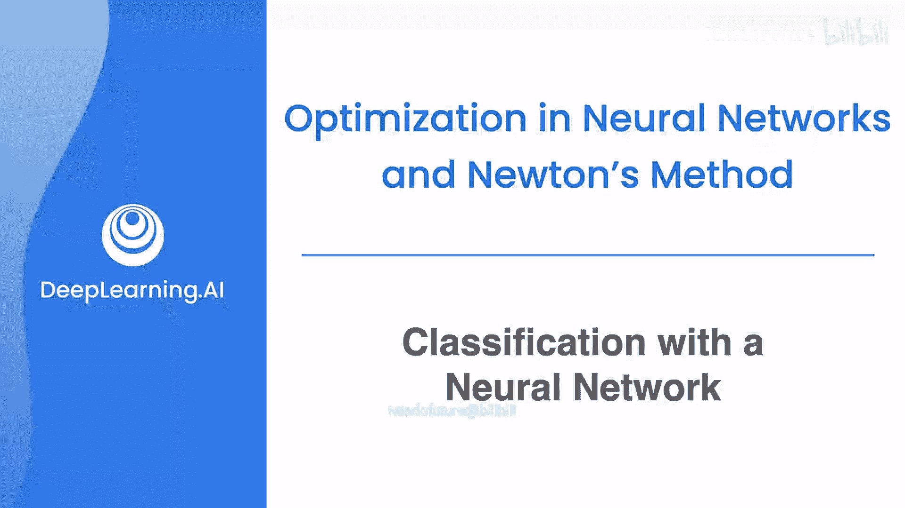
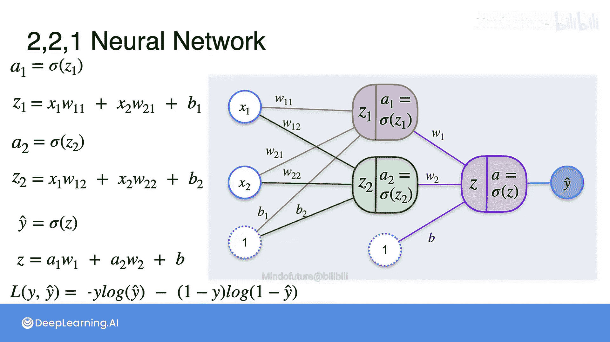

# 【Deeplearning】吴恩达：机器学习和数据科学微积分2 ｜ Machine Learning Calculus p51 P51_神经网络分类_03_01_08 -BV19M6LBeEkZ_p51-

Now that you know what a perception is， you're just one step from knowing what a neural network is。

 a neural network is just a bunch of perceptioncepts organized in layers where the information of these perceptions is passed to the next layer。

And how to train these neural networks using gradientding descent just like before。

 except now we have many derivatives， we have to take the derivative of the log loss with respect to each one of the weights and biases of the neural network let me show you how。

😊，So remember in the previous lesson you worked the binary classification problem where you had to do sentiment analysis。

 use this perception shown here where that was the summation of the previous variables type multiplied by the weights and then the sigmoid set was the activation function that got you to find the prediction Y hat。

Now， it turns out that these models are pretty simple and they can only do so well。

If you remember what this thing does is it builds a linear boundary a line between the happy and sad sentence。

 but maybe language is much more complicated than that。

 maybe it needs boundaries that are much more complex and not just aligned。

 so for that we use not just one perceptron， but several percepts put together。

So that's called a neural network， so here we have one perceptron， the red perceptron on top。

 and then we put a green perceptron on the bottom。And now we have two perceptions that perhaps do different things and what we do with the outputs of these two perceptions。

 we plug them into another perceptionceptron， the purple perceptionceptron。

And that is a neural network and you can imagine that a very complex neural network we have many。

 many percepts plugged into others and the outputs of those are plugged into others and then you have many。

 many， many layers and you'll be able to solve very complex problems For now we're going to do it with two layers。

 the one of the red green and the purple one。So that we can actually handle the math properly。

 so here is the math。 we're going to have weights and here we're going to have weights W11。

 W21 and the bias B1 that goes into the red percept。And the sum as usual is Z1。

 and then you apply sigmoid Z 1 and you're going to call that a1。

 so a1 is what comes out of the red perceptron。Now what comes out of the green perception。

 similar thing， W12 are the weights， W22， the bias is B2。

Z2 is the usual summation of the weights times the features plus the bias。

 and when you apply sigmoid to this， you get A2。And81 and A2 are the inputs to the purple perceptron。

 so the weights here are W1 and W2 and then Z is obtained as a1w1 plus a2 w2 and then you obtain Z and you apply the sigmoid function to this to obtain y hat so this is a neuraln network of depth2 that has one input layer over here one hidden layer over here and the output layer。

 but as I said you can imagine neural networks with lots and lots and lots of inputs however there's one thing missing right percepts normally have a bias and the purple perceptron doesn't have a bias。

That's no problem， we'll just put the bias here and we'll call the bias weight B。

Now we have a full neural network， let's study the inner workings on the red node inner heatated layer。

So focusing on this node alone。We've established that a1， its output is given by the sigmoid of Z 1。

 and Z1 is given by the usual combination of weights and inputs and the bias。

 so x1 w11 plus x20 to 1 plus B1， the same thing happens with the green perceptron。

A2 is given as sigmoid of Se 2 where set 2 is the usual summation of the weights times the features plus the bias。

And now let's go to the purple perceptron for the purple perceptron the output is y hat and it sigmoid of set and set is again the summation of a1w1 plus a2w2 plus B so the new inputs to the purple perceptron are the outputs of the green and red perceptron so A1 and A2 and that is multiplied by the weights W1 and w2 and B gets added to that。

And that is the output of the neural network。And as a reminder， here are all the variables。

So here's a full picture of the neural network with the inner workinging and the math behind each one of the nodes and now since we're dealing with a classification problem。

 let's not forget that the error function is a log loss that we saw in our earlier problem to help us measure the error that is L yY hat equals negative logarithm of y hat。

 minus1 minus y hat logarithm of1 minus y hat where Y hat。

Is the prediction and why is the target in the training data that we want to hit？

So now that we know how a neural network works， let's get to training them。

