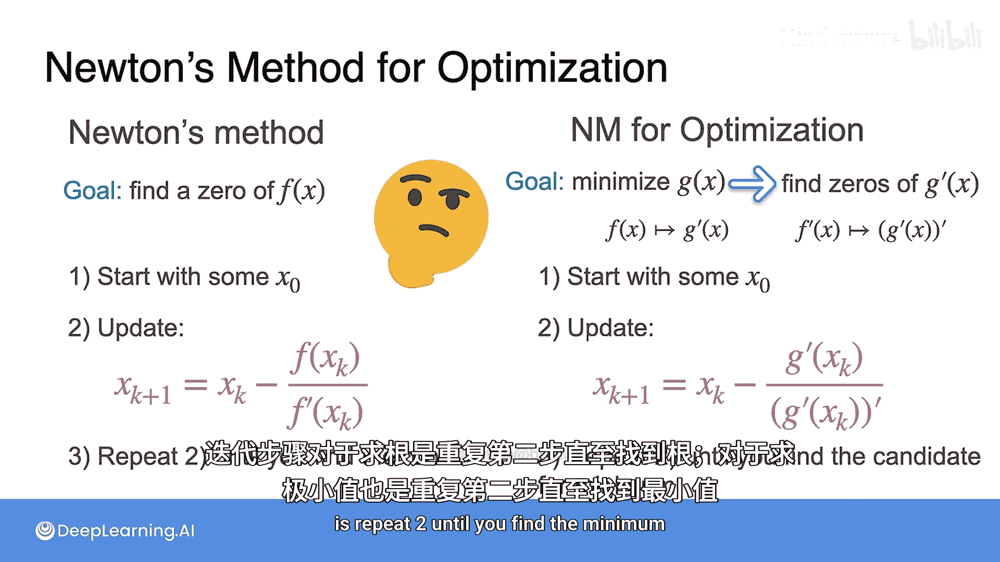

# 【Deeplearning】吴恩达：机器学习和数据科学微积分2 ｜ Machine Learning Calculus p54 P54_牛顿法_03_02_01 -BV19M6LBeEkZ_p54-

In this in the following videos， I'm going to show you an alternate method to grading descent called Newton's method。

Newton's method is also very fast and very powerful In principle。

 Newton's method is used to find the zeros of a function， however。

 we can adapt it a bit to be used for optimization。😊，Newton's method works in many variables as well。

But let's start by looking at how it works in one variable。

So let's say you have this function over here and your goal is to find zero。

 so find this point over here， that's the point where f of x is equal to 0。

So here's a pretty good method to approximate this0 really well that works similar to gradientding descent。

 Let's start with some random point x0。 That's not the0 of the function， but that's okay。

 We're going to get a better one from here。Let's take the tangent at this point。

 so let's take the derivative and draw the tangent and see where it hits the horizontal x axis。

And at this point， we're going to call it x1， notice that x1 is much closer to the0 than x0。

 So all we need to do is iterate over here。 So let's do it one more time。

 draw the derivative and find the new point x2。 notice how close x2 is from the0 of the function。

 So we pretty much almost got there by the third point where' very， very， very close to the 0。

 So we pretty much found it we didn't exactly found it， but we got pretty close。

And that's a point to be able to approximate the zero of the function really well。

 Now let's add some numbers。This line over here has slope f prime of x0。

 and this height over here is f of x0， and the base is x 0 minus x1。

 So this formula over here for the slope is。Rice over run now rise is f x0 and run is x 0 minus x1。

 So therefore f prime x0 is F x 0 divided by x 0 minus x1。 We can manipulate this。

To get that x1 is equal to x0 minus f of x0 divided by f prime of x0， and that's the iterative step。

 you have f0， you simply calculate x1 based on x0 and then iterate so how do we iterate well let's go to one more step let's say that you've done it k times and you've got to xk。

This slope over here is f prime of xk， this height is F of xk。

And this horizontal distance is xk minus xk plus 1。

 therefore doing the same methods before xk plus 1 is equal to xk minus fxk divided by a prime of xk。

 and since you know xk， you know f， and you know the derivative， then you can find xk plus 1。

 so you iterate on the step and you get Newton's method。

Now the question is how do you use that for optimization because remember gradientding descent from the minimum of a function。

 Newton's method is only finding the zero of a function， not the minimum。Well。

 we simply remember that when you want to minimize a function G of x。

 you actually have to find the zeros of g prime of x， so if I can find the zeros of a function。

 I'm very close to minimizing it， I just have to look at all the zeros and see which ones are minimum because those are the candidates for minimum so in other words if I let f of x v the derivative of G of x。

 then by finding the zeros of fx I am minimizing G prime of x and the derivative of f prime of x is simply the derivative of G of x and the derivative of that。

So in other words， here are the algorithms。For Newton's method， you start with some x0。Now。

 if I wanted to find a0 of f， what I have to do is update and the step is xk plus 1 is xk minus fxxk over f prime of xk。

 where xk is my k iteration and xk plus1 is my k plus1 iteration。

Now in Ne to's method for optimization， I have to do the same thing。

 except not with f but with G prime， so I have xk plus 1。

 the k plus 1 iteration is xk minus g prime of xk divided by G prime of xk prime。

 the second derivative。So that's going to be a big deal very soon。

But before that let's do the iterative step， the iterative step is repeat2 until you find the root on the left and on the right is repeat 2 until you find the minimum。

