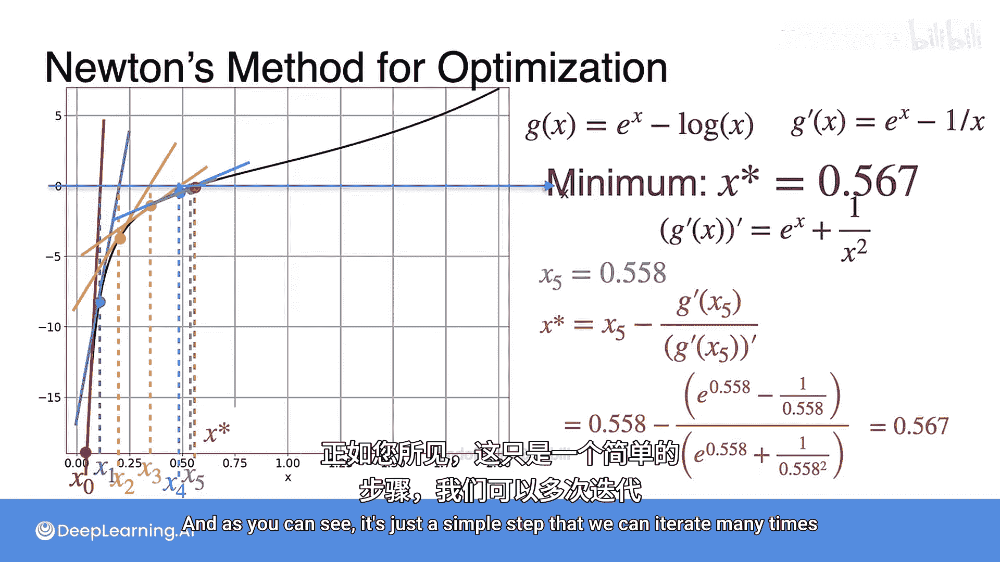

# 【Deeplearning】吴恩达：机器学习和数据科学微积分2 ｜ Machine Learning Calculus p55 P55_牛顿法示例_03_02_02 -BV19M6LBeEkZ_p55-

So now that you're know needton's method let's put it in action。

 I want to recall this function you saw in week two when you learn about grading descent。

 the function was e to the x minus logarithm of x， and its derivative was e to the x minus 1 over x recall that the minimum for this function was the omega constant 0。

5671 etc。And so let's approximate this minimum recall that in order to use Newton's method for a minimum you actually have to use it to find the zeros of the derivative。

 so we're going to try to find the0 of this function which is the derivative e to the x minus1 over x Now what's the derivative of the derivative Well if we take the derivative of e to the x is again to the x and the derivative of1 over x is minus1 over x squared so the derivative of the derivative is e to the x plus1 over x squared。

That's going to be our F prime of x when we're taking f of x equals G prime of x in other words。

Our new function to find the0 is f of x， and we're going to use F prime of x to help us with Newton's method。

 So let's start。 let's do a few iterations。 We start with the iteration with the first value x0 equals 0。

05。 That's the first iteration。 Now let's take the derivative and see where it hits the 0。

 So it's at a 0 x1 not too far from it。 x1 is given by this formula using Newton's method。

 We evaluate the derivative at E to the 0。05 minus 1 over 0。05。

 that's the derivative divided by e to 0。05 plus 1 over 0。05 squared。And we get 0。097。

So that's our new point x1。So with x1， we're going to iterate again， withdraw draw the tangent。

 see where it hits。And that's at a  point x2。How do we calculate x2 by plugging in these values。

 So x2 is going to be 0。183， and again， we take the derivative C rate hit 0， and that's our 0 x3。

How do we calculate x3？Using the derivative again。And the value for x3 is 0。320。We're getting closer。

 let's do it one more time with x3， we draw the derivative。

We see where it hits the axis and we get x4。And to calculate X 4。

 we use the iterative formula again to get 0。477 notice how close we're getting as's the one more iteration。

With X4。We draw the derivative， we see where it hits。That's at a point x5。

And x5 is going to be calculated like this and the value is going to be 0。558。

And let's just do one more。We draw the derivative again。

We see where it hits and it's at x6 and its 6 is going to be 0。

567 and notice that with only six iterations we actually got really close to the minimum which is 0。

567 Newton's method is actually really really fast and this example shows it。And as you can see。

 it's just a simple step that we can iterate many times。

