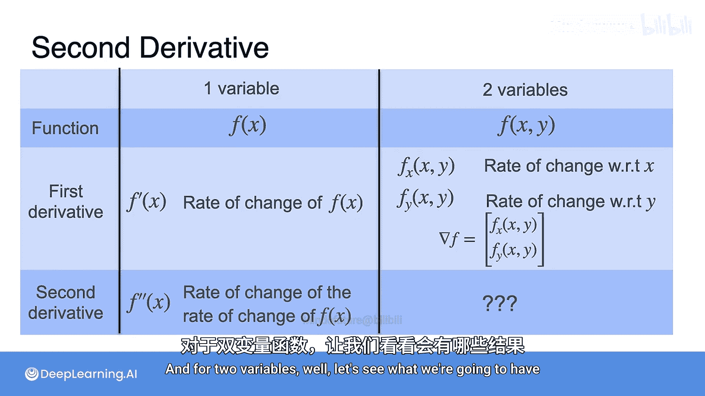
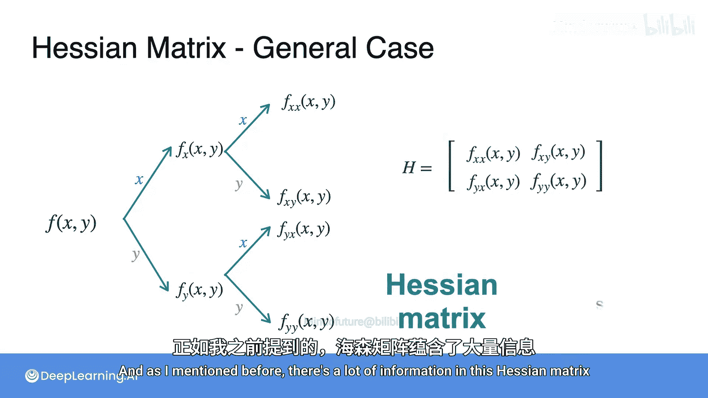
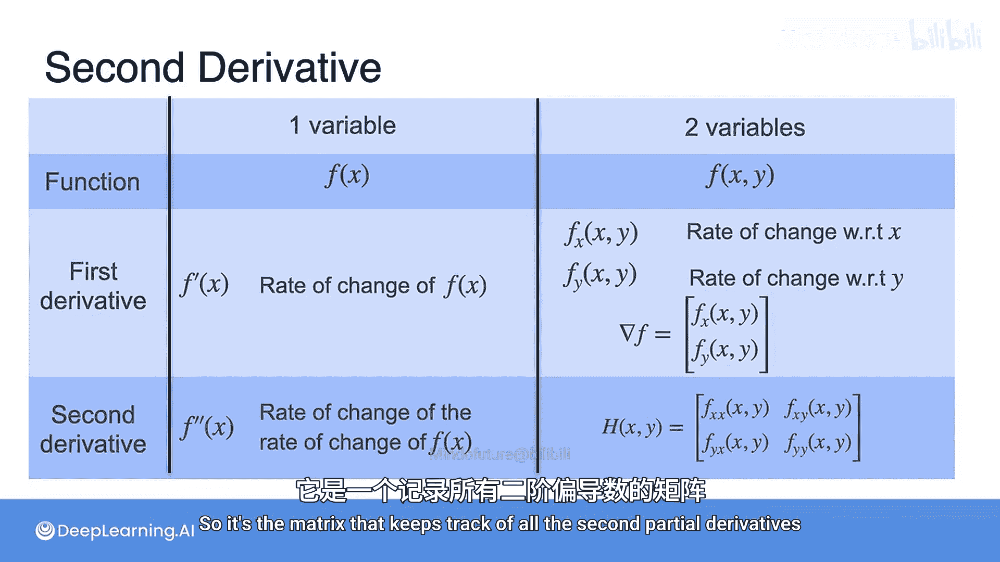

# 【Deeplearning】吴恩达：机器学习和数据科学微积分2 ｜ Machine Learning Calculus p57 P57_海森矩阵_03_02_04 -BV19M6LBeEkZ_p57-

In the previous video， you learn the second derivative and how it's useful in optimization problems。

 that was all in one variable Next I'm going to show you how it works in more than one variable。

For multiple variables， the second derivative is actually a matrix full of second derivatives called a hessian。

😊，So now I'm going to show you the hessian， its properties and how it's used in optimization in particular。

 when we want to optimize a function of many variables。

 we can use multivariable Newtons method and that one uses the hessian。

So let's start with a little comparison between functions of1 and two variables。

 so recall that a function of one variable is called f of x and it only depends on the variable x。

 whereas a function of two variables depends on variables x and y。

So the first derivative is simply f prime of x， which is the rate of change of f with respect to the only variable x when you have two variables。

 you have two rates of change， the rate of change of f with respect to x called fx and the rate of change of x of f with respect to y called fy。

And if you put them together， you get the gradient NaBla F， which is a vector。

Now what happens with the second derivative？Well， you have a prime prime。

For the second derivative of one variable， that's the rate of change of the rate of change of effects and for two variables。

 well let's see what we're going to have This is what I'm going to show you in this video。

So to understand the second derivative in two variables， let's analyze this simple example。

 f of Xy equals 2x squared plus 3 y squared minus Xy。We can take the derivative with respect to x。

 which is 4 minus y and with respect to y， which is 6 y minus x。

 and now we can take the second derivative so we can take the derivative with respect to x with respect to x。

 which is4。And we can take the derivative of 4 x minus y with respect to y， and that's minus1。

For the second one，6 y minus x， we can take the derivative with respect to x and with respect to y and we get minus1 and 6。

 so these four are the rate of change of the rate of change。

 so its the rate of change of fx with respect to x of fx with respect to y and then of fy with respect to x and of fy with respect to y notice something peculiar these two are the same thing。

That happens almost all the time。But let's summarize this a little bit so the first two are the rate of change with respect to x and then with respect to x and also with respect to y and with respect to Y so these work exactly like in one variable because pretty much if you have f as a function of only x you can take f prime prime of x and the same thing with y however。

 the last two are a bit peculiar that's the change in the slope along one coordinate axis with respect to tiny changes along the orthogonal coordinate axis and these two are actually the same thing actually in most cases you need both partial derivatives to be differentiable and when both partial derivatives are differentiable then the derivative with respect to x of the derivative to y is the same as the derivative with respect to Y of the derivative with respect to X。

So in light this notation， we can write this as di squared f over dix squared。

 di squared for diy squared， and for the 2 di squared for di x si y， and di square f over diy dix。

 and La notation， we get Fx，x， FYy， Fx，y， and Fyx。So now let me show you what the Hessian matrix is。

Let's go back to this little graph over here where we took the derivative with respect to x and y。

 and then the partial derivatives with respect to x and y of each one of these。

When we put these four together in a matrix， we get the Hessian matrix。

 so the hessian matrix here is4 negative 1， negative 1，6。

And the Hessian matrix gives us a lot of information about second derivative。

 and it also is very useful in optimization as we'll see soon。In the general case。

 we have our function F， the partial derivatives fx and xy， and their partial derivatives fx，x， Fxy。

 Fyx and FYy， and when we put these together in a matrix， we get the Hasian matrix。Just like before。

And as I mentioned before， there's a lot of information in this hassian matrix。

So now let's go back to our table in our table we have that the second derivative for1 variable is simply a prime prime of x。

 and what is it in two variables， well it's the hessian。

 so it's the matrix that keeps track of all the second partial derivatives。

