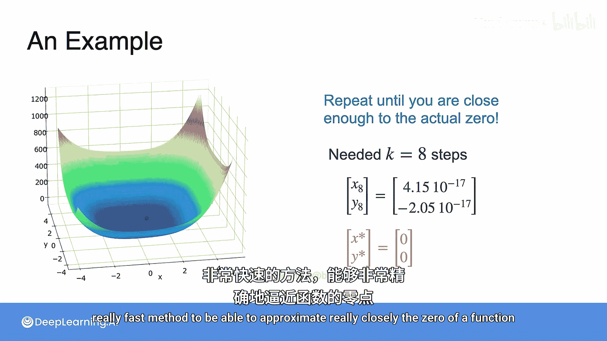

# 【Deeplearning】吴恩达：机器学习和数据科学微积分2 ｜ Machine Learning Calculus p59 P59_双变量牛顿法_03_02_06 -BV19M6LBeEkZ_p59-

Let's conclude this week by learning how to apply Newton's method to optimize functions of many variables。

 and as you guessed it， the hesian appears here。So remember that at the beginning of this lesson。

 we saw Newton's method and found an expression for iterly finding the minimum or maximum out of a function。

For one variable， the update equation has this expression that depended on the current value。

The first derivative。And the second derivative。We could just as easily rewrite this like this。

 where instead of dividing by f prime prime of xk， you multiply by the inverse of f prime prime of xk。

Now what happens in two variables well in two variables you don't have one coordinate。

 you have two coordinates x and y， so your K iteration is x KYk and your K plus1 iteration is xk plus 1 y k plus 1 and how do you obtain the K+1 iteration from the K iteration？

Well let's look at the expression above， this is the second derivative turns into the hessian。

 and this is the first derivative turns into the gradient and notice that the second derivative is inverse because we're dividing by it well that simply turns into the inverse of the hessian matrix。

So this is the expression for two variables and you can see that actually this works for m variables I simply have to do。

A vector of n coordinates minus an m by n matrix， the hesian inverse times a vector of n coordinates which is the gradient。

 and I have to be very careful it's tempting to write it like this as well。

But this actually won't work。You cannot multiply the gradient at the left of the matrix you have to multiply at the right。

 and the reason is that the matrix is2 by2 and the vector is 2 by1 and you cannot multiply it2 by one vector to the left of a matrix you can only multiply it at the right so when working with two variables。

 the orders is pretty crucial。Now it's a lot of work to actually prove this formula。

 but we're going to just take it as is and notice that it actually is a sensible generalization of the one variable case。

And now that you know Newton's method for more variables。

 let's put it in practice here is a function that is concave bo and we're going to try to find the minimum so first let's take a look。

At the two partial derivatives with respect to X and Y。

And then the partial derivatives of those with respect to X and Y。And with respect to X and y。

So the hessian is obtained with these four expressions at the right。

 and the gradient is formed by the two expressions in the middle in other words。Here's the gradient。

And here is the hessian。Yeah。So now。Using the hesian and the gradient。

 you're going to use Newton's method， so let's start at some point。

 let's say the point x0 y0 equals 44。Here is the gradient at that point。

 so what we did is in the expression of the gradient we simply put the numbers 4 and 4 and now let's find the hessian so now notice that this 0。

44 is not the 0 of the function。But we're going to get closer and closer using Newton's method。

 so what's the first point， well， the second iteration is going to be 44 the first iteration minus the hessian inverse times the vector。

And that's actually going to be 2。58 2。62， and that's the new point notice that it' much。

 much closer to the 0。00。Which is the route that we're looking for。Now let's iterate again。

We have that this is the gradient。That this is the hessian and the second iteration is this point minus the Hessian numbers minus the gradient。

 so we get the 01。59， 1。67。And let's actually continue repeating it。

 and when you repeat it many times， you end up in the actual zero。

So it takes eight steps to get this close， check it out the eighth iteration is 4。

15 times 10 to the minus17 and minus 2。05 times 10 to the minus17 this is an awfully small number it really。

 really really close to 00 and 00 is actually optimal point you' are looking because that is the root of the function。

So as you can see， just like with one variable， Newton's method and two variables is a really。

 really fast method to be able to approximate really closely the zero of a function。

