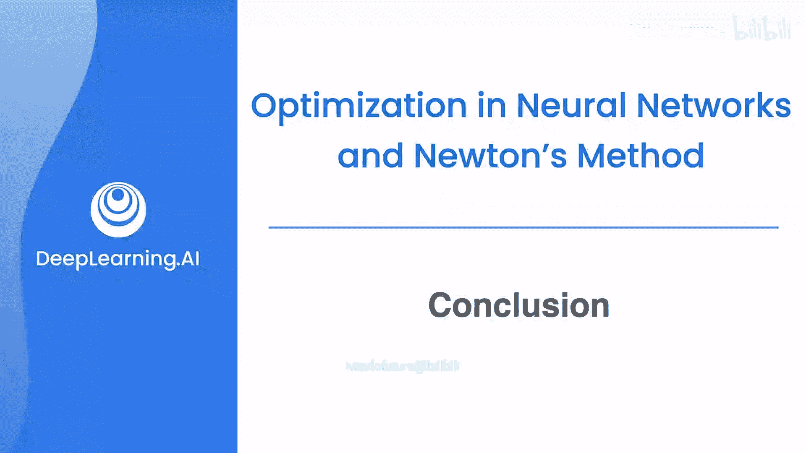

# 【Deeplearning】吴恩达：机器学习和数据科学微积分2 ｜ Machine Learning Calculus p60 P60_第三周总结_03_03_01 -BV19M6LBeEkZ_p60-

Congratulations you have finished the calculus course in this course you've learned a lot of stuff first you learn derivatives in one variable。

 then you learn gradients and derivatives in multiple variables。

 you learn how to calculate them and you learn how to use them to optimize problems。

When things get complicated， you learn methods such as grading descent and Newton's method to speed things up。

 and most importantly， you learn how to apply all these optimization methods to machine learning。

I am so excited you've taken this step with us and I'm even more excited for all the next steps you're going to be taking in your machine learning journey。

😊。