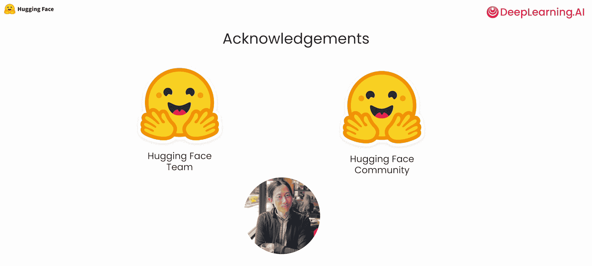
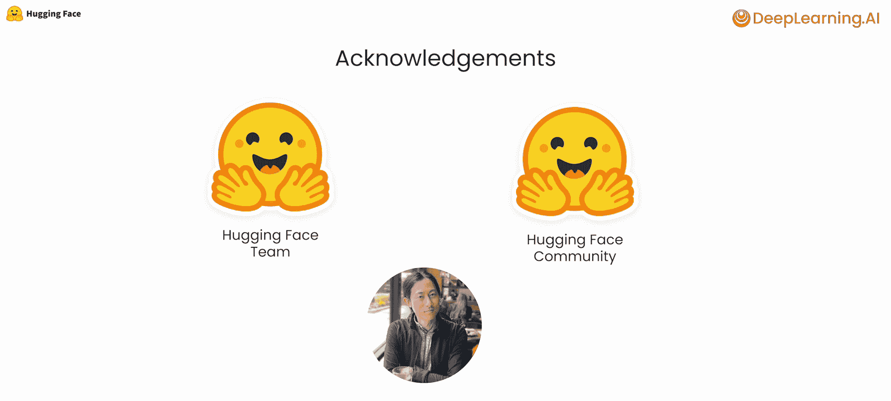

# 量化基础：P1：1. 课程介绍 🎯

在本节课中，我们将要学习量化技术的基础知识，这是让大型AI模型能够在消费级硬件上运行的关键。我们将了解不同的量化方法、数据类型选择，并学习如何使用Hugging Face的工具进行实践。

大型生成式AI模型，例如大型语言模型，通常非常庞大，难以在消费级硬件上运行。量化已成为实现这一目标的关键工具。

## 课程内容概览 📋

在本课程中，您将了解各种量化方法的不同选择和数据类。例如，您应该使用 `int8` 还是 `float16`，或者某种称为 `BFLOAT16` 的东西。它代表 Brain Float 16，用于压缩您的模型。

您还将了解有关如何压缩和存储 32 位浮点数的技术理论和算法细节，也许是从您希望使用 8 位整数部署的模型中。

## 讲师介绍 👨‍🏫👩‍🏫

我很高兴为您介绍本课程的讲师。

**Eunice Bakoda** 是 Hugging Face 的机器学习工程师。Eunice 参与了开源团队，在那里他致力于许多由 HuggingFace 开发的开源工具的交集，例如 Transformers、Peft 和 TRL。

**Mark Sun** 也是 HuggingFace 的机器学习工程师。Mark 是开源团队的一员，他为 Transformers 或 Accelerate 等库做出贡献。Mark 和 Eunice 也深度参与量化，以使大型模型对 AI 社区更加可用。

## 课程学习路径 🗺️

谢谢，Andrew。我们很高兴与您和您的团队合作。在本课程中，您将首先了解有关整数和浮点表示法的基本概念，以及如何使用 PyTorch 和 Hugging Face Transformers 库加载 AI 模型。

您还将了解每种不同数据类型的优缺点，以便为您的用例做出正确的决策。

## 深入线性量化 🔍

上一节我们介绍了课程的整体框架，本节中我们来看看核心的量化技术。

您还将深入了解线性量化，了解其在实践中的工作原理。您将看到线性量化如何用简单的术语工作。该量化方案在大多数最先进的量化方法中使用。

## 动手实践：使用Quanto库 🛠️

在回顾了线性量化的工作原理后，您将直接将其应用于使用 HuggingFace 的 Quanto 库的小型文本生成模型中。Quanto 使得对任何 PyTorch 模型使用线性量化变得容易。

以下是实践的主要步骤：
1.  我们将首先使用 Transformers 库加载模型。
2.  然后使用 Quanto 对模型进行量化。

## 课程总结与展望 📝

总而言之，在本课程中，您将详细了解量化背后的基本理论，以及如何使用量化的实际方面。我希望您学会这些技术，并将这些基本构件结合起来，创造出一些独特的应用程序。

## 致谢 🙏

许多人致力于创建本课程。我要感谢 HuggingFace 方面的整个团队对课程内容的审查，以及 HuggingFace 社区对开源模型的贡献。来自 deeplearning.ai 的 Eddie Hsu 也对本课程有所贡献。

这是一个涵盖广泛内容的短期课程，我对您能以压缩的方式学到什么感到兴奋。

---

本节课中我们一起学习了量化基础课程的介绍，包括课程目标、讲师背景、核心知识点（如线性量化和数据类型选择）以及实践工具Quanto。接下来，我们将深入这些概念的具体细节。