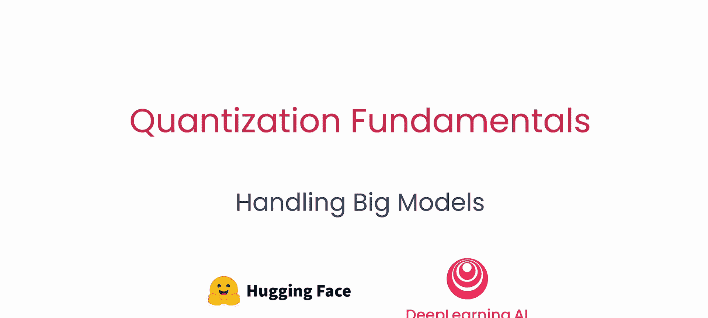
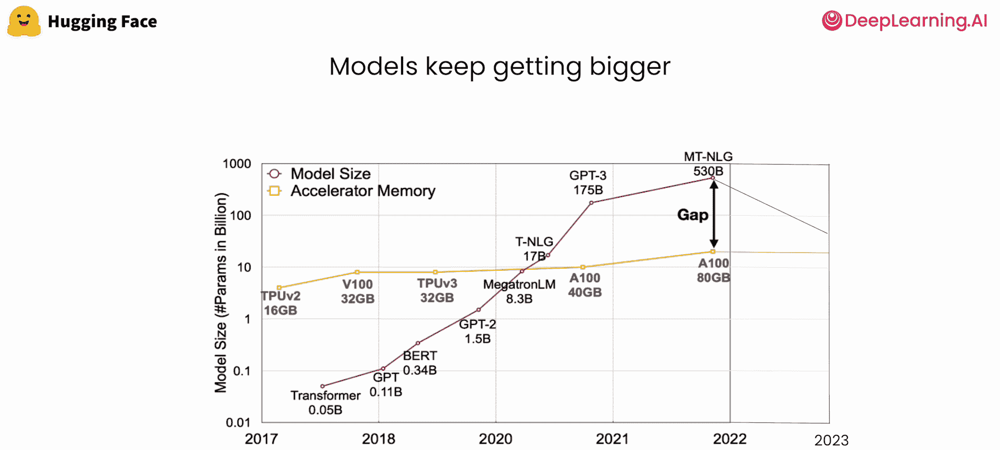
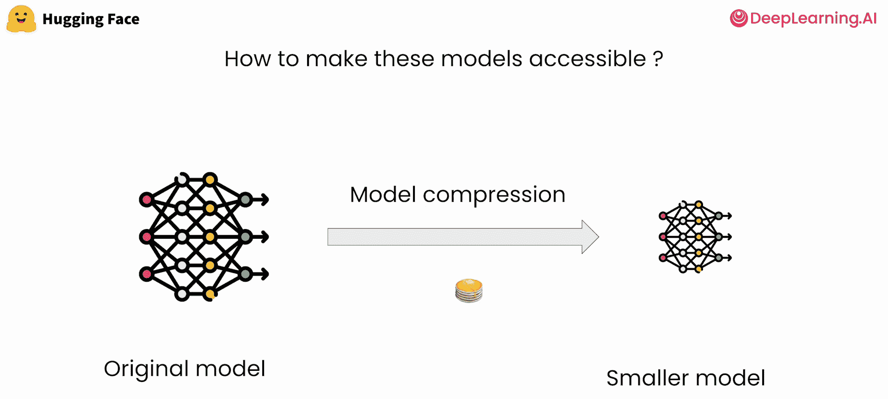
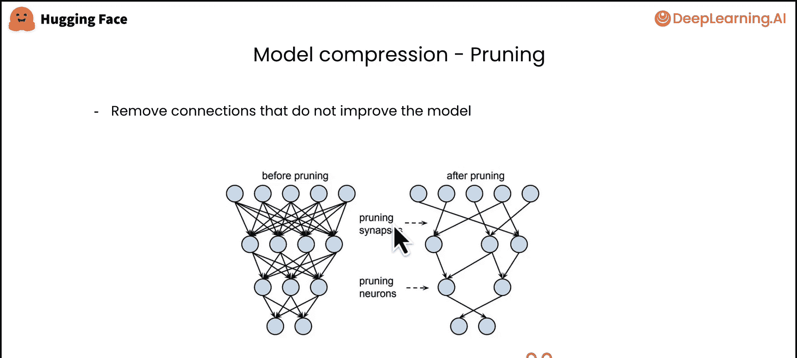
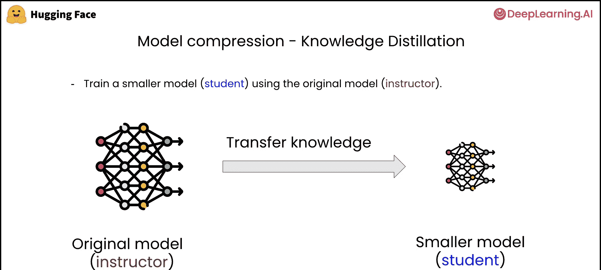
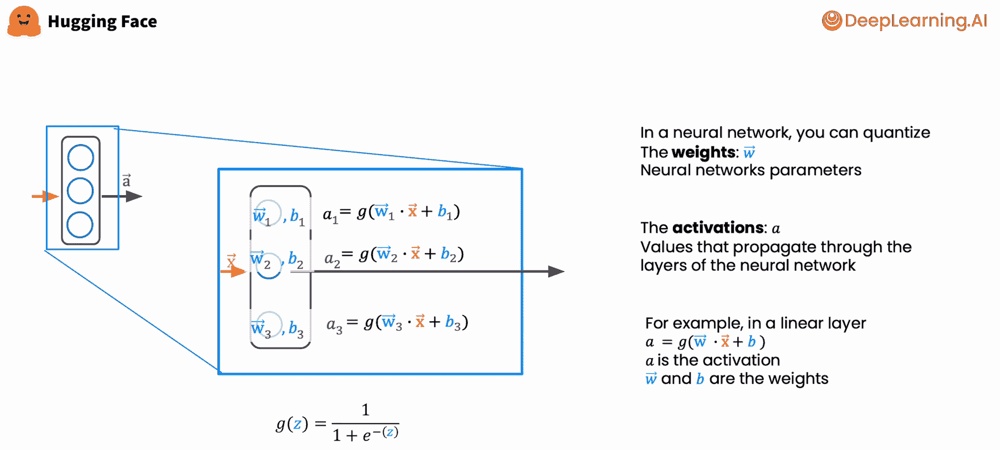
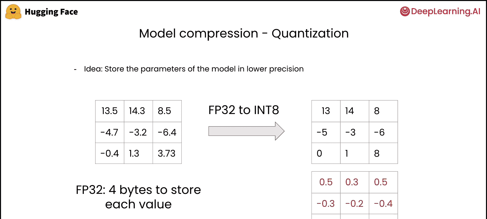
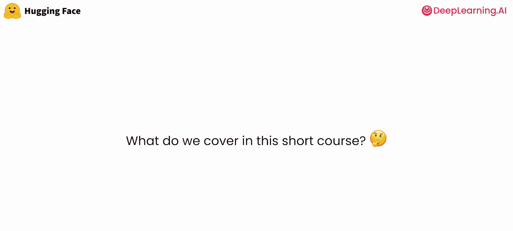
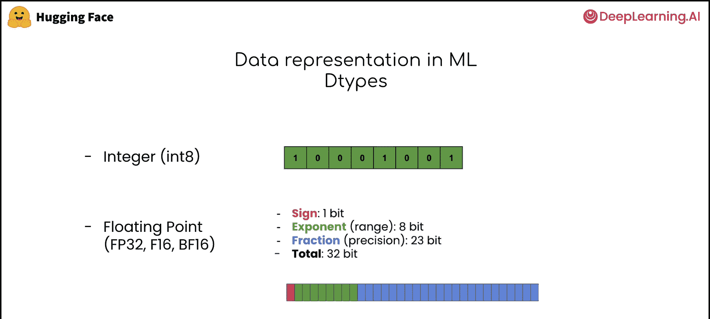
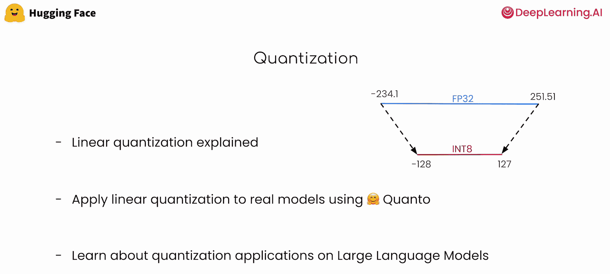

# 量化基础：2：大型模型与量化需求 🧠

在本节课中，我们将学习为什么AI模型变得越来越大，以及量化技术如何成为解决这一挑战的关键。我们将探讨模型规模增长带来的硬件限制，并概述量化如何帮助我们在保持性能的同时，显著减小模型尺寸。

## 模型规模的增长趋势 📈



如今，深度学习架构，特别是大型语言模型，正变得越来越大。在短短几年内，模型的平均尺寸增长了一个数量级。这导致最大GPU硬件与最大模型之间的差距日益扩大。

目前，最大的GPU硬件内存容量约为80GB。然而，从2023年开始，最先进的语言模型平均拥有约700亿个参数。一个拥有700亿参数的模型需要大约280GB的内存才能完全加载到硬件中。

此外，消费级硬件（如NVIDIA T4 GPU）通常只有16GB内存。因此，在无需访问内存密集型硬件的情况下，有效运行这些最先进的模型对社区而言仍然是一个巨大挑战。

## 模型压缩技术概览 🛠️

为了应对上述挑战，社区致力于通过模型压缩技术使大型模型更易于访问。以下是两种当前主流的模型压缩方法：



### 1. 剪枝
剪枝方法的核心是删除模型中对最终决策影响较小的层。它通常基于某些指标（例如权重的大小）来识别并移除不重要的参数。



### 2. 知识蒸馏
知识蒸馏过程涉及训练一个较小的“学生”模型，使其模仿较大的“教师”模型的输出。这里的挑战在于，你需要足够的计算资源来运行原始的大型教师模型，以生成用于指导学生模型训练的预测数据。对于非常大的模型，这个过程可能计算成本高昂。

上一节我们介绍了两种主流的模型压缩方法。本节中，我们将重点探讨另一种强大且高效的技术：量化。



## 什么是量化？ 🔢

量化是一种将模型权重和激活值从高精度数据类型（如float32）转换为低精度数据类型（如int8）的技术。其核心目标是减少模型的内存占用和计算需求。



让我们通过一个简单的例子来理解量化。假设我们有一个小的权重矩阵 `W`，它最初以float32格式存储。

**代码示例：量化前的内存占用**
```python
# 假设一个3x3的权重矩阵，数据类型为float32
import numpy as np
W_fp32 = np.random.randn(3, 3).astype(np.float32)
memory_fp32 = W_fp32.nbytes  # 计算内存占用（字节）
print(f"Float32矩阵内存占用: {memory_fp32} 字节")  # 输出: 36 字节
```
在float32格式下，每个参数占用4字节（32位）。因此，一个3x3的矩阵总共占用 **36字节**。



如果我们将这个权重矩阵量化为int8格式：

**代码示例：量化后的内存占用**
```python
# 将权重量化为int8（此处为简化模拟，实际量化涉及缩放和零点偏移）
# 假设经过量化转换后
W_int8 = W_fp32.astype(np.int8)  # 注意：这是概念性表示，实际量化过程更复杂
memory_int8 = W_int8.nbytes
print(f"Int8矩阵内存占用: {memory_int8} 字节")  # 输出: 9 字节
```
在int8格式下，每个参数仅占用1字节（8位）。因此，同一个矩阵的内存占用减少到仅 **9字节**。

**公式：内存节省**
内存节省倍数 ≈ 原始精度位数 / 量化后精度位数
例如，从float32(32位)到int8(8位)，理论内存占用可减少约 **4倍**。



然而，量化并非没有代价。将高精度数值映射到低精度范围会引入**量化误差**。最先进的量化方法的核心挑战，正是最大限度地降低这种误差，以避免模型性能的显著下降。

## 本课程内容预告 🗺️



总结一下，为了让你对量化的基本概念有扎实的理解，我们将在本课程中涵盖以下内容：



1.  **机器学习常用数据类型**：我们将讨论最常用的数据类型，如整数（主要是int8）和浮点数（如float16, bfloat16, float32），并了解根据模型训练或推理的用例如何选择精度。
2.  **线性量化原理**：我们将深入探讨线性量化的工作原理，包括缩放因子和零点偏移的概念。
3.  **实践：使用Hugging Face量化Transformer模型**：我们将利用Hugging Face生态系统中的`transformers`和`accelerate`库，实际量化一个Transformer模型，并使用不同配置测试其结果。
4.  **大语言模型量化进展**：最后，我们将讨论近期在应用于大语言模型的量化技术方面取得的最新进展。

在下一课中，你将学习如何探索这些构成机器学习模型核心构建块的数据类型。

---



**本节课总结**：本节课我们一起学习了AI模型规模增长带来的挑战，了解了剪枝和知识蒸馏等模型压缩技术，并重点引入了**量化**的概念。量化通过将模型参数从高精度（如float32）转换为低精度（如int8），能显著减少模型的内存占用和计算需求，是使大型模型能够在消费级硬件上运行的关键技术。