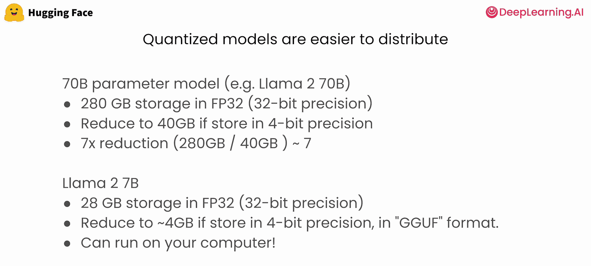
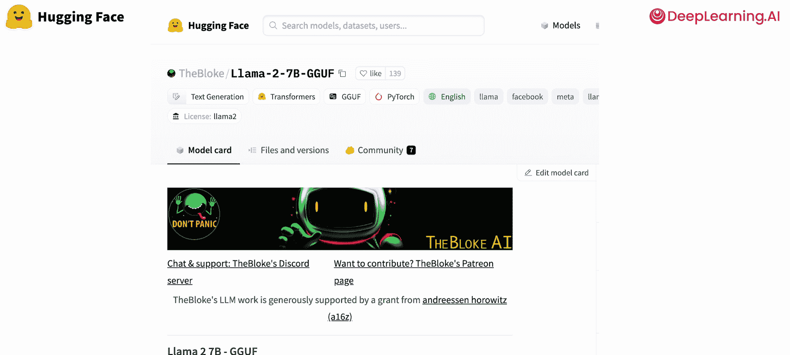
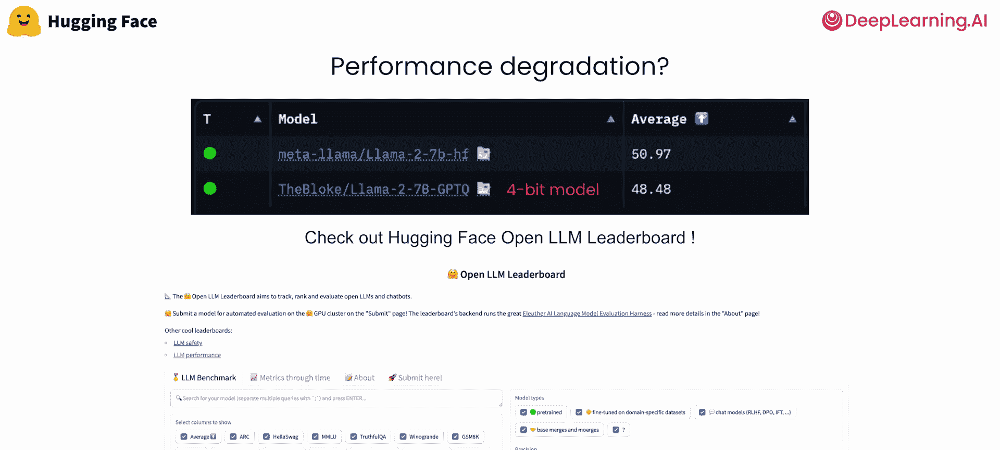
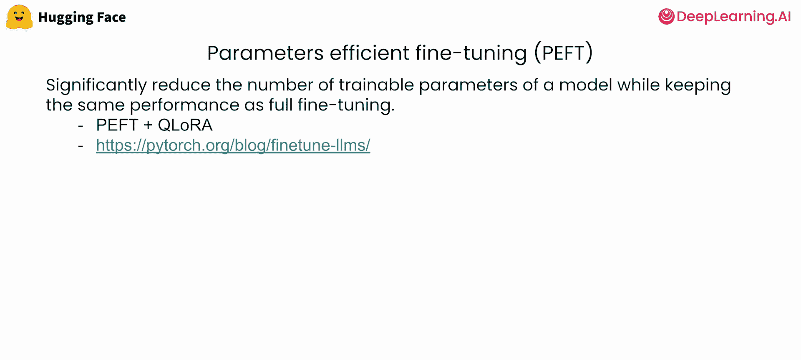
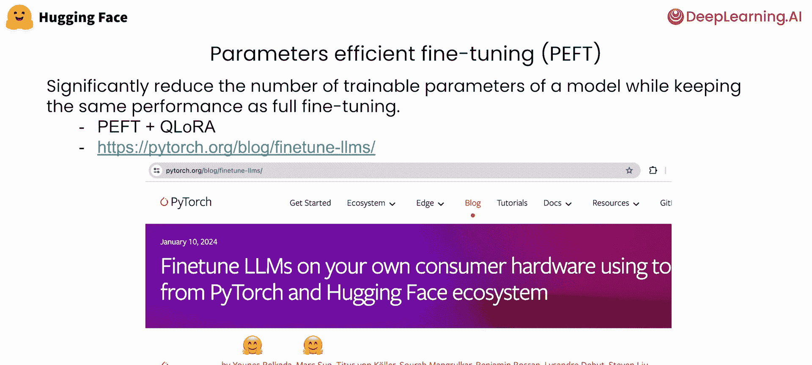
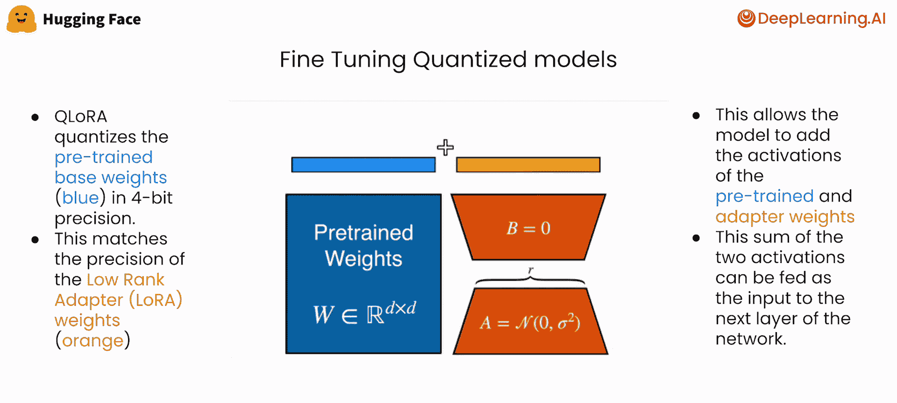

# 量化基础：P6：大型语言模型的量化 🧠

在本节课中，我们将探讨将最先进的量化技术应用于大型语言模型（LLM）时会发生什么。我们将了解量化如何帮助微调LLM，并介绍当前社区中的主要量化方法及其应用。

## 概述

量化是一种压缩模型权重的技术。将其应用于大型语言模型，可以在几乎不损失性能的前提下显著减小模型体积，这为开源AI社区带来了极大的兴趣和许多新的应用机会。

## 量化方法的发展

上一节我们介绍了量化的基本概念，本节中我们来看看针对大型语言模型的具体量化方法。近年来，出现了许多开创性的论文，以下是其中一些关键方法的简介：

*   **LLM.int8 (2022年夏季)**：提出了一种无性能降级的8位量化方法。其核心思想是将矩阵乘法分解为两个阶段，以处理LLM中出现的“异常值”特征。具体而言，它将异常值部分保留为`float16`精度，而非异常值部分量化为`int8`。
*   **QLoRA**：该方法通过将大型语言模型量化为**4位精度**，并引入**低秩适配器（LoRA）** 进行微调，极大地降低了LLM的使用和微调门槛。
*   **AWQ、GPTQ 和 SmoothQuant**：这些方法提出了对预训练模型进行**校准**的技术，以使量化后的模型能够更好地处理由大模型引起的大规模激活值问题。
*   **更激进的量化**：后续研究如 **QuaRot**、**HQQ** 和最近的 **AQLM** 等，甚至在**2位精度**上也取得了有希望的结果。

所有这些工作都致力于使LLM变得更小、更快，并且都是开源的，这意味着你可以直接获取官方实现并亲自尝试。

## 量化的优势与应用

了解了主要方法后，我们来看看量化带来的具体好处。量化使得大型语言模型的**分发和部署**变得更加容易，因为它们占用的存储空间大大减少。

例如，一个拥有700亿参数的模型：
*   在完整精度（如FP16）下，需要约 **280 GB** 的存储空间。
*   如果以4位精度存储，则可以减少到约 **40 GB**，体积缩小了**7倍**。

这种体积的减少显著降低了加载模型的成本，并使得在本地计算机（例如使用 `gguf` 格式与 `llama.cpp`）上运行这些大型模型成为可能。

在Hugging Face生态系统中，你可以找到强大的量化模型分发平台，例如 **Bloc**，它向社区分发经过预校准（如AWQ或GPTQ）的量化权重。

## 如何评估量化模型的性能

你可能会问，量化后的模型性能如何？评估量化LLM性能的一种有效方法是检查其在专门为LLM设计的知名基准测试上的表现。

为此，你可以参考 **Hugging Face的Open LLM排行榜**。该排行榜现在支持对最先进的量化模型（如LLM.int8、QLoRA和GPTQ）进行评估。对于你感兴趣的模型，你可以查看其在排行榜上的性能，以判断其是否满足你的需求。

## 量化模型的微调

最后，我们来探讨一个关键问题：能否对量化后的模型进行微调？答案是肯定的，主要有两种应用场景：

1.  **量化感知训练**：在模型量化的同时进行微调，以获得可能的最佳量化模型。请注意，这种方法与我们之前提到的所有**后训练量化**技术不兼容。
2.  **基于量化模型的适应**：对于那些希望针对特定用例（例如在自己的数据集上微调LLM）调整模型的人来说非常有用。这通常通过 **PEFT（参数高效微调）** 方法实现。

PEFT方法旨在**大幅减少可训练参数的数量**，同时试图保持与完全微调相近的性能。我们将特别深入介绍 **PEFT + QLoRA** 的组合，它同时利用了量化和PEFT的优势。

以下是一个展示**低秩适配器（LoRA）** 工作原理的示意图。在进行LoRA时，你只需将额外的可训练参数（蓝色权重）附加到原始的冻结权重上。由于LoRA引入的参数秩（`r`）通常远小于模型隐藏层的维度，最终的优化器状态非常小，使得训练变得易于实现。

QLoRA在此基础上更进一步：它将基础权重量化为4位（左侧蓝色权重），并确保量化权重的激活数据类型与LoRA权重的数据类型匹配。这样，我们就可以轻松执行求和操作，同时享受量化和参数高效微调带来的好处，从而解锁许多强大的功能，例如在消费级GPU（如Google Colab的T4实例）上对LLM进行微调。

## 总结

本节课中，我们一起学习了当前最先进的大型语言模型量化技术。我们回顾了从LLM.int8到QLoRA等多种关键方法，了解了量化如何显著减小模型体积并降低部署门槛。我们还探讨了如何评估量化模型的性能，以及如何通过PEFT（特别是QLoRA）对量化模型进行高效的微调。这些方法为你根据自身用例应用和优化LLM提供了强大的工具和清晰的路径。在下一课中，我们将对本课程的所有内容进行总结和回顾。