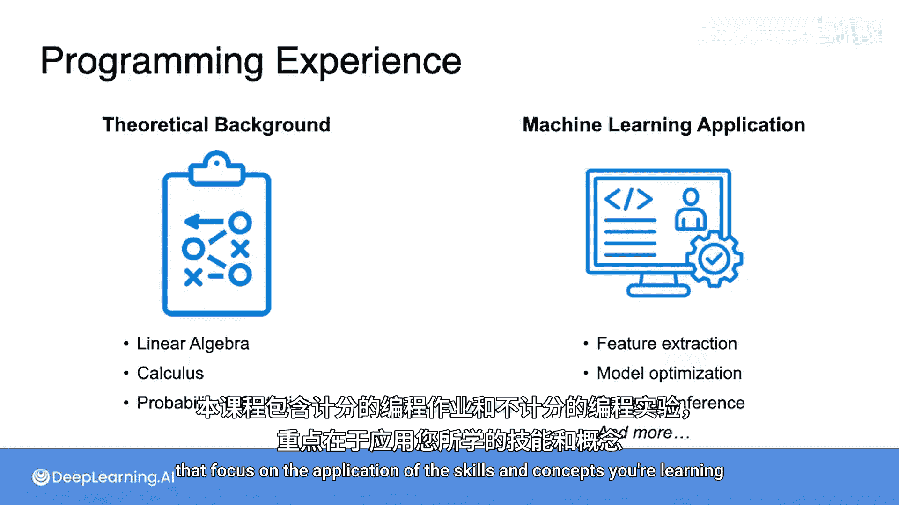
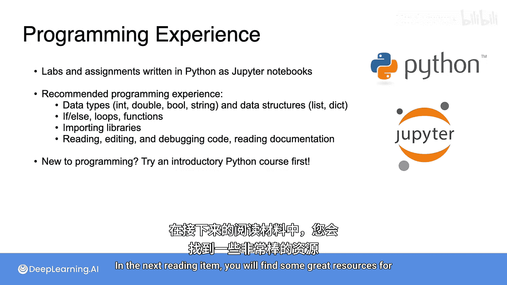

# 【Deeplearning】吴恩达：机器学习和数据科学线性代数1 ｜ Machine Learning Linear Algebra p04 P04_关于编程经验的说明_01_01_05 -BV1Pp6VBjE29_p4-

Let's talk quickly about programming experience。 This course is designed to both provide you a theoretical background in the mathematics underlying machine learning and show you how those concepts are applied in practice。

 That means you will need to do some programming。 This course includes graded programming assignments and und programming labs that focus on the application of the skills and concepts you're learning。

 This exercises are written in Python and will appear as Jupyter notebooks and interactive web-based interface that allows you to read。

 run and edit those programs。 You won't need to be an expert Python programmer to be successful in the exercises。

 but you should be comfortable with the concepts that would typically be taught in an introductory Python programming course。

 This includes things like different data types and data structures Controlflow using conditional statements。

 loops and functions as well as importing and using different python libraries。

 You should be comfortable reading an editing Python code using these concepts。

 writing and debugging your own code and occasionally referring to the documentation of new packages。

 If you are a confident。

Gmar in another programming language， you should be just fine learning the Python you need for this course as you go。

If you're new to programming， however， I would recommend you take an introductory Python course before you begin this course in the next reading item。

 you will find some great resources for where to get started learning Python。

