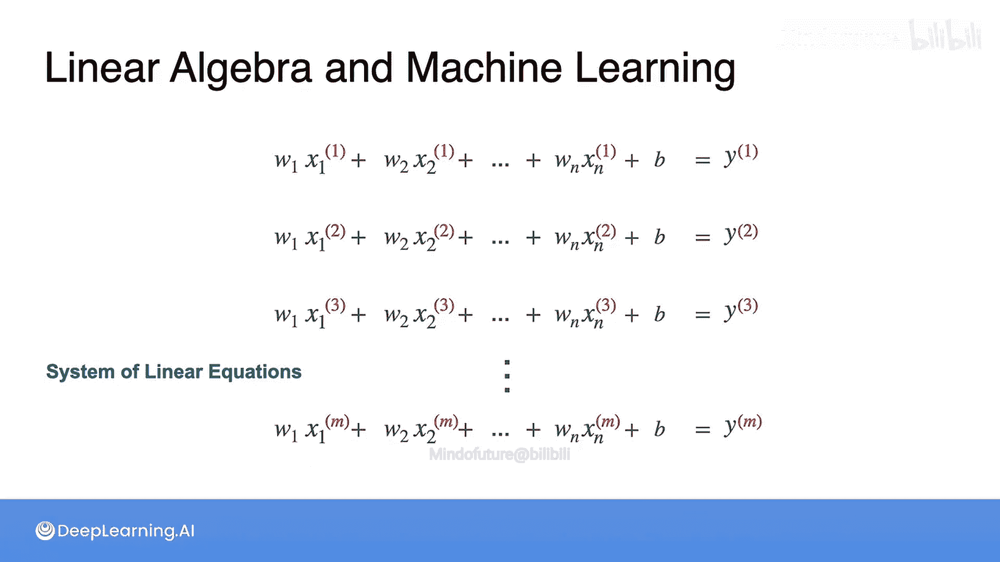
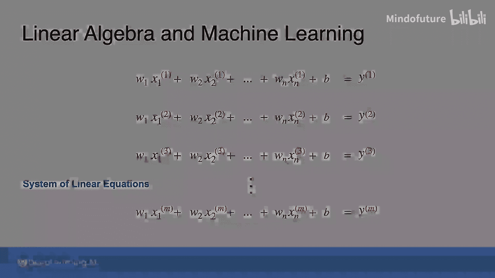

# 【Deeplearning】吴恩达：机器学习和数据科学线性代数1 ｜ Machine Learning Linear Algebra p05 P05_线性代数应用一_01_02_01 -BV1Pp6VBjE29_p5-

Welcome to week1 of the linear algebra course this week you will learn what a system of linear equations is and some of its representations。

 one of them is as a set of lines in the plane and another one is as an array of numbers called a matrix。

Furthermore， you will learn what singular or non singular systems are and why is this so important in linear algebra？

Linearal algebra has applications in many fields of science and technology and machine learning is certainly not the exception。

 in fact， it is not a stretch to say the linear algebra is the most useful and widespread math field in machine learning。

In this video you will learn about some of the best applications of linear algebra and machine learning starting from the most popular application that you know by now Linear regression this course is first and foremost a math course。

 but I'm guessing you're here because you're interested in further studies in machine learning。

 you may have already explored some machine learning topics or maybe even taking some machine learning courses。

If you haven't yet studied machine learning， I can recommend the machine learning specialization from deep learning AI to provide you with great foundation in the field as a complement to this specialization throughoutout these courses I'll be using machine learning examples to provide context for the math you're studying and how these ideas are applied in practice In this machine learning courses sometimes Andrews says don't worry about the math In this course I'll sometimes do the opposite and say don't worry about the machine learning you'll see many examples of machine learning techniques but if you don't understand all the details of how they work that's okay The goal is to build a strong mathematics foundation continue to build your interest in machine learning topics and prepare you for further courses in machine learning。

With that approach in mind， let me introduce this week's main topic。

 systems of linear equations using an example from machine learning a common machine learning approach to modeling systems is called linear regression Linear regression is a supervised machine learning approach。

 which means you've already collected data on many inputs and an output and your goal is to discover the relationships between them。

So for example， suppose you want to predict the electrical power output from a wind turbine。

If you had just one feature like in this case， wind speed shown here on the X axis。

 which is the horizontal axis and you plot your target of power output on the y axis which is the vertical axis。

 then the data points here are representing real measurements of wind speed and power output。

 clearly there's a pattern and the goal of linear regression would be to find the line of best fit for this data。

 for example this one。With a model like this， you're making the assumption that this relationship is literally linear。

That it can be modeled by a line， in other words， that if you know the wind speed。

 you can multiply it by a constant， add a second constant and make a reasonable estimate of the power output from the wind turbine。

 So for example， with this model I can say that if the wind is blowing at 5 meters per second。

 then I predict the power output from the wind turbine is going to be 1，500 kilowaW。

Now this model is not perfect， you can see the actual data scattered about the line representing the model。

 but is's doing a reasonable job The model here is the familiar linear equation y equals mx plus B where y is the power output and x is the wind speed。

Your goal is to find the best values for M and B that fit the data in machine learning。

 you'll often see the equation of this model written as y equals w x plus B。

 because the number multiplied by x is called a weight。

 The B is called a bias and so luckily doesn't need to change Now linear regression with just one feature like this is easy to visualize but in many machine learning problems you'll be considering more features。

In the case of predicting power output from a wind turbine。

 you may want to include not only wind speed but temperature as well。

In order to account for the new input， the equation of your line would need to change Now y equals w1 times wind speed plus w2 times temperature plus B with a new weight added for the second input variable。

If you grab this equation， it no longer would form a line。

 instead it would be graphed as a plane in three dimensional space。

But what if you wanted to consider more features like pressure。

 humidity or anything else that might affect the performance of the wind turbine？

The idea is exactly the same as with one or two features。

 you simply add a new weight for each new feature， even as the equation of the model gets longer。

 conceptually it works the same。By finding the right values for the weight and the biased terms。

 it should be possible to make accurate predictions of the output or target under the assumption that this is a linear relationship。

If we write that out explicitly， then you have w1 times x1 plus w2 times x2 and again for as many features as you have up to Wn times xn。

 then you add B and set that all equal to y your target if you imagine this equation as being one row in a data set then you already know the values of the x's and the Y's and your goal is to find the values of the Ws and b to make this equation true。

Of course， in reality， you have many records in your data。

 so you have many equations you could write down like this， one for each record in your data。

So if you add a superscript1 with parenthesis up here on everything in this first equation I wrote down。

 then I can write down the same thing for the second example in the dataset and they note that with a superscript2 in parenthesis like this and then so on down to the superscript M and parenthesis for the last example in a dataset containing M records notice that these red superscripts are not exponents they simply act like subscripts except that we put them on top for clarity ideally you'd find the values of the weight and biased terms that solve all these equations at the same time or at least get as close as possible and so from this very common machine learning model appears a fundamental concept of linear algebra called a system of linear equations this will be a fundamental topic that you'll study this week。

Join me in the next video to take a closer look at systems of linear equations and test your knowledge of linear algebra before we dive into the week's materials。

