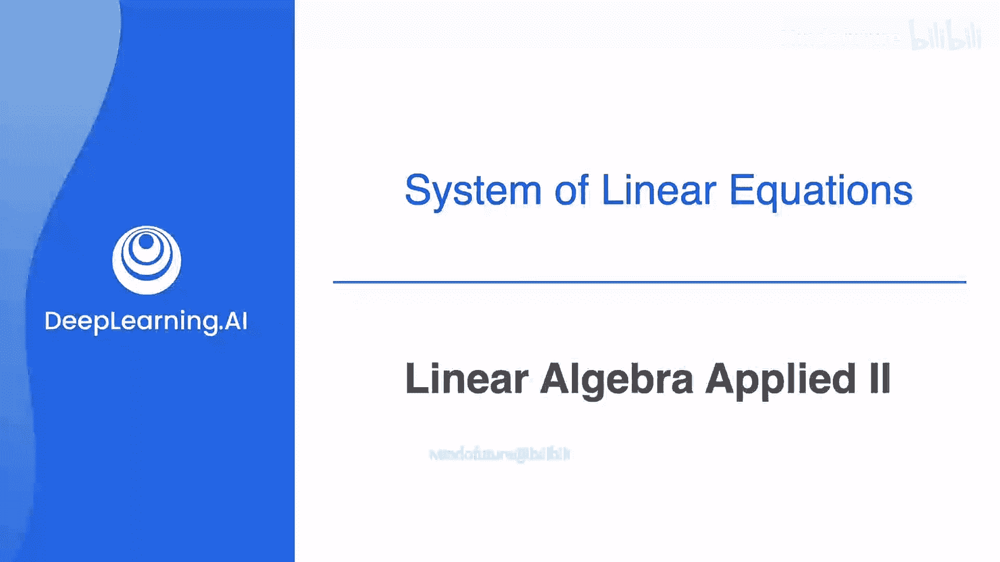
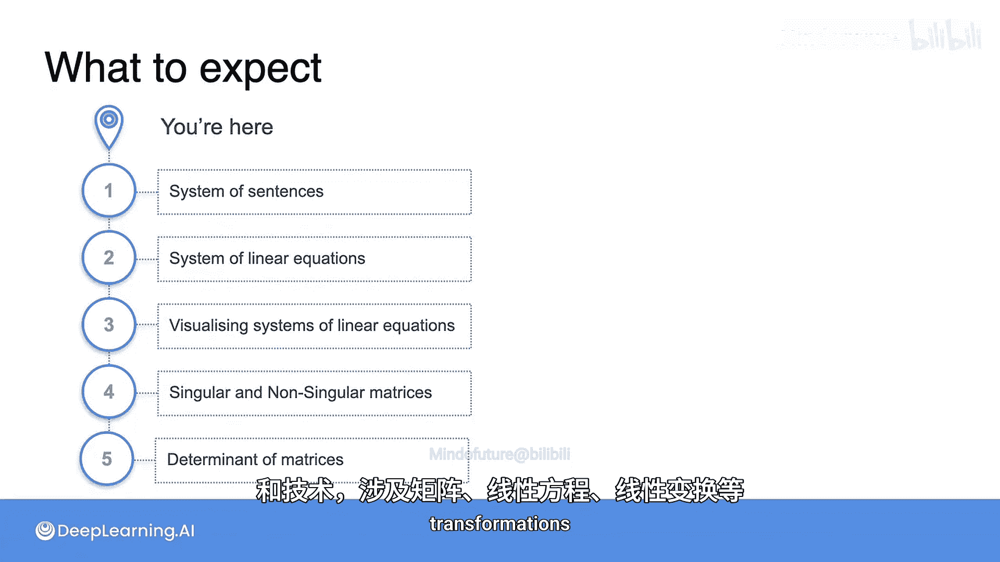

# 【Deeplearning】吴恩达：机器学习和数据科学线性代数1 ｜ Machine Learning Linear Algebra p06 P06_线性代数应用二_01_02_02 -BV1Pp6VBjE29_p6-

In the previous video， you looked at a linear regression scenario for the problem of predicting electrical power outputs from a wind turbine。

In this case， you have a dataset containing a series of features， things like wind speed temperature。

 atmospheric pressure， humidity， and so on， and I call this x1。

 x2 and so on up to XN for a dataset with n features。

And then I added a superscript to the data set to denote which row of data a set of features belong to。

 then you had the model weights multiplying it feature， which we wrote as W1W2 on up to WN。

And then we also added a biased term B， and we set that equal to the target Y。

 which in this case is power output from the wind turbine。

 An important thing to note about this system is that while the x's and y's are unique in each row。

 So all of these x superscript ones are different from these x superscript 2 and so on and all these y superscript 1 is different from these y superscript 2 on down to y superscript M the w values and D are all the same across all rows。

 So again， what you're saying here with a linear model is that there exists some set of values W1 W2 and so on up to Wn。

As well as some value B that when multiplied by any of these rows of features and added up like this we'll be able to provide you with an estimate of your target y for that row。

 In other words， with this model you are saying give me a set of x's and I can estimate a value for y because I have a model that tells me what all the ws and bs are and instead of writing this model out in long form like this I can instead say I have a vector of weights called W that is made up of W1 w2 and so on and I multiply that by each row a features x in my matrix of features which I now call capital x。

And then I add a biased term and set that all equal to y， which is a vector of my target variable。

 and just like that， we're back to a nice simple equation that lookss just like the equation of a line。

I just jumped ahead a lot， so don't worry if you're not already familiar with the terms vector and matrix for now it's fine to think about them as just lists of numbers or grids of numbers Line algebra is all about manipulating vectors and matrices to do powerful calculations and as you just saw this kind of math is the backbone of many machine learning techniques。

Now， if you're already a linear algebra fionado， you may have noticed that I'm being a little imprecise with the notation here。

 like I might need to indicate whether this is really a transpose of w or x to make the math work out depending on how these vectors and matcheses are defined。

 but I'm not going to worry about that for now。 Instead。

 I want to emphasize that when you're using linear regression as a machine learning model。

 you are representing the system you're interested in as a system of linear equations。 In fact。

If there were a set of W and B values that allowed you to perfectly predict Y。

 given a set of X features， then this would be a system of equations you could solve analytically without any machine learning。

 And by that， I mean you could solve this by just applying basic algebra with a pencil and paper provided that you have a dataset set containing all the X and Y's values and you have at least as many example records as you have unknowns the Ws and the B's that is to solve for with linear regression。

 you're solving the system empirically， which is to say iteratively。

 and approximately by finding the best fit linear solution to the system。

In this week of materials I'm going to start super simple and walk you through common vector and matrix operations from the basis of linear algebra If you studied linear algebra before it is possible you will have seen some of these concepts already in order to give you a sense of what's coming in each week in this course I will post a series of questions for you to think about if you can answer all these questions successfully then congratulations you are ready to skip right to the end of the week and take the quiz if you have some uncertainty about any of these questions then you'll find some valuable learning in this week of materials。

This week will begin with systems of linear equations。

 how you represent those systems of vectors and matrices and how you manipulate those systems to compute the determinant or other characteristics of the system so here's your first set of questions。

 this specialization has three courses， linear algebra， calculus and probability and statistics。

 supposeupp I record a score for you in each of these three courses but I don't tell you the actual scores Instead I tell you the following information about your scores。

Your linear algebra score added to your calculus score minus your probability and statistics score is equal to 6。

Your linear algebra score minus your calculus score plus double your probability and statistics score is equal to 4。

Four times your linear algebra score minus double your calculus score added to your probability and statistics score is equal to 10。

 Okay， now of course， no instructor is ever going to give you scores like this。

 that would be ridiculous， but take a moment to think about these sentences and see if you could represent these statements as a system of linear equations。

If we let A represent your linear algebra score， C represent your calculus score and P represent your probability and statistics scores。

 here is what that would look like。Now， in the context of what we looked at before with the linear regression for predicting the wind power output。

 what would be the equivalent of the weights W， the features x， and the target Y？In this case。

 your scores A， C and P are the weights。 The thing that is consistent across all the statements。

 The features are the numbers next to the weights in that case。

 and the numbers on the other side of the equal sign are the targets Y Now。

 could you tell me whether this system is singular or non-singular or in other words。

 do these equations either contradict one another or is there redundant information here。

 could you solve this system of equations which is to say。

 could you now solve for what your score in each of these three courses was Now could you represent the system of linear equations as a matrix and a vector and can you calculate the determinant of that matrix。

If you could easily answer all these questions， then congratulations。

 you are ready to go ahead and take the quiz for this week and complete the labs for this week。

If not， then also congratulations you are in the right place。

 join me through this week's materials as we go through systems of linear equations step by step。

We'll start super simple with systems of sentences that will then turn into equations and then from there we'll get into solving these systems and the properties of such systems like singularity and the determinant。

 as you can see linear algebra is used all over the place in machine learning and that is a great reason for you to master it in the remainder of this course you'll be learning some very important concepts and techniques in linear algebra involving matrices。

 linear equations， linear transformations and much more。

Ready， let's begin。