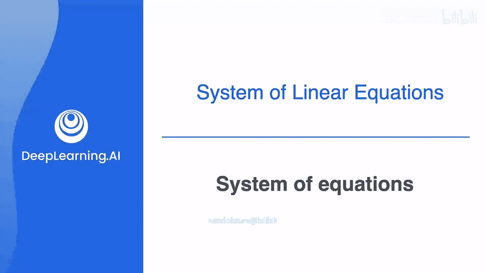
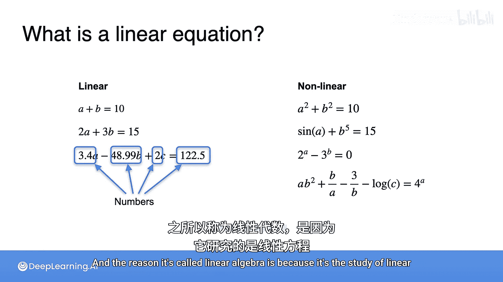

# 【Deeplearning】吴恩达：机器学习和数据科学线性代数1 ｜ Machine Learning Linear Algebra p08 P08_方程组_01_02_05 -BV1Pp6VBjE29_p8-

As I mentioned before， equations behave a lot like sentences as they are statements that give you information in this video you will learn what a linear equation is and what a system of linear equations is as a matter of fact。

 you will be solving your first system of linear equations which is extracting all the possible information from that system。

Just like with systems of sentences， systems of linear equations can also be singular or non singular based on how much information they carry。

And as you already learn these concepts of real life sentences。

 you are more than ready to tackle them with equations In the previous video。

 you saw sentences such as between the dog and the cat one is black for the rest of the course you'll focus on sentences that carry numerical information such as this one。

The price of an apple and a banana is $10。This sentence can easily be turned into equations as follows if a is the price of an apple and b is the price of a banana and the equation stemming from the sentence is a plus b equals 10。

 Of course you might wonder why an apple and a banana together cost a whopping $10 to keep our example simple I'm going to use these hypothetical prices with nice hold numbers so while the thought of a $10 apple and banana might make your wallet shutter rest assured it's all in the name of mathematical simplicity now here's the first quiz in which you will be solving the first system of linear equations in this class。

The problem is the following you are going to a grocery store but this is a very peculiar grocery store in this store the individual items don't have information about their prices。

 you only get the information about the total price when you pay in the register naturally being a math person as you are you're interested in figuring out the price of each item so you keep track of the total prices of different combinations of items in order to deduce the individual prices so the first day that you go to the store you bought an apple and a banana and they cost 10。

The second day you bought an apple and two bananas and they cost $12 and the question is。

 how much does each fruit cost？So several things may happen you may be able to figure out the price of the Apple and banana or you may conclude that you don't have enough information to figure this out or even more you may conclude that theres a mistake with the prices giving this information all of these are options in thequiz and the solution is that apples cost $8 and bananas cost $2 each why well from day one you can see that an apple plus a banana is $10。

From day two you can see that an apple plus 2 bananas is $12 so what was the difference between day one and day two well in day two you bought one more banana than day one also in day two you pay $2 more than in day one。

Thus you can safely conclude that that extra banana you bought in day two cost $2。

The extra $2 you paid on day two were because of that extra banana you bought on day two。

And now that you know that bananas cost two， well how much do apples cost。

 well from day one you can see that an apple and a banana costs $10。

 so if a banana costs $2 then the remaining eight dollars must correspond to the apple。

Thus each apple costs $8 and each banana costs $2 to start you'll be solving your first system of three equations with three unknowns and the problem is a familiar one you' were in a similar stores as before but now your goal is to find the prices of three items an apple a banana and a cherry so you go to the store three days in a row on the first day you bought an apple a banana and a cherry and pay $10。

On the second day you bought an apple， two bananas and a cherry， and paid $15。And on the third day。

 bought an apple， a banana and two cherries and paid $12 Now the question is how much does each fruit cost？

So the way to solve this is very similar to the way to solve the previous systems with two equations and two unknowns。

The first equation says that an apple a banana and a cherry costs $10。

The second one says that the same arrangement plus an extra banana costs $15 therefore that extra banana must cost those extra$5。

And the third one says that the same arrangement of day one plus an extra cherry costs $12。

 therefore that extra cherry must cost that extra $2， so bananas 5 and cherries2。

 we still need to find the price of the apple。Now look at the first equation。

If the banana is 5 and the cherry is 2 and the three of them cost 10， then the apple must cost 3。

 so our solutions are the price of an apple is 3， the price of bananas 5。

 and the price for cherry is 2。The system of equations you just solved is this one over here system of equations 1。

 which has us equations a plus b plus c equals 10， a plus 2 b plus c equals 15 and a plus b plus 2 c equals 12 and the solution you got was a equals 3 b equals 5 and C equals 2 Now here's quiz 2。

 the scenario is the same except the prices in the store are a little different and you also bought different quantities of fruits。

On day one， you bought an apple and a banana and they cost $10 on day two。

 you bought two apples and two bananas and they cost 20。The question is， how much does a route cost。

 remember that the options of not having enough information or having a mistake in the information given are both valid as well。

For this problem， the solution is that there is not enough information to tell the actual prices and why is this？

Well， you can use a similar reasoning than before from day one。

 you can deduce that an apple in a banana cost $10。From day two。

 you can deuce that two apples and two bananas cost $20。But these two equations are the same thing。

 they may not look the same， but in these guys they're the exact same thing。

 because you see if one apple and one banana costs 10。

 then twice of one apple and one banana costs twice of $10 which is $20。

 so two apples and two bananas cost $20。Therefore， the system is redundant because it basically has the same equation twice it's like that system of sentences where both sentences stated that the dog was black。

 the system didn't carry enough information now what are the solutions to the system？Well。

 because the system doesn't carry enough information， the system has infinitely many solutions。

 any two numbers that add to 10 are a solution to the system。

 so for example if the apples8 and the bananas2， then that works because Apple plus bananas 10 and two apples plus two bananas is 20。

But if they're  five and five， that also works， if they're 8。3 and 1。7， that also works。

 and even saying that the apps are free and the bananas are 10 works too。

So this system has infinitely many solutions because you simply don't have enough information。

 you don't have the two equations to narrow it down to one single solution like you had with the complete system。

And now you're ready for a final quiz， similar scenario except the first day you bought an apple and banana and they cost $10 and the second day you bought two apples and two bananas and they cost $24 Can you figure out how much each fruit costs and remember there are still the options of not enough information or I'm mistakeing the information。

And the answer here is that there is no solution why well in the same fashion as before if one apple in one banana costs $10 then two apples and two bananas must cost $20。

 but the store charged you $24 for two apples and two bananas where are those four extra dollars if you assume that there are no extra fees for buying more than one fruit or discounts or anything of that sort then you must conclude that that extra money must be due to a mistake with the register when you checked out in at least one of the two days？

This means that these two equations contradict each other， just like the two sentences。

 the dog is black and the dog is white contradicted themselves。

And this concludes that the system has no solutions。So here's our recap。

 you solved three systems of equations。The first one has the equations a plus b equals 10 and a plus 2b equals 12。

 because the price of an apple and a banana was 10 and the price of an apple and two bananas were 12。

The second one has the equations a plus b equals 10 and 2 a plus 2b equals 20。

And the third one has the equations， a plus b equals 10 and 2a+ 2 b equals 24。

The first one had a unique solution， which was a equals a and b equals 2。

For a is the price of an apple and B the price of an apple。

The reason this system has a unique solution is because both equations give you one different piece of information。

 thus you're able to narrow down the solution to one unique solution for this reason the system is complete and non singularing。

The second system has infinitely many solutions。Which are any two numbers that add to 10。

In this system。The two equations are the exact same one。

 so you never had a second equation to help you narrow down the solution to a unique one。

This means the system is redundant and singular。And finally。

 the third system has no solution because the two equations contradict each other therefore the system of equations is contradictory and singular。

 so as you see we are using the same terminology as with systems of sentences and everything works in the exact same way Now you're ready to solve more systems here are three systems to solve remember that just like before some of them may not have a solution。

 some of them may have an infinite number of solutions so if that's the case please stated even if any of the options already shows a solution to the system。

And so here are the solution， system 2 has infinitely many solutions， why？Well。

 you look at equation 1 it says a plus b plus equals 10 and from equation 2 there's an extra c and an extra 5 so that c must be equal to 5 the price for cherry is 5 however when you go from equation 2 to3 there's also an extra 5 and also an extra C so equation 3 brings nothing new to the table。

When you replace C equals 5 on the first equation， you get a plus b equals 5 and actually any triplet where the third number is 5 and the first two add to5 works so all of these are solutions to that system that system has infinitely many solutions Now let's look at system 3 system 3 has no solutions why well from the first and the second equation C is equal to5。

However， from the second and the third， C is equal to three because from the second equation to the third one you bought an extra cherry and you paid an extra $3。

 so C is equal to 5 but C is equal to 3， that's a contradiction so system 3 has no solution What about system 4 Well system 4 has infinitely many solutions Why Because as you can see the second equation is two times the first one and the third equation is three times the first one so the first one is really the only equation here that matters or equivalently the second or the third but only one of them matters so any three numbers that act to 10 would work so for example 0010271910。

 any three numbers that at to 10 are a solution so we have infinitely many solutions。

And finally some clarification you may have noticed the words linear equation several times What does that mean Well linear equation can be anything like a plus b equals 10 to a plus 3 b equals 153。

4 a minus48。99 b plus 2 c equals 122。5 anything like that and notice that it can have as many variables as we want but there's a special rule that must be followed in a linear equation variables ABc etc we're only allowed to have numbers or scalars attached to them and there's also an extra number all by itself like the 122。

5 here allowed to be in the equation So in short you can multiply the variables by scalars and then add them or subtract them and then add a constant and that's it。

So what's an equation that's not linear well linear equations can be much more complicated。

 they can have squares like a squared， B squared， they can have things like sine， cosine tangent。

 a 10， anything like that， powers like B to the 5。They can have powers like two to the A or3 to the B。

 and furthermore， you can actually multiply the A's and Bs。In linear equations。

 you can only add them， but in nonlinear equation you can have A B， AB squared。

 B divided by A 3 divided by B， things like logarithms， anything along those lines。

So linear algebra is the study of linear equations like the ones in the left。

 and since theyre much simpler then there are many things you can do with them such as manipulating them and extracting information out of them so we're only going to worry about the linear equations in the left and the reason it's called linear algebras because it's the study of linear equations。

