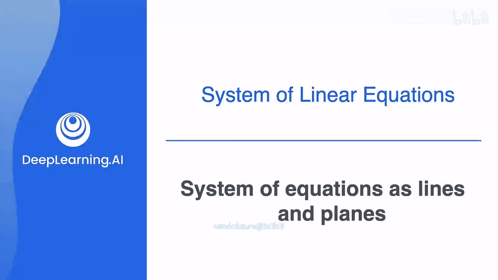
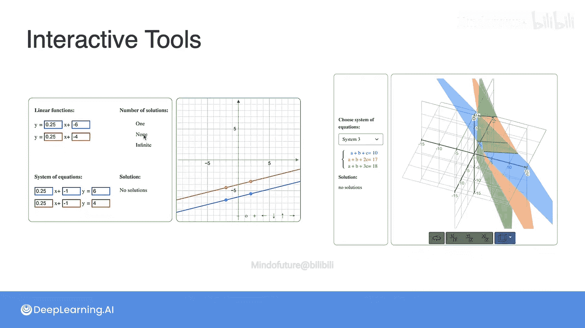

# 【Deeplearning】吴恩达：机器学习和数据科学线性代数1 ｜ Machine Learning Linear Algebra p09 P09_方程组可视作直线与平面_01_02_06 -BV1Pp6VBjE29_p9-

Now that you learn what a system of linear equations is and when they are singular or non singular。

 it is time for some visualizations， it turns out that linear equations can easily be visualized as lines in the coordinate plane。

Well this is because you have two variables， if you have three variables， they are planes in space。

 and if you have more variables， they look like high dimensional things。

 but let's not worry about that yet。So since linear equations can be represented as lines。

 then systems of linear equations can be represented as arrangements of lines in the plane。This way。

 you can visualize their solutions and their singularity or non singularity in a much clearer way。

Okay， so how can you visualize， for example， the equation A plus b equals 10 as a line？First。

 let us get a grid in which the horizontal axis represents a， which is the price of an apple。

 and the vertical axis represents B， which is the price of a banana。

Now let's look at solutions to this equation a plus b equals 10 in other words。

Pairs of numbers are added to 10， and what you'll do is put them in this plot。

So two of solutions are the 0 100 so the a coordinate the price of an apple is 10 and the b coordinate the place of a banana is 0 because 10 plus 0 is 10 Another obvious solution is a 0。

010 where a is 0 and b equals 10 other solutions are the 0。

46 because 4 plus 6 equals 10 so this is a equals 4 and b equals 6 or the 0。

8 comma 2 where a equals a and b equals 2 notice that you can also have negative solutions for example minus414 Now this makes no sense in the word problem because an apple cannot cost minus-4 but these are two numbers that up to 10 minus-4 plus 14 equals 10 so this is a legitimate solution to the equation and you can also have negative solutions like 12 minus2 Now notice that all this04 a line In fact everything single point in this line is the solution to the equation so you can then associate the equation a plus b equals 10 with this line。

Now let's do another equation say the equation a plus 2b equals 12。

 that means points for which the horizontal coordinate plus 2 times the vertical coordinate add to 12。

 so some solutions for this equation are the 0。06 saying 0 plus 2 times 6 equals 12， the 0。

120 because 12 plus 2 times 0 is 12。The point82 because 8 plus 2 times 2 is 12 and again。

 negative solutions like minus48， for example， because minus4 plus 2 times 8。

is 12 and again these points form a line and every point of the line is a solution to this equation。

 so the line is associated with the equation a plus 2 b equals 12 one small side you may be familiarized with the notions of slope and y intercept in a line。

The slope is the ratio of rise overrun， which in the line of the left is minus1 as for every unit you move to the right。

The line moves one unit down， so the down is the minus the negative。For the line on the right。

 the slope is minus and half because for every unit you move to the right。

 the line moves half a unit down。For the y intercept， for the line on the left， it is 10。

 as this is the height of the intersection between the line and the vertical y axis。

 and for the line on the right it is 6。Now here's what's interesting Each equation is associated to a line。

 so what happens with the system of two equations Well。

 the system of two equations is simply associated with the two lines in the same plane。

Notice that these two lines cross at a unique point， the point a2 for a equals8 and b equals 2。

 the point is precisely unique solution to that system of equations This is exactly what we got before algebraically but now we can see it geometrically now that we know how to plot the equation of line equal plus equals 10 let's try another one how about 2 a plus 2 b equals 20。

We'll notice that that line still goes to the 0。010 and 100。

As the line is defined by only two points then the line is exactly the same and as the1 with equation a plus b equals 10。

 we called that a few lessons ago you learned that equations a plus b equals 10 and 2 a plus 2 equals 20 carried the same information。

 this is a visual confirmation for that。And now， when we want to find the solution to this set of equations。

 there is no single intersection point， instead the two lines overlap each other。

 they are the same line。And what happens now is that every point that belongs to both lines is a solution to the set of equations。

 a plus b equals 10 and 2 a plus 2 b equals 20。That means we have infinitely many solutions because every point in that line is a solution and finally let's look at our system of equations。

 the one with equations a plus b equals 10 and 2 a plus 2 b equals 24 so let's plot the one on the right notice that the lines of equation 2 a plus 2 b equals 24 goes to the 0。

012 and 120。Because 2 times 0 plus 2 times 12 is 24 and 2 times 12 plus 2 times 0 is 24 and therefore it has to be this line over here is very similar to the original line except it's translated up by two units。

So when we try to get the solutions to this set of equations， take a look。

The system of two equations is simply associated to these two lines in the same plane that are parallel parallel lines never meet。

 so there are no solutions to this system。 There's no point that belongs to both the lines。

 so the system has no solutions。 Let's now summarize what you've seen in this video。

 There are three systems of equations。 The first one has equations a plus b equals 10 and a plus 2 b equals 12。

The second one has equations a plus b equals 10 and  a plus 2 b equals 20。

And the third one has equations a plus b equals 10 and 2 a plus  b equals 24 and here are the plots for the3。

 the first one corresponds to two lines that intersected the unique 0。8 comm 2。

 so that's the unique solution to the system， the second one corresponds to two lines that are exactly the same line corresponding to a system that has infinitely many solutions。

And the third one corresponds to two parallel lines that never meet。

 which means the system has no solutions。So we can use the exact same nomenclature as we used with equations and with systems of sentences。

Since the first system has a unique solution， it is complete and it is non singular because every line brings something new to the table。

The second system has infinitely many solutions because the second line is exactly the same as the first one。

 so the system is redundant and singular， the second line brings nothing new to the table because it's exactly the same as the first line。

And finally， since the third system corresponds to two lines and never meet。

 it means the second equation contradicts the first one， we have no solutions；

 therefore the system is contradictory and singular。Now you're ready for another quiz。

Problem1 says which of the following plots correspond to the systems of equations。

 3a plus 2b equals 8 and 2a minus b equals 3。And Pro 2 says by looking at the plot for problem one。

 do you conclude that the system is singular or non singular？

And the answer is this in order to plot these lines you can notice that the line with equation 3a plus 2b goes to 0。

04 and 830， and the line with equation 2a minus b equals 3 goes to the 0。0 minus 3 and 3 half 0。

And notice that the two lines cross at the02 comma 1。

 which is precisely a unique solution to the system of equations， that's a equals 2 and b equals 1。

Since the two lines intersect at a unique point， then the system is non singular。😊，In a similar way。

 a linear equation in three variables is represented by a plane in three dimensional space。

At the right， you have three dimensional space with3 axis。The axis A， which is a horizontal axis。

 the axis B， which is vertical， and the axis C， which should stem from the screen and go all the way to your nose。

So how would the plot of， for example， the equation a plus b plus c equals1 look like in space？Well。

 let's look at some points that would belong to this plot。For example， the 0。

100 belongs to this plot because 1 plus0 plus 0 is equal to 1。

That's the point where the a coordinate is1 and the other two or0。The 0。

010 also belongs to here because 0 plus 1 plus0 is1 and finally the 0001。

Also belongs to this plot now three points define a plane and actually the entire plane that passes to those three points is the set of solutions of the equation A plus b plus C is equal to1。

So in the same way as a linear equation with two variables correspond to a line in the plane。

 a linear equation on three variables correspond to a plane in space。

Now in the particular case where the constant equation is 0。

 for example in the equation 3a minus 5b plus 2c equals 0， the plane must go through the origin。

 which is the 0。000， and the reason for this is because if we set a equals 0 b equals 0 and c equals 0。

 this is a solution to the equation because the sum of 3 times 0 plus 5 times 0 plus 2 times 0。

Is  equal to 0。So now in the same way as we used to intersect lines to get points as a solutions to systems equations。

 you can also intersect planes。Check this out so here we're not so concerned about getting the right visualization because these things are hard to visualize in two dimensions。

 however， we're going to be concerned about how the intersections of these planes appear。

So for this system of equations， a plus b plus equals0 a plus 2 b plus e equals 0 and a plus b plus 2 ss 0。

 let's look at the first equation that corresponds to some plane that goes to 0。

000 The second equation corresponds to some other plane that goes to 0000 and these two planes intersected a line。

And the third one corresponds to another plane that passes to the 0。000。

 and the three planes intersected a single point， which is precisely the 0。000。

So this is important because this is a non singular system。

 it has a unique solution and that unique solution is the 0。000。Now let's look at system 2。

The first equation is again a plane and the second equation is another plane and both of them go through the origin and they intersected a line。

Now this system is singular， so what happens is that the third plane also crosses the other two and the origin。

 but it actually crosses the other two at a line， so these are three planes that all of them go through the same line。

So the set of solutions is not just a point， it's an entire line。

 so there are multiple solutions to the system of equations， which means that the system is singular。

And finally， we have these other system where the equations are a plus b plus equals 0。

2 a plus 2 plus 2 equals 0 and 3 a plus 3 b plus 3 c equals0。

 the first one corresponds to a plane now as you've seen before。

 the second equation is just a multiple of the first one， so it's actually the same equation。

So it's not surprising that it corresponds to the exact same plane。

And the third equation also corresponds to the exact same plane。

 therefore the set of solutions to this system is every single point in the plane。

 there are multiple solutions， and therefore this system is again singular。Coming up next。

 you will have an opportunity to use some interactive tools that let you explore this concept in a hands on way。

The first one allows you to build and manipulate two by two systems of equations。

 visualize them as lines in the plane， and see how changes to the system impact the number of solutions to your system。

In the second tool， you can choose between several systems of equations in three dimensional space。

And then rotate those equations in three dimensions。

You're more than welcome to explore these tools on your own。

 but I've also included instructions on how you use them and some suggestions of activities to complete。

 enjoy trying them out and I'll see you once you're done。

