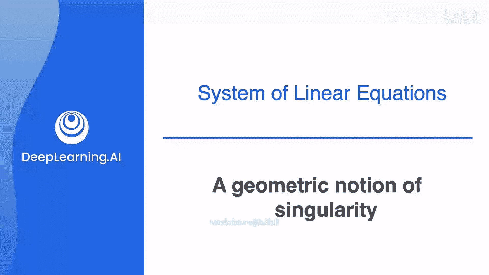
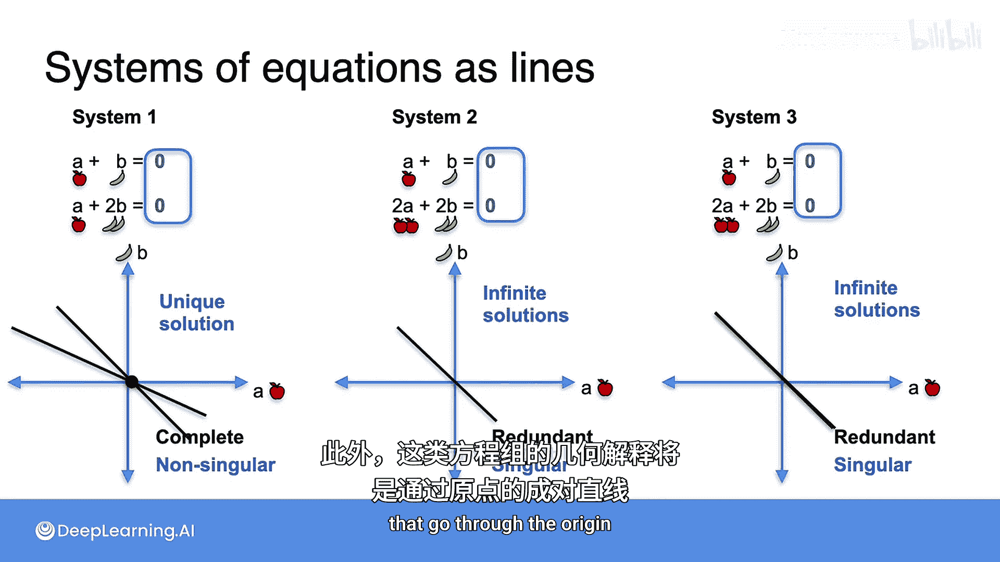

# 【Deeplearning】吴恩达：机器学习和数据科学线性代数1 ｜ Machine Learning Linear Algebra p10 P10_奇异性的几何概念_01_02_09 -BV1Pp6VBjE29_p10-

Now that you learn how systems of linear equations are represented by lines in the plane and that nonsingularity equates to these lines it' transsecting at a unique point。

 I'm going to show you an even simpler way to visualize singularity and non-singularity。

 it involves slightly simplifying the system。Recall that these are the three systems you've been studying where system1 has a unique solution。

 so it's complete and nonsingular， system 2 has implemented the domain solution。

 so it's redundant and singular， and system 3 has no solution， so it's contradictory and singular。

Now forget for a moment about the system being complete， redundant or contradictory。

 and let's focus on the singularity and non singularity。

And the reason for this is that these are the terms we're going to be studying during the whole class。

Note that system 2 and 3， the singular ones are very similar since both consist of parallel lines。

 difference lines and in system 2 these lines are the same and in system3 they are spaced apart but both are fundamentally different from the nonsingular system1 since the system1。

 the two lines are not parallel so can you somehow contract systems2 and 3 into one in order to really separate singular and nonsingular systems into two buckets and the answer is yes。

 and the way to do this is to look at the constants of the systems of equations。

These constants are the numbers in the equations that are not accompanying the variables A or B。

For instance， in system1， they are 10 and 12 and system 2， they're 10 and 20， and in system 3。

 they are the 10 and the 24。So let's turn all these constants for all these three systems into zero and see what happens to the plots。

So。When you turn these constants to zero， the plots now become this why。

 because the new systems always have the 0。00 as a solution so they must pass by the origin。

 notice that if I were to set A and B to be0 in any of these equations。The equations would work。

 so 00 is a solution to all of them Now notice that system 1 is still a pair of intersecting lines。

 so it still has a unique solution， so it's still complete and non singular。

System 2 is still a pair of identical lines， so it still has symphonronic solutions。

 so it's redundant and singular。But notice what happened to system 3。

 it went from a pair of noninterssecting parallel lines to a pair of identical lines。

 so now it has infinitely many solutions instead of none， so it went from contradictory to redundant；

 however， it stayed singular as before and that's what matters so in conclusion the constants in the system don't matter when it comes to determining if the system is singular or non-s。

Now， for the rest of the course， singularity and non singularity will be the important concept。

 and completeness， redundancy and contradiction will be used much less。So for this reason。

 you can now start considering systems of equations where the constants are always zero。

 and these are much simpler。Furthermore， the geometric interpretation of these systems will be pairs of lines that go through the origin。

