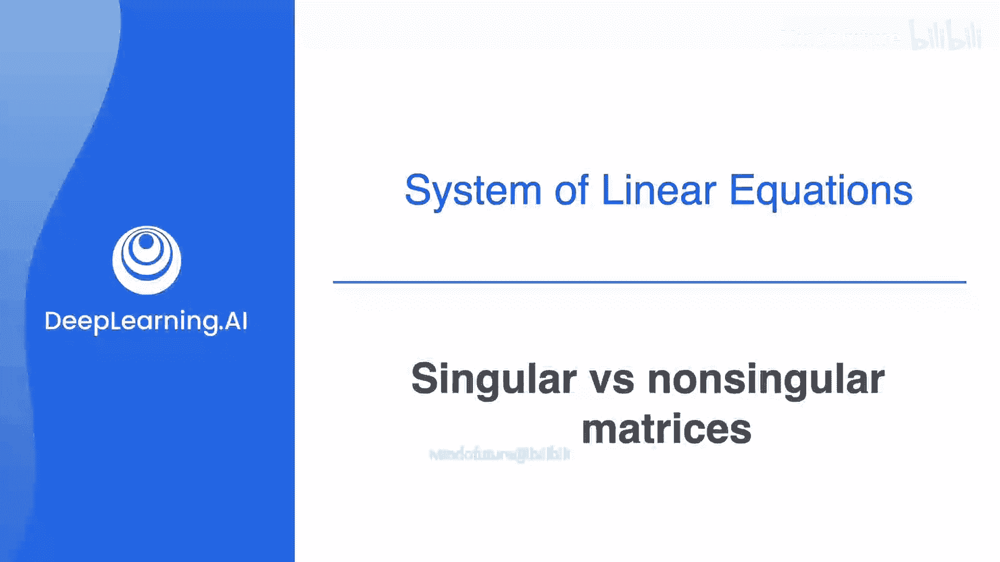
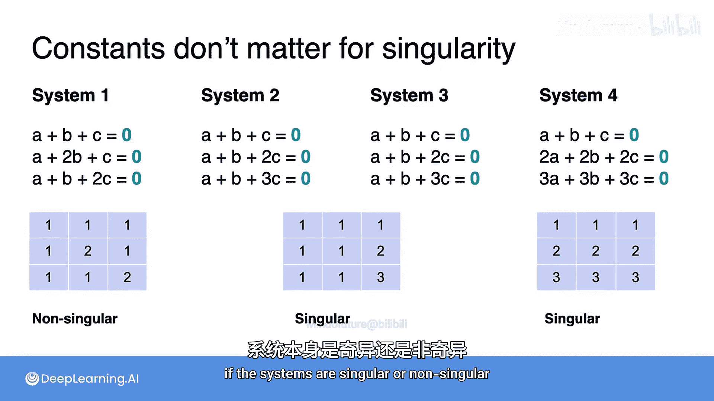

# 【Deeplearning】吴恩达：机器学习和数据科学线性代数1 ｜ Machine Learning Linear Algebra p11 P11_奇异矩阵与非奇异矩阵_01_02_10 -BV1Pp6VBjE29_p11-

So now that you know that the constants in the system of linear equations are not important in order to determine if the system is singular or non- singularing。

 you are about to jump into one of the most important and fundamental objects of linear algebra。

The matrix。Marices have lots of very important properties。

 and they arise from many different places in math。 In this case。

 they will arise from the coefficients in a systems of equations in a very natural way。😊。

Let us go back to the two systems of equations you previously saw。

 recall that systems 2 and3 collapse into one system when you turn the constants into zero。Now。

 since the constants are zero， you can forget about them if you take the coefficients of A and B and now put them in a2 by2 shape box。

 which is called an array or a matrix。That's the matrix corresponding to the system。

 so the matrix corresponding to the first system is the one with entries 1，1，1 and2。

Why these numbers， because the first equation a plus b can be considered the equation 1 times a plus1 times B thus the one and the1。

And the equation a plus 2 B can be considered equation1 times a plus2 times b thus the1 and the2。

So in this matrix， each row corresponds to each equation and each column to the coefficient of each one of the variables in this case。

 a for the left column and B for the second column。Similarly。

 the matrix corresponding to the second system is this one with entries 1，1，2， and 2。

So a matrix is simply an array of numbers inside a rectangle。

 these ones are simple as they're a 2 by2 rectangle。

 but later in the course you're going to see larger matrices。And matrices。

 just like systems of linear equations， can also be singular or non singular。

 since the first system is non singular because it has a unique solution。

 then we say that a corresponding matrix is non singular。And since the second system is singular。

 as it has infinite many solutions， we say that its corresponding matrix is singular。Of course。

 there are quicker ways to tele matrix is singular or non singular without having to find the solutions to its corresponding systems of equations。

In the previous video solved four systems of three equations and three unknowns。

 you found that the first one has a unique solution， the second one has infinitely many solutions。

 the third one has no solutions， and the fourth one has infinitely many solutions。

 using the same terminology as the before， the first ones complete， the second one is redundant。

 the third one is contradictory and the fourth one is redundant。And the first one is non singular。

 while the other three are all singular。Now， just like with systems of two equations and two unknowns。

 an easy way to find if a system is singular or non-singular is to turn the constants into zeros and to study that system。

 and now that you have simplified the system with zeros as the constants。

 then let's look at the solutions。The first system。

 we know that it has a unique solution since it is non singular， and furthermore。

 000 is a solution because setting A B and C equal to  zero is a solution to the system。Therefore。

 the unique solution is the 0。000 and the system is complete and nons Now notice that systems 2 and 3 are now the same system because we set this constants to be 0 what are the solutions to the system Well take a look at equations 1 and 2。

The only difference between equations 1 and 2 is that equation 2 has an extra c and C must be equal to0 because that C doesn't change the result which is 0。

 therefore c is equal to0 and if you plug that into the first equation you get that a plus b must equal to 0 so a is equal to minus B so all the points satisfied that the first coordinate is equal to negative the second coordinate and the third one has to be0。

And this system is redundant and singular。And the fourth system well。

Its solutions are all the points for which the three coordinates add to0 that means a can be anything。

 B can be anything， and C needs to be minus a minus B for the 3 to add to 0。

And the system is redundant and singular。And just like before each of the systems is associated with a matrix that keeps track of its coefficients。

 again in each row you have each equation and each column you have the coefficients of each of the variables A。

 B and C， so the matrices are these ones。And using the same notation as before。

 these matrices are singular or non singular based on if the systems are singular or non singular。

