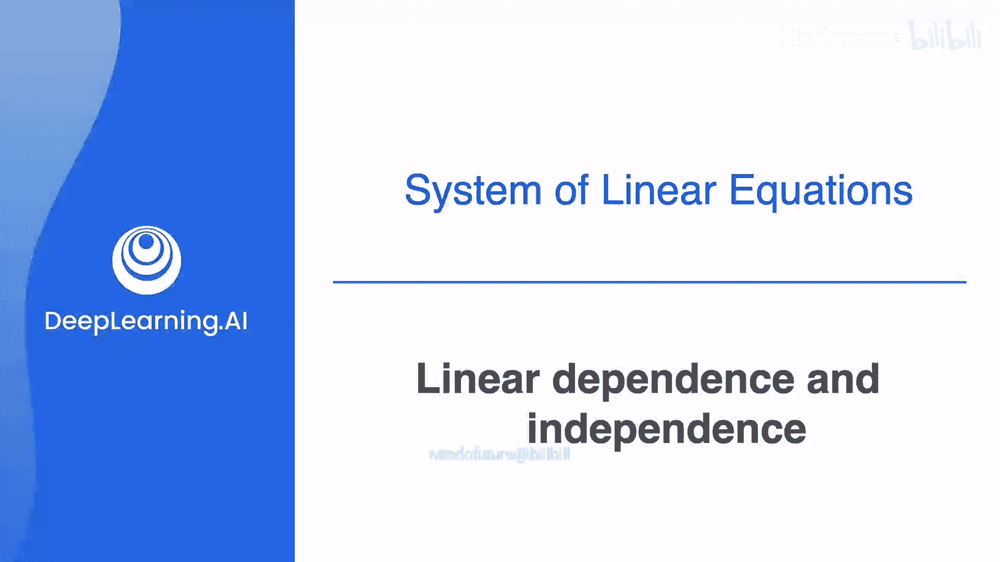
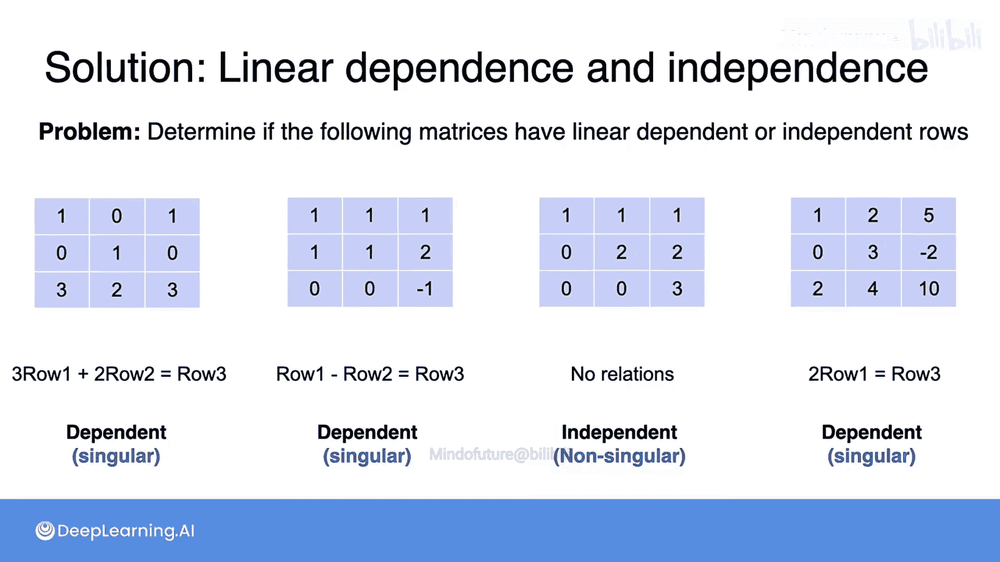

# 【Deeplearning】吴恩达：机器学习和数据科学线性代数1 ｜ Machine Learning Linear Algebra p12 P12_线性相关与线性无关_01_02_11 -BV1Pp6VBjE29_p12-

In this video， I will show you a way to tell if a matrix is singular or non- singularingular directly without having to solve the system of linear equations。

 but first， let us look back at systems of sentences。

 recall that a system of sentences is singular if the second sentence carries the same information as the first one。

Similarly， a system of equation is singular if the second equation carries the same information as the first one。

This is the concept of linear dependence。Let's look back at the two systems of linear equations that you've seen so far with this corresponding matrices and let's focus on the singular system on the right The reason this system is singular is because the second equation is a multiple of the first one in particular is two times the first one that means if we take the left hand on the right hand and multiply everything by two in the first equation you get the second equation。

Now if you look at the corresponding matrix， then the second row is a multiple of the first one。

 and by that we mean that if you take every element in the first row and multiply them all by two。

 you get the second row。That means that the second row can be obtained from the first one。

 so the second row is dependent of the first one。Notice that you can also say that the first row is dependent of the second one by taking the second row and multiplying everything by a half。

So in any way， either one depends on the other one or the other one depends on the one。

 they're both dependent， so they're linearly dependent。

In contrast in the nons system on the left the second equation is not a multiple of the first one or vice versa。

 there is no constant that I can multiply the first equation to get the second equation or vice versa；

 This is why the system is nons each equation tells you something completely different so in the corresponding matrix the same thing happens no row is a multiple of the other one。

 I cannot take a number and multiply one row entirely by the number to get the other row。

That means the rows are linearly independent。As you may imagine the same thing happens with columns and rows。

 and can define these concepts of linear dependency between rows and between columns and they determine the singularity and non-sularity of the matrix for a larger matrix。

 the concept of linear independence and dependence is a bit more complex， but still very intuitive。

Follow along for the details。In order to understand linear your dependence。

 consider the following example， take a look at the system with three equations and three unknowns；

 the equations are equals 1， b equals 2， and a plus B equals 3。Now， notice that C doesn't appear。

 but that doesn't matter。Now this system is singular for the simple reason that the third equation is the sum of the first2 and to see this more in detail the first equation can be written as a plus0 b plus 0 c equals 1。

 the second one is 0 a plus b plus 0 c equals 2 and if we add them we get a plus b plus0 c equals 3 which is precisely the third equation。

Now consider the matrix of the coefficients of the system。

That the matrix obtained by forgetting the constants the matrix has entries 100。

 010 and 110 and in the same way that the sum of the first two equations is the third one。

 the sum of the first two rows in the matrix is equal to the third one because 1 plus0 is 10 plus1 is 1 and 0 plus0 is 0 therefore row 3 depends on rows 1 and 2 row 3 in the same way as equation 3 doesn't bring anything new to the table is the sum of the first 2。

So we say that the rows are linearly dependent。Because you can get from the first and the second。

 you can form the third one。Therefore， this matrix and this system are singular。

Now let's look at another system， which you already seeing that it's singular。

 the corresponding matrix is this one over here， 111222333。

Notice that there are many relations between the equations of this system， here's one。

 the first equation plus the second equation equals the third equation。And in the matrix。

 row 1 plus row 2 is equal to row 3， so row 3 depends on rows 1 and 2。

 meaning that the rows are linearly dependent。Now if you look closely。

 this system and this matrix have a lot of our dependencies， for example。

 the second row is twice the first row and the third row is three times the first row。

 so this is a highly singular system with a lot of dependencies between the rows。

Now in order to really understand the concept of linear dependence and independence let's take a look at this other system。

 which you've also seen is singular， though this one is a little more subtle。

 What are the relation between the equations Well here's one。

Let's take the first equation and let's add it to the third equation。What do you get？

You get 2 a plus 2b plus 4c is equal to 0 now that doesn't look like one of the equations perhaps。

 or perhaps yes， if you take this equation and divide it by 2。You get a+ b plus 2 c equals0。

 which is precisely the second equation。So in other words。

 the second equation is the average of the first and third equation and in the same way。

 the average between row 1 and row 3 of the matrix is row 2， so row 2 depends on rows 1 and 3。

So therefore， the rows of this matrix as well as the equations in the system are linearly dependent。

Now in contrast， take a look at the system of equations。

 you've seen before that this system has a unique solution， so it's non singular。Now。

 no matter how much you try， it is impossible to find any linear relations between these equations。

 there's no way you can obtain the third one out of the other two or the second one or the first and the third。

 there's nothing you can do here。And the same thing happens in the matrix。

 no row can be obtained as a linear combination of the other two row。

Thus the rows are linearly independent， and this implies that the matrix is non singular。Now。

 as you can see， it's not easy to see and to verify that there's no relation。

 so don't worry soon I'm going to show you some methods to be able to verify this。

 but for now you're ready for a quiz determining the following matrices have linearly dependent or independent rows。

And the answers are in for the first matrix notice that the first row times 3 plus the second row times 2 is equal to the third row。

 and so the rows are linearly dependent。 This implies that the matrix is singular。

For the second matrix notice that if you subtract the second row from the first when you get the third row。

 those rows are again linearly independent， showing that the matrix is singular。

The third matrix has no relations no that no matter how much you try。

 there's no way to get one row out of the other two， for example。

 the first row has that leftmost one， there's no way you can obtain that from linear combinations of the second and third row and so on。

So this matrix is non singular because the rows are linearly independent and finally for the fourth matrix notice that the first row times 2 is equal to the third row。

 so these rows are dependent and the matrix is singular。

