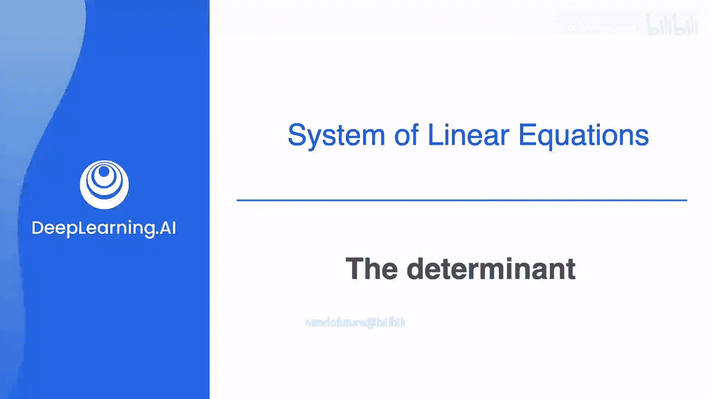
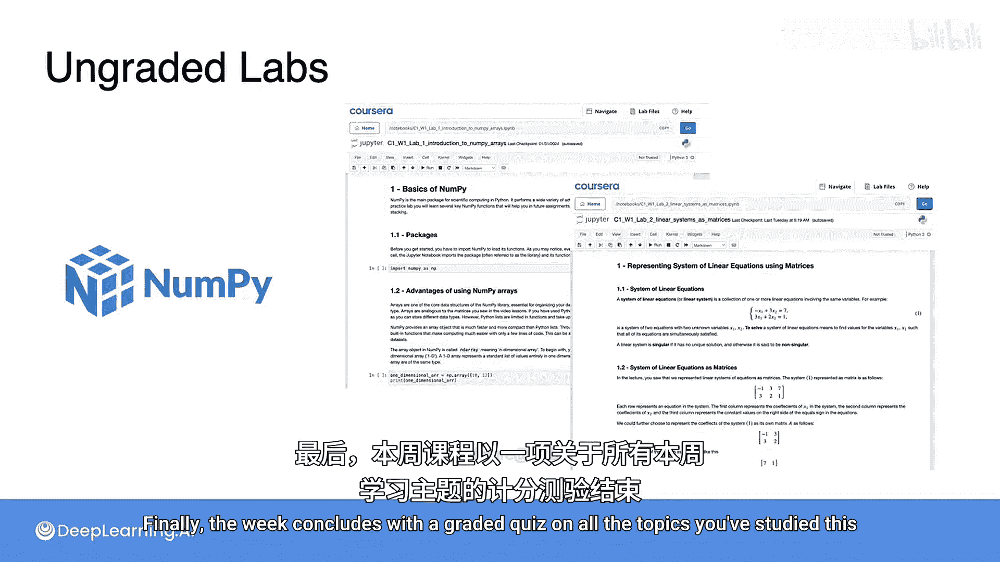

# 【Deeplearning】吴恩达：机器学习和数据科学线性代数1 ｜ Machine Learning Linear Algebra p13 P13_行列式_01_02_12 -BV1Pp6VBjE29_p13-

Now it turns out that there is a much faster way to tell if a matrix is singular or non-singular and in this video you will learn it。

 it's called the determinant， and it is a quick formula that returns a0 if the matrix is singular and a number different from 0 if the matrix is non singular。

Take a look back at the matrix in the previous example and let's focus on the singular matrix on the right in this matrix。

 you can multiply the first row by two to obtain the second row。And therefore。

 the rows are linearly dependent。In contrast for the non singular matrix in the left。

 there's no number that you can multiply the first row by to get the second row because the rows are linearly independent。

Let us look at this more carefully， if the matrix has entries A， B， C， and D。

 then the matrix is singular， if there system some number k for which the first row times k is equal to the second row。

That means ak equals C and Bk equals d for the same value of k。

 This is equivalent to C over a equals d over B equals K。

And that's the same thing for getting about K。That AD is equal to BCc。Or equivalently。

 ad minus bc equals 0。This value of ad minus BCc is very important。

 we're going to call it the determinant of the matrix。

 so the determinant of the matrix is AD minus BCc。And by construction。

 this determinant is zero if the matrix is singular and non0 if it's non singular Now a way I like to look at the determinants is like this。

AD is the product of the numbers in the main diagonal。

 and BC is the product of the numbers in the anti diagonal。

So let's calculate the determinants of this two matrixes in the ongoing example and see what you get。

 the first matrix has determinant1 times 2 minus1 times 1， which is1 and the second one。

1 times 2 minus2 times1。Which is 0。So notice that the first matrix which is nonsing has a determinant of 1 which is non0 and the second matrix which is singular has a determinant of0。

 this is no coincidence is always going to be the case nons matrices have nonzero determinants they don't need to be1 but their nonze and singular matrices have zero determinant。

To summarize， the determinant of a matrix with entries A， B， C and D is AD minus BCc。

 and it is 0 precisely when the matrix is singular and nonze when the matrix is non singular。

So now you're ready for a quiz in problem one you have two matrices and you're asked to find their determinants。

 and in problem two， determinemin of the matrices are singular or non singular based on the results of problem1。

And the answers are for the first matrix， the product of the terms in the main diagonal is 5 times 3 which is 15。

 the product of the terms in the main anti diagonal is 1 times minus1 which is minus1。

 and the difference is 15 minus minus1 which is 15 plus1 which is 16。

Since the determinant is different from0， then the matrix is non singular。For the second matrix。

 the determinants is2 times 3。Minus minus1 times minus6， so the three minuses that's 1 minus。

 so the term is 6 minus6， which is precisely 0。Since the determinant is0。

 then the matrix is singular。The determinant for  three by three majores is a bit more complicated than that for two by two majores。

 but it is mostly the same。Here it is。Before calculating the deter， recall that for a2 by 2 matrix。

 you consider the main diagonals， add the products of the elements in one of them and subtract the products of the element in the other one。

In a larger matrix， this is the same thing except you will need some more diagonals。

 The first diagonal is the main one over here。Now consider the next diagonal here。

 this one's incomplete so you can complete it by wrapping around the matrix and finishing it like this。

The same thing happens with the next diagonal。So for the determinant。

 you're simply going to add the products of the elements in these diagonals and subtract the products of the elements in these diagonal that go the other way around。

Let's do an example。Consider this three by three matrix over here in order to calculate the termminant。

 consider the main diagonal with entries  one， two， and2。Its product is1 times2 times2， which is4。

Now， consider the next one。With entries 111， so the product of these entries is one。

And now the next one again with product of entries  one。

 and now we're going to subtract the diagnoseagons that go in the other direction。

 so this one is one times 2 times 1， which is2。 This one over here is one times 1 times 1。

 which is one。And this one over here is one times one times2。Which is two。

 So we're adding4 plus one plus1 minus2 minus1 minus2。And the determinant becomes one。

So a little more calculations， but basically the same thing as with two by two matrices。

 so now you're ready for a quiz， find the determinant of the following matrices。

And verify that those with determin zero are precisely the singular matrices。

 you can recognize that these are the exact same matrices from the previous quiz。

And here are the answers， the first one has determinant 0， and so does's the second one。

 the third one has determinant 6 and the fourth one has determinant 0。

 therefore the first two are singular， the third is non singular and the fourth is singular because the same thing happens as with two by  two matcheses。

 singular mates have determinant0， and nons mates have determinant non0。

Now let's look more carefully at the third matrix， the one with the determinant 6。

 this 6 was obtained at 6 plus 0 plus0 minus 0 minus 0 minus0 why， well， let's do it。

You first have the main diagonal， which is1 times 2 times 3， which is 6。The next one is 0。

 the next one is 0， and the negative ones are 0，0 and 0 notice something peculiar here。

 the only term that is non0 is the first one because this matrix is very special is upper triangular is that everything below the diagonal is a0。

And now， since everything below the diagonal says0。

 all the terms in the determinant are going to contain one of these elements below diagonal。

 except for the one that takes the entire main diagonal。

So whenever you have a matrix where anything underneath the diagonal is 0。

 the determinant is going to be the product of the elements in the main diagonal。

 so that's a quick shortcut you can use and they can still be singular for example。

 look at this one in the same way this determinant is going to be the product of 1 times 2 times 0。

 the elements in the diagonal and that happens to be 0。Alright。

 that's the last new concept this week after this you will have a few different opportunities to deepen your understanding there are two labs that will help you get familiar with NI。

 the Python packet you'll be using on labs and assignments throughout this course。

The first lab is an introduction to the Numpy library overall， and in particular Numpy arrays。

 if youre already familiar with this library， feel free to just skim this first lab。

 The second lab introduces the ways Numpy can be used to represent systems of equations and show you how to use ping libraries to visualize those systems。

 Both labs are ungraded， but provide valuable background for the rest of the course。 Finally。

 the week concludes with a graded quiz on all the topics you've studied this week。 Good luck。

