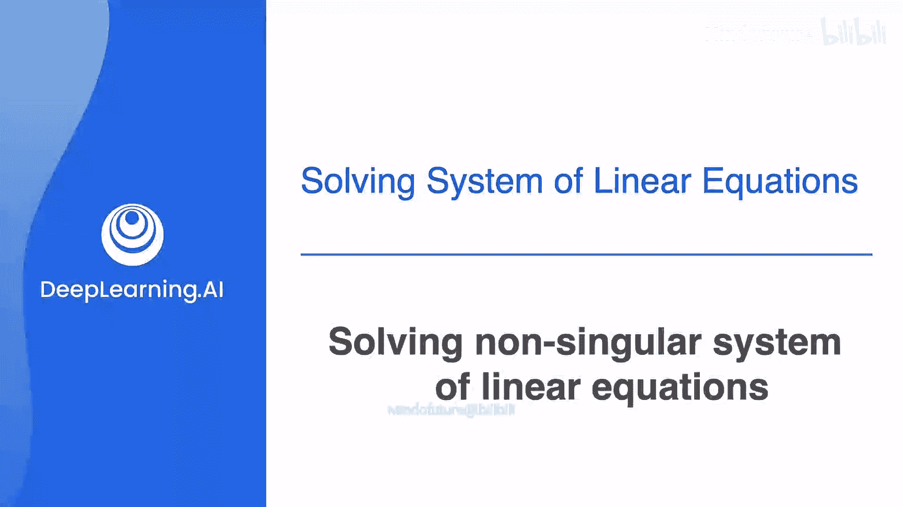
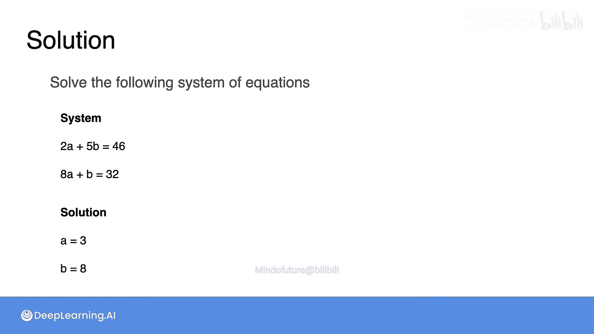

# 【Deeplearning】吴恩达：机器学习和数据科学线性代数1 ｜ Machine Learning Linear Algebra p15 P15_求解非奇异线性方程组_02_01_02 -BV1Pp6VBjE29_p15-

You are now ready to learn something that has been lurking yet present in the previous lessons In one of the first quizzes。

 you took a system of linear equations and found its solution。

In general this is hard to do by simply looking at the equations。

 however there exists a simple way to do this in this video you will learn a method or an algorithm that helps you find a solution to a system of linear equations and that is also able to tell you if the system is singular or non-s。

First， let's go back to how you solve the first system of equations。

 the one with equations a plus b equals 10 and a plus 2 b equals 12。

Recall that the scenario was that an appleent a banana costs 10 and an appleent two bananas costs 12。

So you figure out that since the second day you bought an extra banana and pay two more。

 that that extra banana must cost two。From this and the fact that they both cost 10。

 you concluded that the Apple must cost 8。Thus you went from the original system of equations to a solved system。

 one that is still a system of equations except that the equations are a equals a and b equals 2 the solved system is much simpler because each equation actually tells us the value of each of the variables the goal is to take every system and turn it into a solved system。

That is， if the system is non singular and has exactly one solution now in order to get from the system to the solve system。

 you followed some process。This process required manipulating the equations without noticing what you actually did in your head was to follow a specific process that involves manipulation such as swapping equations。

 adding them， and multiplying them by constants in this video you'll see what this means more in detail。

The first step in order to go from a system to a solve system is the following。

Notice that in the system on the left， the equations both have AM&B on them。

You'd like to get to one in which the A and the B are isolated and they only appear in one equation each。

The first step will be to look at the second equation and try to eliminate the variable A from it。

But before you do that， it's important to know how one can manipulate equations。

 that is take some linear equations and produce some other ones that are still true based on the original ones。

One way to manipulate equations is to multiply them by a constant， for example。

 if an apple and a banana cost $10， how much would seven apples and seven bananas cost？Well。

 the answer is $70 as this is 7 times 10。Equation A+ b equals 10 can be multiplied by 7 on both sides to get the equation 7 a plus 7 b equals 70。

 and these equations carry the exact same information， thus if the first one is true。

 so with the second。Another way to manipulate equations is to add two equations。For example。

 if an apple or banana cost $10 and two apples and three bananas cost $26。

 then how much are three apples and four bananas Well if you have these two equations you get the three apples plus4 bananas is equal 232。

If the two first equations are true， then so is there sum？

So now I'll show you how to solve a harder system of equations in order for you to see how these manipulations are used。

So here's the system of equations that you'll learn to solve， the equations are 5 a plus b equals 17。

And 4a minus 3b equals 6， and recall that your first goal in order to get to a solve system。

Is to try to eliminate the variable A from the second equation in order to leave B by itself。

The first step is not always necessary， but it will make your life easier the step is to divide each equation by the coefficient of a in order for both of them to have a coefficient of1 beside the a。

So if we do this， the new equations are a plus 0。2 b equals 3。4 and a minus 0。75b equals 1。

5 and as you saw before these are equivalent to the first two because all we did was multiply the entire equation left and right by a constant。

Now in order to remove a from the second equation， one way is to subtract the first equation from the second one like this。

We take the second equation， we subtract the first one。And。😊。

We can do this component wise a minus a is 0 a minus 0。75 b minus 0。2 b is minus 0。95 b and 1。

5 minus 3。4 is minus1。9。The resulting equation is minus0。95b is equal to minus1。9。

Now we can divide by minus0。95 at both sides to get that B is equal to 2。So you have succeeded。

 you have found the value of B。 In other words， you removed a from the first equation to get B equals 2 in your solve system。

Now that you know that B equals 2， you can simply plug that into the first equation。

 the first equation says a plus 0。2 b is 3。4， so a plus 0。2 times 2 is equal to 3。4 0。2 times 2 is 0。

4 so we have a plus 0。4 equals 3。4 and subtracting 0。4 from both sides。

 you get that a is equal to 3 and that is the value of the second variable。So in a nutshell。

 that is how you solve a system of two equations and two variables。Now here's a small caveat。

 imagine that you are solving this new system with equations 5a+ b equals 17 and 3b equals 6。

 and you'd like to eliminate a from this equation。The first step is to divide both by the coefficient of a。

For the first equation， this goes exactly as before， however for the second equation。

 the coefficients of a0 and you can't divide by0。😊，So are we doingomed？Well。

 actually the doom turns into good luck， check it out the equation says 3b equals 6。

 it already has a eliminated from it and actually implies that b is equal to 2 if you divide by 3 and both sides。

So this is the value of B already and the second equation。

Is already solved in the system in order to solve the first one， you proceed to do the same thing。

 replace on the first equation that B equals 2。Get that A is equal to 3。

And bring it back as the solution。So you're now ready for a quiz。

 solve the following system of equations， 2 a+ 5 b equals 46 and 8 a+ B equals 32。

And the solution to the system is a equals 3 and B equals 8。

I invite you to verify that those values actually work for the equations。

