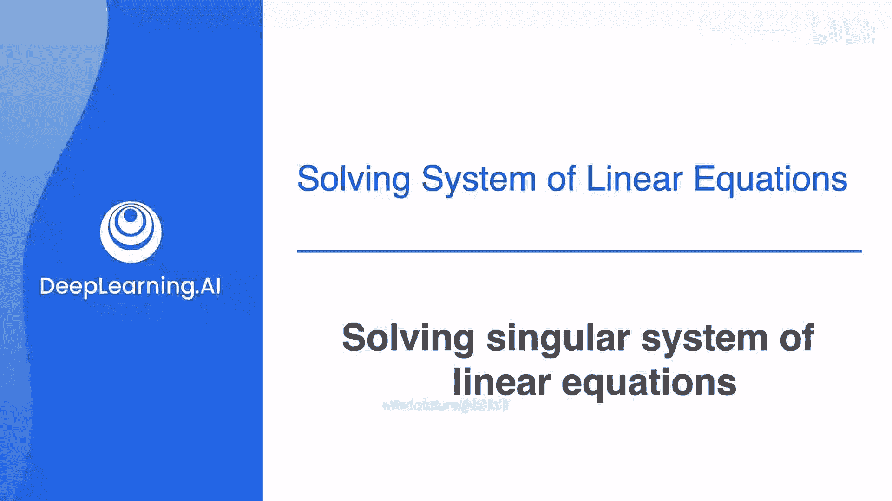
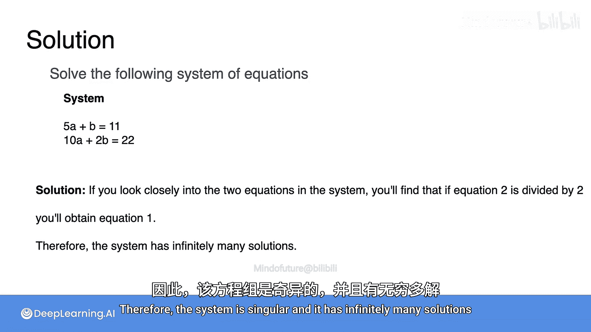

# 【Deeplearning】吴恩达：机器学习和数据科学线性代数1 ｜ Machine Learning Linear Algebra p16 P16_求解奇异线性方程组_02_01_03 -BV1Pp6VBjE29_p16-

Now this method is actually more powerful than you think in the previous examples。

 you saw it in action for a non singular system that has a unique solution。

But what happens with a singular system， namely one that does not have a unique solution？

Let us solve the singular system that also came up before the system of equations a plus b equals 10 and 2 a plus to b equals 20。

 recall that the system was redundant and the second equation is equivalent to the first one。

So let's try the same steps as before to try to eliminate a from the second equation and see where that takes us。

The first step is to divide both equations by the coefficient of a。

 getting the two equations a plus b equals 10 and a plus b equals 10， notice that they're the same。

The next step is to remove a from the second equation by subtracting the equation a plus bs 10 from the equation A plus B equals 10。

Now what do you get here， well， you get zero equals zero because you're subtracting the entire string from itself。

This equation serial goes0 is trivially true and unfortunately gives you zero information about what B can be。

What happened Well， in your efforts of removing a from the second equation or to leave B alone。

 you also remove B， and there is nothing you can do to get B。

 there is no manipulation you can do to remove only one of the variables because anything you do to remove one will also remove the other one because the system is singular。

And again， this is because the second equation adds no value to the system。So in other words。

 the solve system is this one。Where a plus b equals 10。

 and there's no other equation to give us more information。

 so can you still get the solution to look like a equals something and B equals something else？

Well you still can pick any number x and let a equals B X how much is B then well if a plus b equals 10 then b must be 10 minus x。

 This is a solution to the system， Its not a unique solution because x can be any value so the solve system has one degree of freedom and if you vary this degree of freedom X you can get many different solutions to the system。

The solutions， for example， form a line as you see before。

Now what happens if you use the same method with a singular system that is contradictory。

 recall that the contradictory system that you saw earlier was this one。

 a plus b equals 10 and 2 a+ 2 b equals 24。And let's use the same steps to solve it。First。

 we want to eliminate a from this equation， so we divide both equations by the coefficient of a。

We subtract E one from equation 2。And we get that。Z on the left is equal to 2 on the right。

 0 is never equal to 2， so that's a contradiction， therefore there are no solutions to the system。

So now you're ready for a quiz。The quiz is the following。

 can you solve the following system of equations， 5 a+ b equals 11 and 10 a+ 2b equals 22。

So if you look closely into the two equations in the system。

 you will find that equation2 is equation 1 times 2。Or equivalent。

 if you take equation 2 and divided by 2， you'll obtain equation 1， therefore the system is singular。

 and it has infinitely many solutions。

