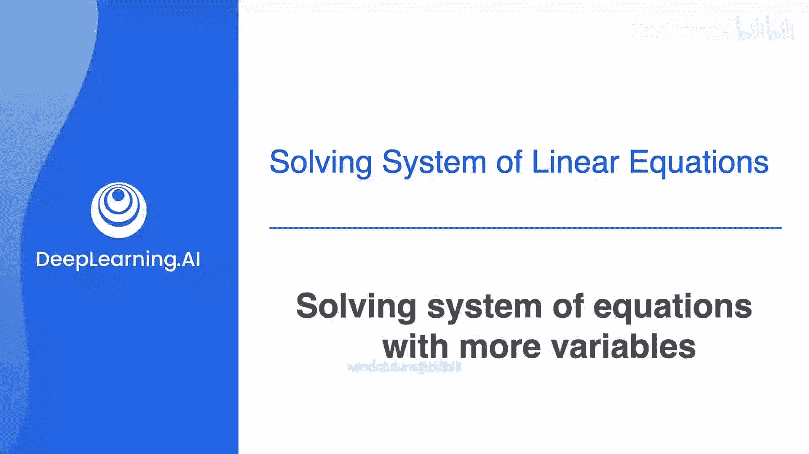
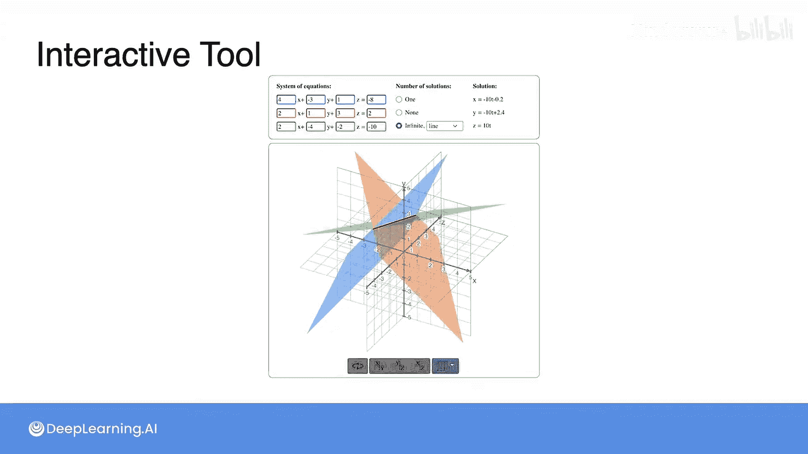

# 【Deeplearning】吴恩达：机器学习和数据科学线性代数1 ｜ Machine Learning Linear Algebra p17 P17_求解变量更多的方程组_02_01_04 -BV1Pp6VBjE29_p17-

Now that you learn how to solve systems of two equations with two variables。

 let me show you how to solve systems of three equations with three variables。

 it's actually very similar。The goal here is first to leave a by itself。

 so we're going to make sure that the only equation that contains an A is the first one and that there's no A on the second and third equations。

So the way to do this is to normalize the first column。

 namely divide each row by the coefficient of a to make sure that every equation has a coefficient of1。

For the variable8。And now use the first equation to remove the variable a from all the other ones。

 so subtract the first equation from the second and then from the third。

To get the following now in the resulting system， you have successfully isolated a and what remains is a system of two equations with two unknowns that are B and C。

 and you know exactly how to solve these ones。So when you solve it， you get the values for B and Z。

Let me show you how， so now let's forget about the first equation and solve the second and third。

And you know how to do this first， divide these two rows by the coefficient of B to get this where the leading coefficient of B is now 1。

Now use this equation。The second one to remove B from the third one。

 so subtract the second equation from the third one to get this 1 minus 11 over 6。

 C equals minus 11 over 2。In this way， you have isolated B in the bottom two rows。From here。

 you can divide by minus 11 over 6 to get that c is equal to 3。So now let's go back to the beginning。

And now we know that C is equal to3。Then we can go propagate upstairs。

 so replace c equals 3 in the second equation to get b equals 2。

And now that you know B and C replace b equals 2 and c equals 3 in the first equation to get a equals 4。

 so the final solution is a equals 4， b equals 2， and c equals 3。After this。

 you'll get to use a new interactive tool to explore systems of equations in three dimensions。

You'll be able to see each equation as a plane floating in three dimensional space and the solution to the system as the intersection of these planes。

 it's a fun tool to play with and hopefully deepens your understanding of the concepts you've been studying。

As always， some suggested activities are below the tool itself。Enjoy。

