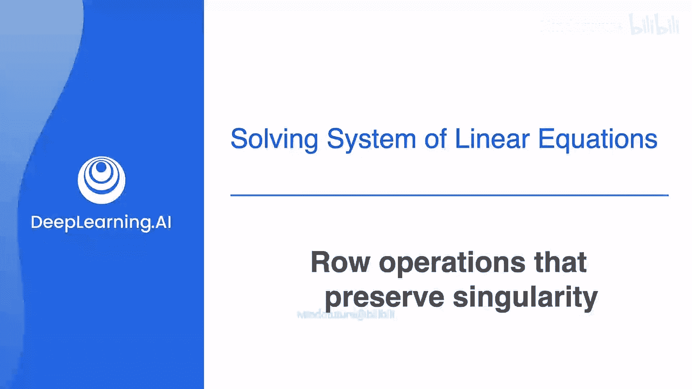
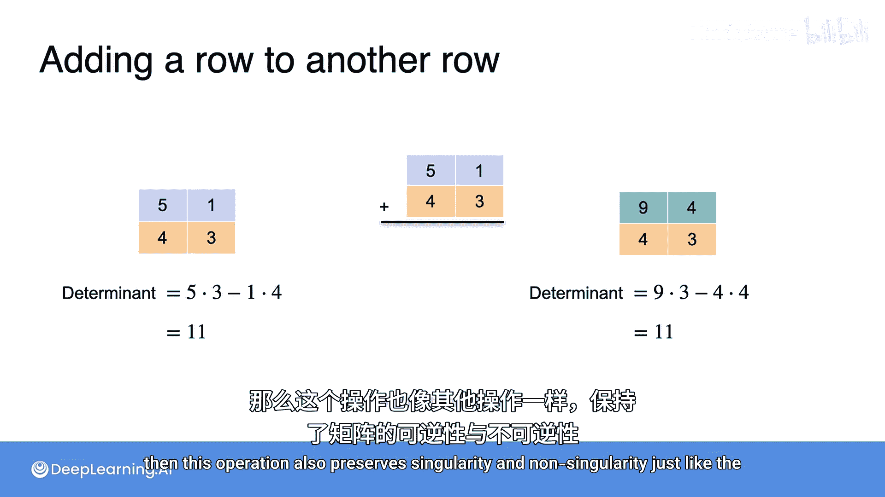

# 【Deeplearning】吴恩达：机器学习和数据科学线性代数1 ｜ Machine Learning Linear Algebra p19 P19_保持奇偶性的行操作_02_01_07 -BV1Pp6VBjE29_p19-

Before we get into the whole row reduction process it is important to note that the same manipulations that you use to solve systems of linear equations can be used in matrices。

 these are called row operations in a matrix and a very important property that they have is that they preserve the singularity of a matrix in other words。

 if you apply them to a singular matrix， you get a singular matrix and if you apply them to a non-sular matrix you get a non-s matrix。

In this video， you will learn more about these rural operations。Consider the matrix with entries 5，1。

 4， and 3。First， check as is matrix singular or non singular by calculating the determinant。

 the determinant is 5 times 3 minus1 times 4 which is 11。Therefore， the matrix is non singular。

Now the first row operation that you learn is switching rows。

 if you switch the positions of the two rows， you get the matrix with entries 4，3， 5， and 1。

I promise you that since the original matrix was non singular， then this one is also nons。

 how do I know this？Well， lets calculate the determinant。The term is4 times 1 minus 3 times 5。

Wwhichch is minus11， which is different than 0， so it's nons and in fact the determinant of the matrix of 1 after switching rows like this is always a negative of the original determinant。

 The reason for this is that the diagonals change place so the one you're adding you're now subtracting and the one you're subtracting now youre adding so now instead of getting 15 minus-4 you get 4 minus-15 hence the minus-11。

You can imagine that if the original determinant was a0， then the resulting one would also be a0。

 which means that if you apply this to a singular matrix， you get a singular matrix。And likewise。

 if the original determinant was not0， then the resulting was also not0。

Row switching preserves singularity or non singularularity of a matrix。

The next operation is multiplying a rowband on zero scalar。

 so let's use the same matrix with a deterant1。Now let's modify the first row。

 so we're going to leave the second row by itself and the first row we're going to multiply it by a number。

 say 10 to get 5010。And now that's going to be the new first row。

 so what's the determinant of the new modified matrix 5010，43？

It's this and notice that it is 10 times 11，10 signs the determinant of the original matrix。

 because in each of the diagonals you have taken exactly one element one of the top row and multiplied it by 10。

 so the whole thing gets multiplied by 10。Now notice that the scalar has to be non0。

 if the scalar that 10 is non0， then this operation turns a nonzero determinant into nonzero determinant and a zero determinant into a zero determinant。

 thus this operation。Also preserve singularity and non singularularity。

And the final operation is to take a row and add it to another row， for example。

 let's take the sum of the first and the second row。And that is 94。

So 94 is going to be the top one of the rows in the matrix。

 and the bottom one is going to be the same。And this new determinant is 9 times 3 minus4 times 4。

 which is actually 11。So believe it or not， when you do this。

 you get the same determinant as the beginning。Proving this is slightly harder and you can find it in a written thanim in the resources of the class。

 but the most important part is that since the determinants stays the same after this operation。

 then this operation also preserves singularity and non-sularity just like the other ones。

