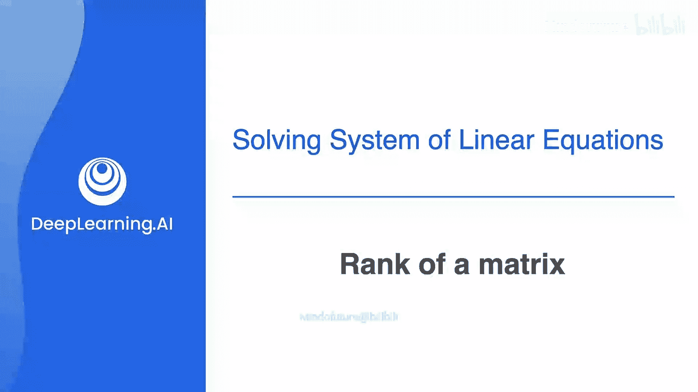
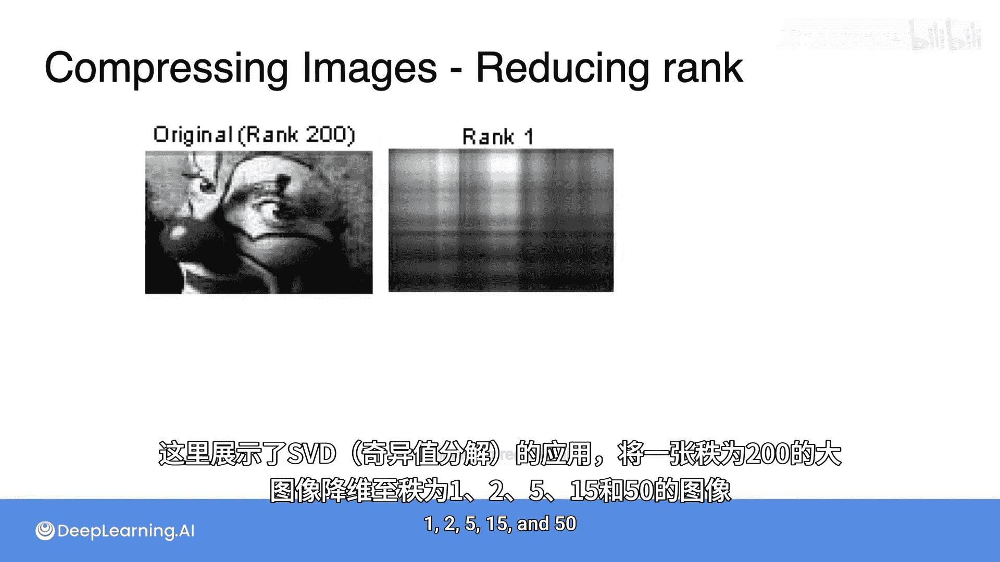
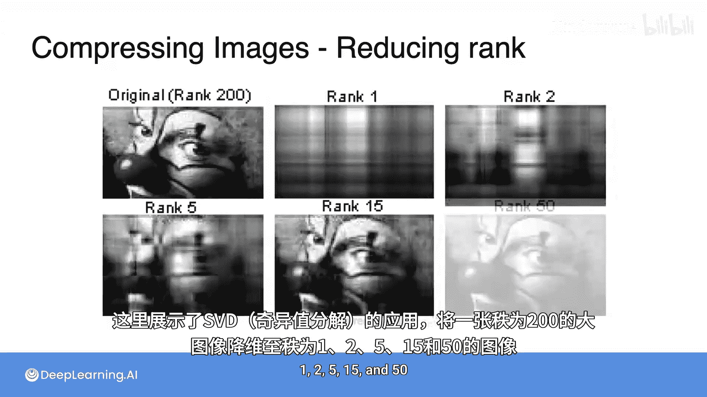
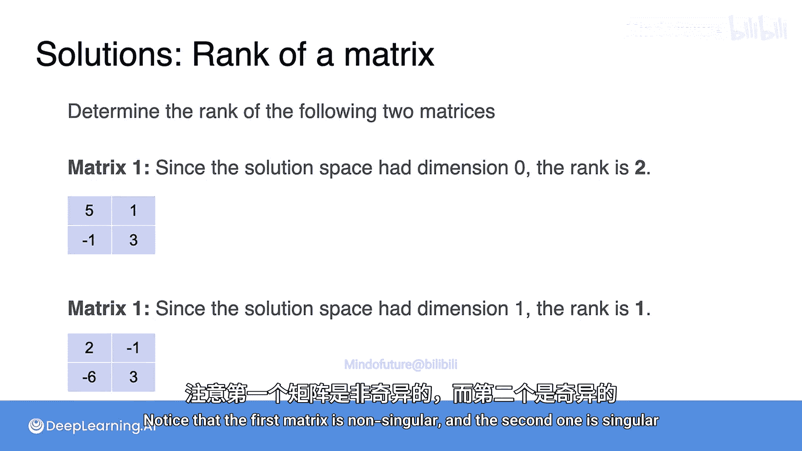

# 【Deeplearning】吴恩达：机器学习和数据科学线性代数1 ｜ Machine Learning Linear Algebra p20 P20_矩阵的秩_02_02_01 -BV1Pp6VBjE29_p20-

Throughout the last few videos there has been a concept that you've seen。

 yet still have not been formally introduced to， it is the notion of the rank of a matrix which in some way measures how much information that matrix or its corresponding system linear equations is carrying。

Follow along with me and see how to define and calculate the rank。

One great application of ranking machine learning is an image compression Take a look at this image。

 it's very crisp， but it also uses a lot of storage because every pixel intensity has to be stored as a number。

Could you store this image or perhaps a slightly blurriier version of it using significantly less space？

The answer is yes， and it uses the main topic of this video， which is the rank of a matrix。

It turns out that pixeld images are mates and the rank of matrix is related to the amount of space that is needed to store that corresponding image this particular image has rank 200。

 which is quite high。It's a very powerful technique on singular value decomposition or SVD in short。

 which can reduce the rank of a matrix while changing it as little as possible。

You can see as video applied here to reduce a heavy image of rank 200 into images of rank 1。

2。5，15。

And 50。Notice how the images of rank 15 and 50 are very similar to the original and we take a lot less space to store。

So recall that in systems of sentences there was a notion of how much information the system carried。

 let's look at three systems of sentences， system one with sentences the dog is black and the cat is orange。

 system two with sentences the dog is black and the dog is black。

 and system3 with sentences the dog and the dog notice that system1 has two sentences。

 and it carries two pieces of information。System 2 also has two sentences， but they're the same。

 so this system carries only one piece of information。

 and system 3 well it has two sentences but it carries no information regarding the color of the animals。

It carries zero pieces of information， recall that your goal is to determine the color。

 so the amount of information a system sentences carries is defined as the rank of the system thus system 1 has rank 2。

 system 2 has rank 1 and system 3 has rank0。Next you will see how this notion applies to matrices and the corresponding systems of linear equation Now let's go back to the three systems of equations from the previous videos。

 as you've already seen the first system has two equations and each equation brings something new to the table and new piece of information。

That's why you're able to narrow down the solutions to one point。

The first equation narrows down to a line and the second one narrows them down to a point thus the system has two pieces of information。

This is how the rank of the system is defined， so the rank is2 the second system has two equations。

 but recall that the second equation was the same as the first one。

 therefore the system really only carries one piece of information which is the first equation。

This is why youre able to narrow down the set of solutions to a line， but as far as you can get。

 thus the rank of the system is defined as1 and finally the third system has two equations but they carry no information as any number AB satisfy these equations does the system carry zero pieces of information and its rank is defined to be0。

And now on to define the rank of a matrix， since its system of information has a corresponding matrix。

 then the rank of the matrix is defined as the rank of the corresponding system of equations。

 thus the matrix corresponding to the first system has rank 2。

The one corresponding to the second system has rank 1 and the one corresponding to the third system has rank0。

Now there's a special relationship between the rank of a matrix and its solution space。

 recall that the solution space for each of these matrices is the set of solutions to the system of equations when the constants are zero。

So for the first one， recall that the solutions are only a equals 0 and b equals 0。

 so that's a point and the dimension of the solution space is 0 because the dimension of a point is 0 for the second one。

 the set of solutions was some line。And a line has dimension 1。

 so the dimension of the solution space was1， and for the third one well every AMB works here。

Because any point AMB is a solution to that system。Therefore。

 the solution space is a plane and it has dimension 2。

So what happens here in all three cases is that the rank is equal to 2。

 the number of rows in the matrix minus the dimension of the solution space。

This is always the case for 2 by 2 matches and in general， as you'll see later。

 this rank con space always and then dimensional solution space always add to the number of rows in the matrix。

Notice also that the first matrix is non singular and the other two are singular。

So a matrix is non singular， if and only if it has full rank。

 namely if the rank is equal to the number of rows。

This is the same as saying that a system of equations is non singular if it carries as many pieces of information as equations it has。

Meaning that you carry the a maximum amount of information possible。

 thus that each equation brings a new piece of information to the table and there's no redundancy between equations。

And now you're ready for a quiz for this quiz， please determine the rank of the same two matrices you've seen recently。

And the solutions are in， so since the first one has a solution space of dimension 0。

 the rank is 2 and the second one has a solution space of dimension 1， so the rank is 1。

Notice that the first matrix is non singular and the second one is singular。

