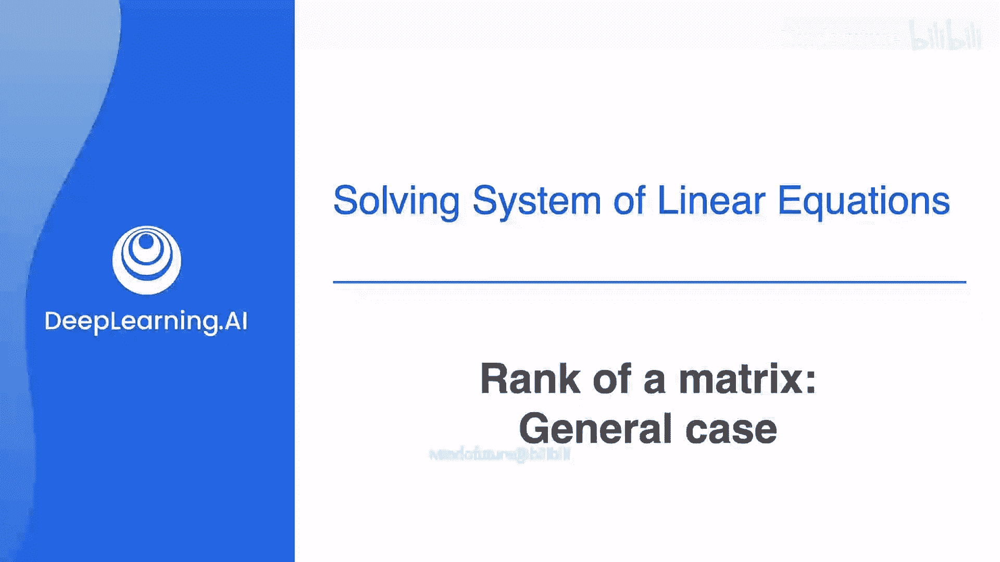
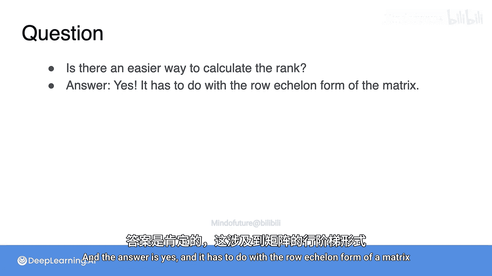

# 【Deeplearning】吴恩达：机器学习和数据科学线性代数1 ｜ Machine Learning Linear Algebra p21 P21_矩阵秩的一般概念_02_02_02 -BV1Pp6VBjE29_p21-

Now， just as it happened with2 by2 matrices， the rank is a measure of how nons a  three by3 matrices and its geometric meaning is very similar to that for two by 2 matrices follow along with me and I'll show you how the rank works for larger matrices so in order to define the rank of a 3 by3 matrices and look at the systems of three equations and three unknowns that you've been looking at so far。

And let's focus on what equations bring new information to the table。

And by not bringing any information to the table， I mean an equation that is already a linear combination of the other equations in the system。

So in system1 you can check that all the equations are linearly dependent。

 there's no way to obtain one out the other two； therefore the system has three equations and all of them are new pieces of information so it has three pieces of information。

The number of independent equations is the rank， so this system has rank 3 and by convention。

 we say that the matrix has rank 3。Now let's take a look at system2 and this can be done in different ways but one way to look at it is to realize that the second equation is the average of the first and the third so you can think of the first and the third to be the new pieces of information and the second one doesn't bring anything new to the table and if you do this in a different order you can get different things but you will always get that there's three equations and two pieces of information because the system has rank2。

And thus， the matrix is defined to have rank 2。System 3 is simpler since the first equation is new。

 but the second one is twice the first one so it depends on it and the third one is also three times the first one so it depends on the first one as well。

And so we have three equations and one piece of information， the system therefore has rank1。

 and so does the matrix。And the usual system 4 is the simplest one。

 no equation brings anything new to the table because no equation tells you anything about A B and C。

 so you have three equations， zero pieces of information， and the matrix has rank0。

There is a question。It seems that calculating the rank is not that easy。

So is there a simpler way to calculate the rank and the answer is yes。

 and it has to do with a row xome form for matrix？

