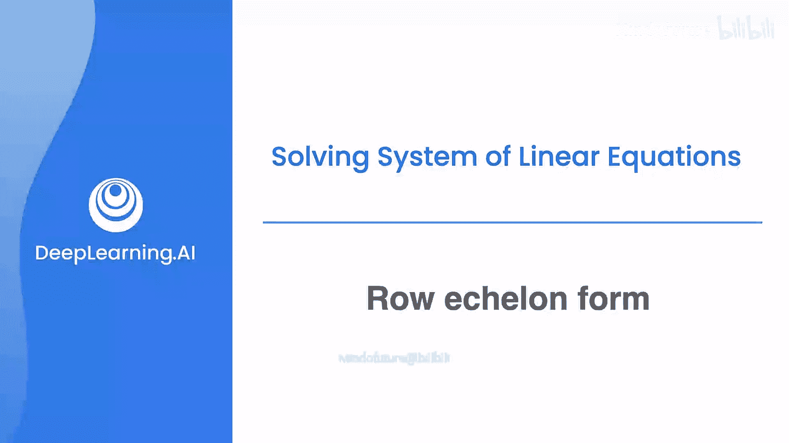
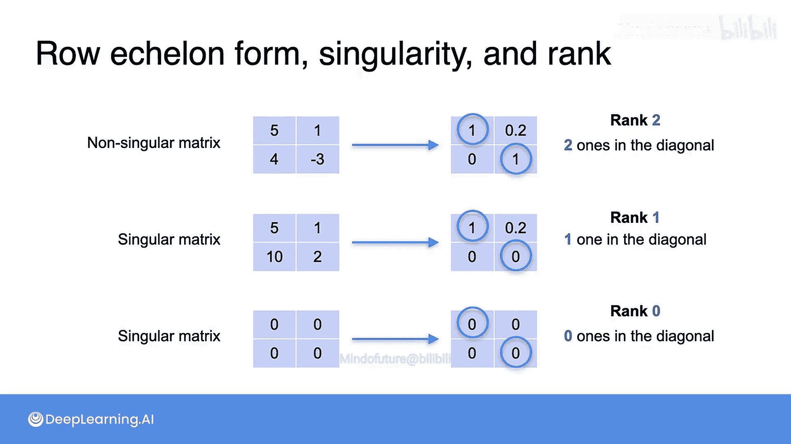

# 【Deeplearning】吴恩达：机器学习和数据科学线性代数1 ｜ Machine Learning Linear Algebra p22 P22_行阶梯形_02_02_03 -BV1Pp6VBjE29_p22-

In the previous videos you learn one particular form of a matrix called row Echeulent form This gives you lots of information about the matrix and it can be obtained with simple row operations So in this video you'll see this more in detail recall from previous videos that the row echeulent forms of these three matrices are the ones in the right however。

 previously we use the systems of equations to find them now you can simply use the row operations you've learned。

Follow me along to see how to do this in order to calculate the rhtum form for this matrix with entries 5。

1，4 and minus 3， here's what you would do。The idea is to get rid of that four in the bottom left。

So first divide each row by the leftmost non zero coefficient to get the matrix with entries 1， 0。2。

1 and minus 0。75。Now， in order to remove that bottom left one， keep the first row the same。

 but subtract the first row from the second row。To obtain the row with entries 0 and minus 0。95。

We have succeeded at getting a0 in the bottom left corner。

 which is what we wanted Now as a final step， divide the second row by the left must non zero coefficient in order to get a one on the bottom right corner and now the matrixes in row s shallum form。

And what if you do this for a singular matrix， well if you try it for this matrix with entries 5，1。

10 and 2， let's see what happens。 The first step is to divide each row by the left most coefficient。

 so you get the matrix with entries 10。21 and 0。2 Now in order to disappear that bottom left 1。

What you can do is take the bottom row， subtract the top row。And what you get is0，0。

 so now that's the new bottom row。And now let's see what happens when you try to divide the second row by the left most non0ro coefficient。

 well that's impossible because you be dividing 0 by0 which is undefined so that's no problem What you do is you let this one be the row form instead。

And finally for the very singular matrix entry 000。

 there's not a lot you can do because you cannot divide each row by the maximum of coefficients。

 those are zero， so instead you just say this is the rhish form。In summary。

 here are the matrices and here are the row echeome forms。

 so here is a very interesting connection with rank。Look at the first one。

 it has two ones in the diagonal， and it happened to have ranked two。

The next one has one one in the diagonal and it happened to have rank one。

And the third one has zero once in the diagonal and it happened to have rank zero。

 so that's actually the connection， the rank of a matrix is the number of ones in the diagonal of the row echeilome form that's an easy way to calculate the rank。

Notice furthermore that the first one is non singular。

 the second one is singular and the third one is singular， So a matrix is singular。

 even and only if the row echeent form has only ones and no zeros。

