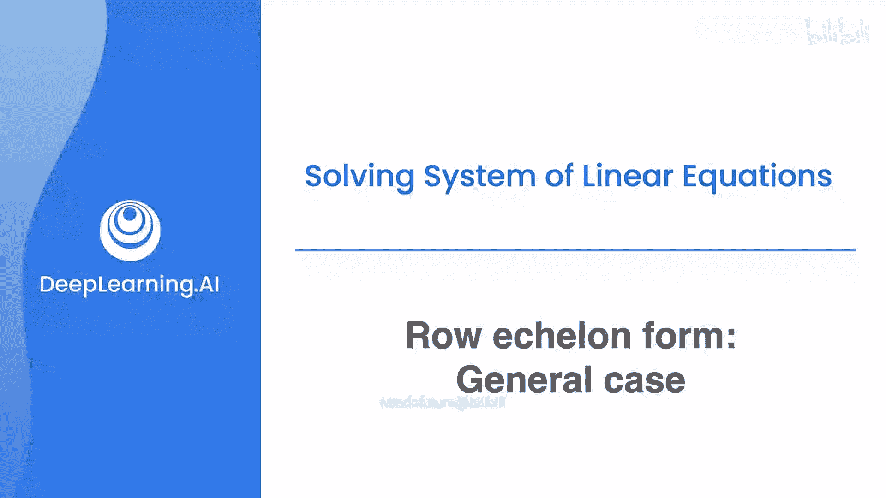
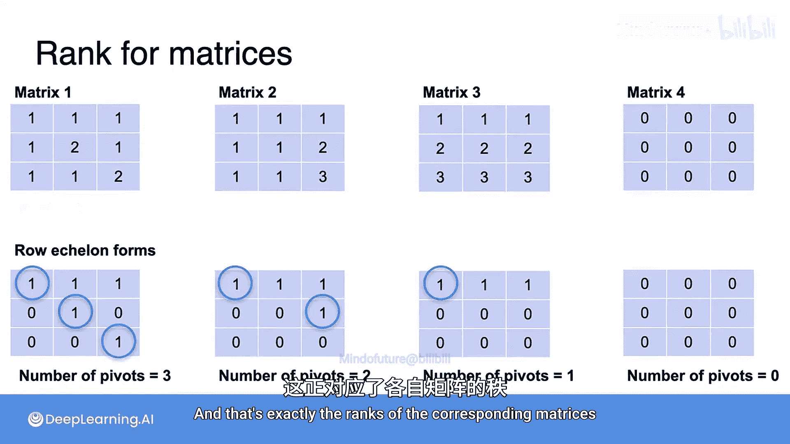

# 【Deeplearning】吴恩达：机器学习和数据科学线性代数1 ｜ Machine Learning Linear Algebra p23 P23_一般行阶梯形_02_02_04 -BV1Pp6VBjE29_p23-

Now that you've seen Roul and form for 2 by2 matrices。

 let me show you what it is for bigger matrices。Recall this system of equations and recall that the process you took to solve it was this intermediate step over here where the first equation has variables A B and C。

 the second one only has variable B and C， and the third one only has variable C。

The exact same row operations can be done in the matrix corresponding to the system in order to get the matrix on the right。

 which now has ones in the diagonal and zeros underneath the diagonal。

This is the rh form of the matrix。Now this is the way a Roalform matrix looks like in general。

 here are two different examples。And in here， the stars represent numbers that could be zero or non zero。

 it doesn't matter。So the matrix may or may not have rows full of zeros， however， if it does。

 they need to go at the bottom。Furthermore， notice that every row that is nonze has a leftmost nonze entry。

So these are called the pivots， so every row has a particular pivot。

And there's a rule about pivots which said that every pivot has to be strictly to the right of the pivots of the row above。

So in other words， if you standard at a pivot and you look at all the pivots above。

 they all need to be strictly to its left。Now the ro chill form as you saw before is very useful to tell you the rank of a matrix。

 it's actually the number of pivots， so the matrix on the left has rank 5 and the matrix on the right has rank 3。

Now here's a very important note in terms of notation that we're going to use in this class on the left you see a rh 4 matrix now you could do some cosmetics and divide the first row by 3 the second one by1 or living the same and the third one by minus4 to get a matrix that looks like this obviously the stars are now different values but the important thing is that the pivots are now one and they're in the same location because dividing by a number one turn a0 into a non0 or a non0 into a0。

So in most textbooks， the form is the one on the left。

 so in general P's different than one are allowed， however。

 for this class we are going to use the form in the right。

So we're going to take that extra step of dividing by the leading entry in the pivot。

In order to get the pivots to be one， this makes no mathematical difference。In terms of rank。

 it's the same rank， and it's more consistent with the way we are solving our system of equations by dividing by the leading coefficient。

 but this is definitely something to keep in mind。So here are some other examples of rh and Formso matrices and the matrix over here that you've seen before can be reduced to this one by simply subtracting the first row from the second row and third row。

Notice that the one on the right is in rotation form。Now what the matrixes singular。

 let's try to find the rhulum form of this singular matrix over here， which you've seen before。

 first subtract the first row from the second and third ones to get this matrix over here。

Now take the second row。Multiplily by2 and subtract it from the third one。

And you get this matrix over here。And that is the rhtome form of that matrix。

Now let's find the row which form for another singular matrix that you've seen before for this matrix。

 what you can do is take the first row multiplied by two one subtracted from the second row to get this matrix。

Now you can again take the first row and multiply by3 and subtract it from the third row to get this one over here。

Now check this out just like for22 matrices， the rank of the matrix is the number of pivot ones in the rh Echelon form。

 so here we have the row Echelon forms。That we just calculated。And if you look at the pivot once。

 there's three here because Im sure it has rank three， two here。

Because the matrix has rank two and one here and zero here。

 and that's exactly the ranks of the corresponding matrices。

