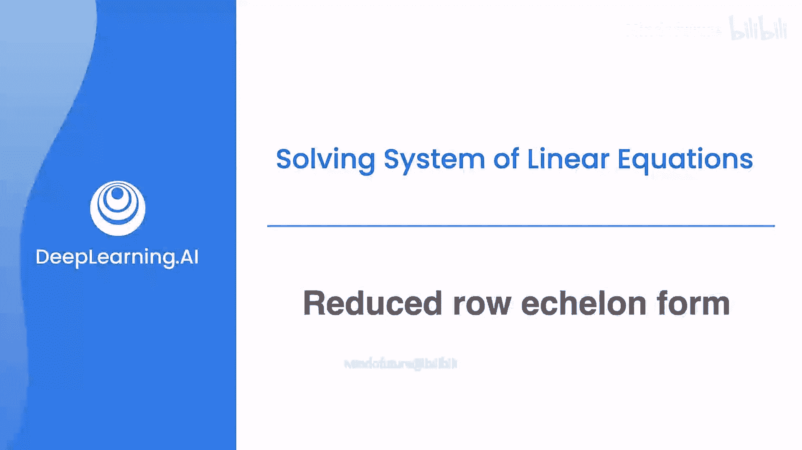
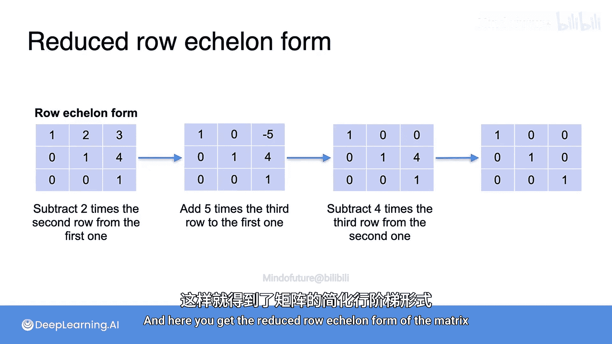

# 【Deeplearning】吴恩达：机器学习和数据科学线性代数1 ｜ Machine Learning Linear Algebra p24 P24_简化行阶梯形_02_02_05 -BV1Pp6VBjE29_p24-

So now that you've learned the row channel form， let me show you the reduced row form。

 which is just one more step。So let's say that you're solving this system 5a plus b equals 17 and 4a minus2 b equals 6。

 so recall that what you do is go through an intermediate step of removing the variable A from the bottom equation in order to calculate the value of B。

And then you went to a step of replacing the value of B in the first equation and to get the value of a。

 the solve system then has equations a equals 3 and b equals 2。

Now following the same procedure above the corresponding match of coefficients。

 forgetting about the constants 17 and 6， you go to the intermediate row echelon form with entries 1。

0。20 and1， using manipulations of the rows。And finally。

 some more manipulation will get you to the metrics with once in the diagonals and zeros everywhere else。

Why is this the matrix corresponding to the system above because you can see the system of equations equals 3 and b equals 2 as the system of equations 1 a plus 0 b equals 3 and 0 a 1 b equals 2？

From which this matrix with entries 1001 comes out。

And recall that the intermediate matrix is called the rh form。

 and the final one is called a reduced row is form。

 this is the one corresponding to the solve of the system。

And the way to get from the raw form for matrix to the reduced rationalche form is simply to use each one in the diagonal to disappear all the non0 entries above。

 for example， here you' like to get rid of that pesky 0。2 at the top right。So in this case。

 you can leave the bottom row untouched and from the first row， you subtract 0。

2 times the second row。So you get zero comm 0。2， subtract it from the first row and get the row 10。

 that's your new row1 of the matrix， and that's the reduced row form。

The way I reduce raw echeome form matrix in general is this one here are two examples。

 The first rule is that it has to be in row echeome form Furthermore， each pivot has to be a1。

And any number above the pivot has to be a0。So that's the main difference that the numbers above the pivots have to be zero and a nice property that it has is the same as the rh form property。

 which is that the rank of the matrix is actually a number of pivots。

 so this one on the left has rank  five and the one on the right has rank 3。

And here is the general method to go from a rowome form matrix to a reduced rowome form。

 Let's say you have one over here where these are the pivots and they're allowed to be not ones。

 And remember that for this course where' using a rowome form where the pivots are one but if you were to not have ones that's no problem you can just divide each row by the leading coefficient So the first one by3。

 the second one by 2 and the third one by minus-4 to get this matrix on the right where the pivots are1 and now all you have to do to get to the reduced rowome form is to use each one2 clear out any number above it。

 So for example， if above the one you have a5 all you do is multiply by5 the row the one and subtract it from the previous one。

And so here's a small example， let's say that this is the row Xome form of the matrix and we're going to turn that into a reduced row eome form。

 the first thing is to get rid of that two in the first row。And for that。

 we can subtract two times the second row from the first one to get rid of that。

 and that changed some numbers around， but at least it turned that into a zero。

Now let's get rid of that minus5， so take the third row。

 multiply by 5 and add it to the first row so that gets rid of that minus5 now to get rid of that4。

 take the third row and subtract it from the first one after multiplying it by 4 so multiply by 4 subtracted from the first one and here you get the reduced row eome form of the matrix。

