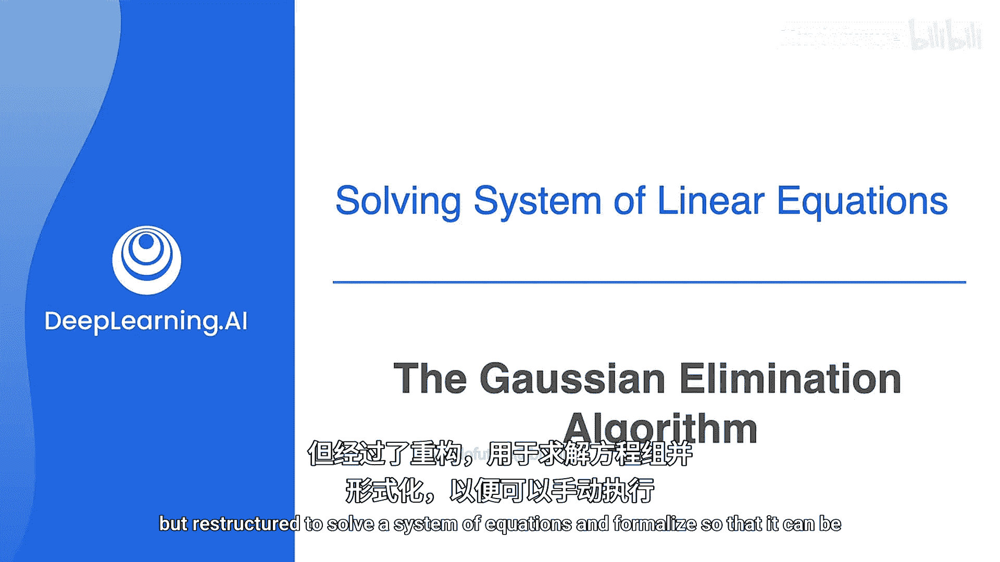
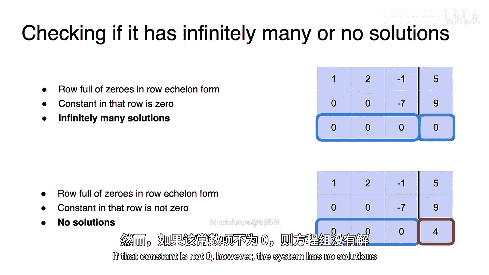
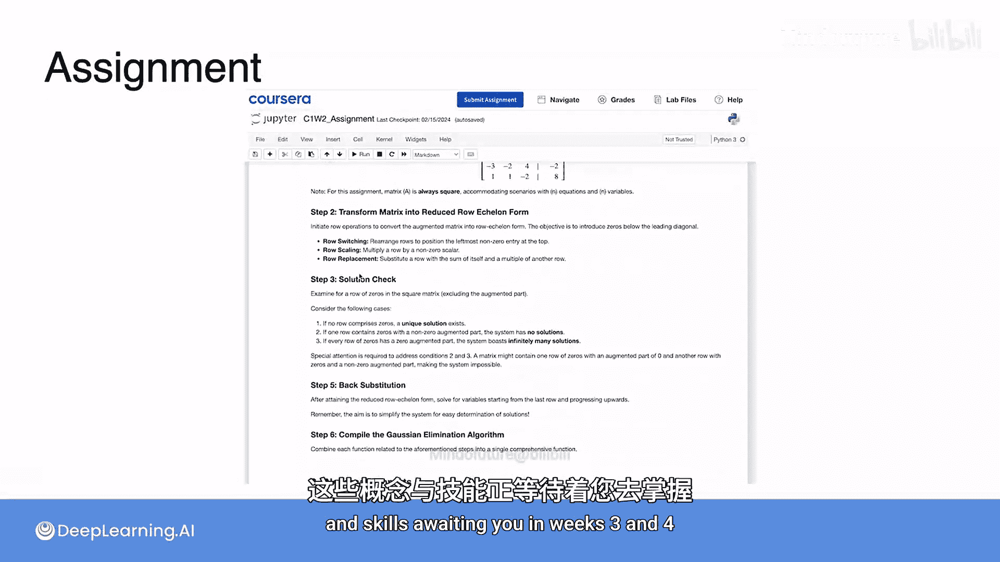

# 【Deeplearning】吴恩达：机器学习和数据科学线性代数1 ｜ Machine Learning Linear Algebra p25 P25_高斯消元法_02_02_06 -BV1Pp6VBjE29_p25-

Now you're ready to learn a very famous and classic algorithm called Gaussian Elilimination。

You will see that this is just the elimination method you studied before。

 but restructured to solve a system of equations and formalized so that it can be followed by hand or implemented in code。

 recall that when you learn about the singularity of a matrix。

 you ignore the constant values on the right hand side of your equations。

 Those equations have constants 1-2 and -1。 but you treated them as though they were just 0。

 to actually solve a system of equations， you will now need to pay attention to them。

 Here's how it's done。

To begin， make a matrix of the coefficients in your system of equations， just as you always have。Now。

 add another column to the right side of your matrix， which holds the constant values 1，-2 and -1。

 This is called the augmented matrix。 The vertical line is used to separate the constants。

 So you remember they are not part of the variables。 And now。

 if you proceed with the elimination method as normal。

 you can use the augmented matrix to solve your system of equations。

Re callll it to complete the elimination method， you'll repeatedly find an element called a pivot on the diagonal of the matrix。

To start， you'll select the top left cell as your pivot。

 Your first task will be to use row operations to set your pivot to one。 Next。

 you'll use row operations to set all the values below your pivot to 0。

 You then repeat the process row by row using row operations to simplify the matrix down to the reduced row echeulline form。

 Whatever row operations you perform on the matrix will also be applied to the column of constants you included to form the augmented matrix。

 As you see， they'll eventually help us solve the system of equations。

 So this is the high level overview。 Now， let's see how this process actually works。To start。

 you'll need to turn the pivot from the first row into a one。 Since the pivot is currently at2。

 multiply the row by one half。 After the row operation， the pivot is now a1。

 and every other value in the row is also divided by 2。

 replaceplace r one with the updated row you just calculated。

Notice that even the constant on the right hand side was also changed and is now one half。

 Remember that this matrix represent the system of equations you started with。

 So let me also update the system of equations to match what's in the matrix。 Remember that next。

 you want to set all the values below the pivot to 0 using row operations。

 I'll start with this two in row 2。 This is the row operation I'll use to update row 2。

 And hopefully you can see why the pivot is 1， and the value you want to cancel is 2。

 If you subtract two times row 1 from this row 2， you will be left with a 0 below the pivot。

 Just like you want。Compleing this row operation will leave you with a new row 0，3，3，-3。

 which I'll use to update row 2 in a moment。Next， you'll need to cancel out these four in row 3。

Again， since the pivot is a1， it's straightforward to choose the row operation to do this。

 You can just subtract four times row 1 from row 3 to cancel out the pivot。

 completinging this row operation results in this new set of values for row 3。Great。

 now the first column is done。I'll update the system of equations to reflect the changes in the matrix。

 notice that the first column is a one followed by two zeros。

So you're ready to move on to the second column and the second pivot。Moving along the diagonal。

 your new pivot is this3， just as before， you need to set the pivot to one and then set the values below your pivot to 0。

Since the new pivot is a3， multiply the row by1/ third to set the pivot to one。This works out。

 as follows。And once again， update the system of equations。 Now。

 you'll need to turn the second element of the third row into 0。 Once again。

 it seems to come up with a new row operation to do this since your pivot is already a1。

 subtracting three times row 2 from row 3 will cancel out 3 and leave you with a 0。

 completing this row operation will give you the new row，0，0-5 a 0。Once again。

 I'll update the system of equations to match the new values in the matrix。

You're almost done make the minus5 along the diagonal your final pivot。As before。

 you will need to set the pivot to1 so divide the third row by minus5。

 the final values for row 3 will therefore be 0010 and once again， update the system of equations。

Note that the matrix is in raw hent form， the diagonal is all once and below the diagonal there is only zeros。

The row operations performed in the matrix have also changed the values of the constants。

 and this is where you'll use the information in that column to actually solve the system of equations through a process called back substitution。

Here's what back substitution looks like。 You will start from the bottom row and work your weight to the top。

 You'll use the pivot from each row to cancel the values in the cells above it。

 This process actually looks very similar to creating the pivots in the first place。

So start with the pivot in the last row and start by canceling out the one above it。 The pivot is a1。

 and you need to cancel out a 1， so the row operation will be row 2 minus row 3。

 After this row operation， the new values for row 2 will therefore be 0，1，0 minus-1。 Next。

 cancel out this one half and row 1。The row operation you need this time is row 1-1 half times row 3。

Completing this row operation gives new values for row1 of 1，-1/ half，0 and12。

 Now you get the following matrix with this updated system of equations。 Finally。

 repeat the process and use the pivot in the second row to create zeros in the rows above。

 In this case， you will add one half of row 2 to row 1 as follows。And you're done。

 you get this matrix over here。Notice that you've got a matrix that has all ones in the diagonal and zeros on all other positions。

I will update the system of equations one more time to represent the matrix。

 and you see that you now have a solution to the system where a equals 0， B equals -1 and C equals 0。

Note that the square part of the augmented matrix has only once in the diagonal。

 Such a matrix is called the identity matrix。 and by simplifying the matrix to this form using Gaussian elimination。

 you have solved the original system of equations。Now let's talk about the singular case Will Gausian elimination work if the matrix is singular。

 well you already know that if the matrix is singular， then in reduced rhish form。

 you will have a row that is all zeros。There's no need to worry once you get here。

 the algorithm just stops， the whole point of Gaussian elimination is to find solutions to a system of equations。

If you find a row of zeros， however， you know your matrix is singular and there is no solution。

That said， you can still determine if your matrix is contradictory and has no solutions or if it has infinitely many solutions。

To do that， you just need to look at the column of constants。

 If the constant value in the row of 0 is also 0， the row just says 0 a plus 0， B plus 0， c equals 0。

No matter what values you choose for A， B and C， the left side will always equal 0 and this equation will be true。

So the system has infinitely many solutions。What if the system of equations change slightly so that the third equation equals 10？

Well， after row reduction， you get the following matrix with the constant value in the third row changing to a 4。

 Now， the last row states that 0 a plus 0 B plus 0 c equals 4。

 no matter what values of A B and C you choose， the left side of this equation will equal 0。

 but the right side equals 4。 This means that the system has no possible solutions。To recap。

 if you find a full row of zeros in relational form and the constant in that row is 0。

 then the system has infinitely many solutions。 If that constant is not zero， however。

 the system has no solution。

And here's a recap of the whole process of Gaussian elimination。

 You first create the augmented matrix by adding the constants to a new column on the right。Next。

 get the matrix in the reduce raw echelon form。And finally。

 complete back substitution to find the values of your variables。

If you ever encounter a row of zeros， stop as the system is singular。

 you'll have more opportunities to study this in the coming assignment。Okay。

 that brings us to the end of the lecture for this week。After this。

 you'll have a graded quiz and a programming assignment。

 The quiz covers all the topics you learned this week。

 The programming assignment is designed to guide you through actually implementing the Gaussian elimination algorithm。

 Think of this assignment as a capstone to everything you've learned about systems of equations and how to solve them through the first half of the course。

 It's also a great opportunity to hone your skills with a nuie library which you'll be using in the coming weeks。

 This is definitely the most math focused assignment in the course。

 and it helps prepare you for the machine learning focused applications of these concepts and skills awaiting you in Wix 3 and 4。

 Good luck。😊。

