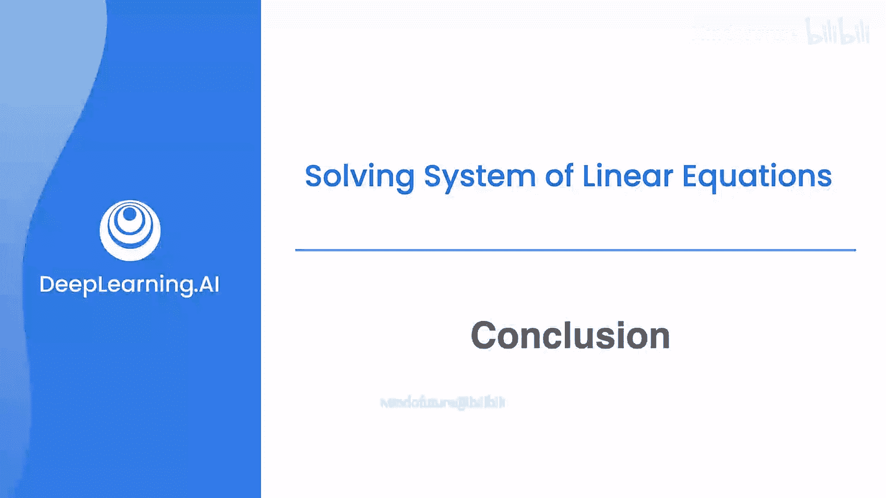
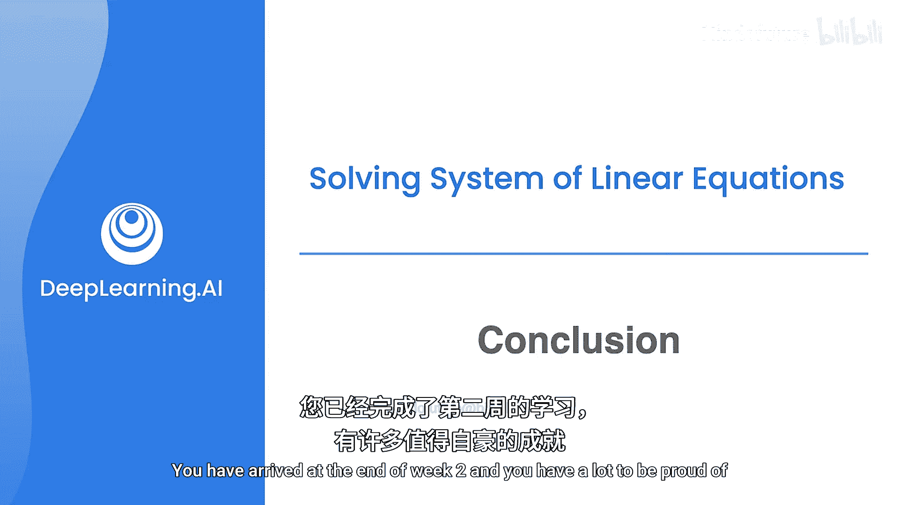

# 【Deeplearning】吴恩达：机器学习和数据科学线性代数1 ｜ Machine Learning Linear Algebra p26 P26_总结_02_04_01 -BV1Pp6VBjE29_p26-

You have arrived at the end of week2 and you have a lot to be proud of this week you build from your week one understanding of solving two by two and three by three systems of linear equations to zooming into the properties of matrices you can now comfortably solve systems of equations by translating into matrices and conducting raw operations to find a solution in a simple yet fast way。

Equivalently， you learn how to turn matrices into the row echeulome forms and their further simplification。

 the row reduced echeome form。From here， you learn how to extract all the possible information of a matrix。

 including the singularularity or non-singularity， the determinant， the rank。

 the solutions to its corresponding systems of equations， and its graphical representation。

We've covered quite a few concept this week。Follow along with me for an exciting journey to week three。

 where you'll learn about vectors， dot products， matrix multiplication， linear transformations。

 and much more。