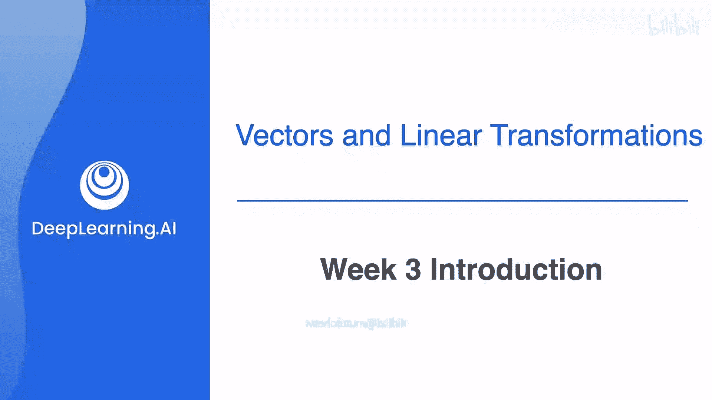
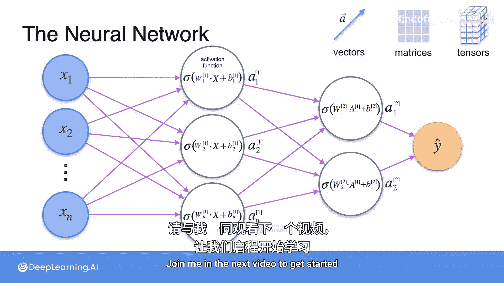

# 【Deeplearning】吴恩达：机器学习和数据科学线性代数1 ｜ Machine Learning Linear Algebra p27 P27_机器学习动机_03_01_01 -BV1Pp6VBjE29_p27-

Welcome to week3， the main topics for this week are vectors and matrix and some other properties such as the size and direction of a vector you will also learn many operations you can apply in them。

See in a way vectors and mates are a lot like numbers， numbers can be added， multiplied， divided。

 and many of these operations can be propagated into vectors and matrices， for example。

 one can think of the sum of two vectors， the product of two vectors or the product of two matrices or the product of a vector and a matrix。

Furthermore， just like you can find the multiplicative universeverse of a number， for example。

 the inverse of 2 is12， you can also find the multiplicative universe of a matrix that is under some conditions that you'll see。

 but actually you've seen before。You'll see throughout the week that matrices and vectors are essential in any kind of data。

Another very important concept you learned this week is a concept of a linear transformation Linear transformations are a very。

 very special way to visualize matrices graphically。

 and one that can make many concepts much more clear。

 but before diving into all of that let's take a look at how these concepts appear in machine learning。

At the start of week1， we looked at linear regressiong as an example of a machine learning modeling situation where you treat your dataset set as a system of linear equations。

As a reminder， the way that worked was that you have a dataset made up of some set of features you called x1。

 x2 all the way up to Xn， and then you had multiple examples in your dataset so you had multiple rows of x's in your feature matrix like this。

And you had a superscript along each road denoting the number of each example。

 and then you had a vector of targets or y values， and the idea with linear regression is that you come up with a set of weights。

 W1， W2 and so on up to WN。One for each X feature， as well as a bias value that allows you to characterize this dataset set as a system of linear equations。

And then to simplify this expression， I can just write a capital W to denote the vector of w values and a capital x to den this matrix of x values and add a B to that and set all that equal to y hat to represent the vector of target values and just like that you're back to the simple equation of a line and of course。

 if you're a linear algebra x already， you may notice that I might be missing a transpose on the w or x here depending on how I've set up these vectors and matrixrices。

But I'm not going to worry about that for the moment。So of course。

 real world data sets are not typically the kind of systems of equations that you can solve analytically。

 like you were doing in last week's materials。But your assumption that this dataset could be approximated as a system of linear equations turns out to be a reasonable one。

 then machine learning will allow you to solve this system in an iterative fashion and make predictions of your target y for any new set of x values。

It turns out， however， that you can only get so far by approximating real world data sets with linear models because in many cases the relationship between features and targets is nonlinear one of the most powerful machine learning models for representing nonlinear systems is the neural network。

And one of the most amazing things about neural networks is that under the hood。

 they're really just a large collection of linear models you might have seen neural networks represented like this with these vertically oriented layers。

 socalled artificial neurons that are all connected with lines like this。

And the way you can think of what this diagram represents is that you have this layer on the left representing your input to the network。

 which are your features， so x1， x2 and so on up to Xn like you had before。

 and I'm going to write this vertically this time inside these notes in the input layer of the network。

And then what these lines are indicating is that you're going to send all those x values to each one of the individual neurons in the next layer。

So for example， all these x's go to the first neuron and that neuron has a vector of w values and a b value associated with it。

 so you can write what's going on up here in this first neuron as your W vector times your matrix of x features plus the b value。

 so you have a linear model just like before in fact you have a whole system of linear equations。

 but now it's all containing this one little neuron。And just like before。

 I can represent the system of linear equations inside this neuron as capital W times capital x plus b and now something you don't need to worry about。

 but that I'll mention just for completeness is that what's really going to happen up here in this neuron is that you're sh this whole Wx plus B expression into something called an activation function and that activation function generate some output that here I'll just call a which is another vector and then each of these neurons in the layer does that exact same thing but with a different set of weights and biases in each case and generate their own output a vector and just to be clear that each of these neurons is unique I am going to add subscripts to all the Ws and b's and A's where the subscript1 means you're in this first neuron at the top and similarly on the way down。

And of course， the matrix of x values you' are passing through each neuron is the same in each case。

 so that doesn't need any subscript。 And as if we didn't have enough notation already。

 I'm going to add a little superscript 1 in square brackets up here to denote that these operations are happening in the first layer of the network。

 and that's because what happens next is that you pass these a values to the next layer and the process happens all over again。

 Now in the second layer， the inputs are your a values from the first layer So the linear model in the second layer here looks the same except that instead of x's。

 you have A's And just to be clear， these a superscript ones are now matrix containing all the a vectors from the previous layer。

 these a1 a2 and so on to AN。And you're multiplying those by a whole new set of weights and adding a different bias value in each case。

So everything else， the Ws and b's and the new A values you generate get a superscript square brackets2 to indicate their part of the second layer。

 then this all repeats as you propagate forward to each of the layers of the network multiplying the outputs of the previous layer by a set of weights。

 adding a biased term， and applying an activation function until you get to your final output。

Now this may all sound pretty complicated， but I wanted to walk through this in a bit of detail so you can see how systems of linear equations are a core component of neural networks。

If you want to understand all the stuff in detail， I will again recommend the machine learning specialization by deep learning AI。

 but here in this course， the point is not to worry about all the intricate details of how neural network functions。

 Qui the opposite。 The point here is that there's nothing particularly fancy going on inside these neural network。

 It's really just a large collection of linear models that take together can work to model highly nonlinear systems。

Instead of writing down a zillient little linear equations to represent a neural network。

 you will instead represent the inputs and outputs of each layer as vectors， matrices and。Tensrs。

Which spoiler alert are just like higher dimensional mats。

You will apply linear algebra to operate on those vectors。

 matrices and tensors and compute your machine learning results this week。

 similar to the last two weeks， if you have studied linear algebra before。

 you might be familiar with some of the concepts we're going to cover this week。

 take a look at the KnowA check in the next reading item and if you can easily answer all the questions then congratulations you're ready to move on to the assessments at the end of the week and if you're not sure how to answer any or all of those questions。

 then also congratulations you're in the right place Jo me in the next video to get started。

