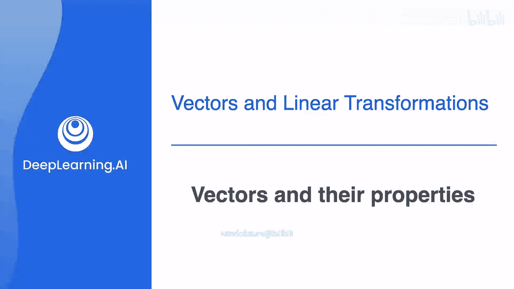
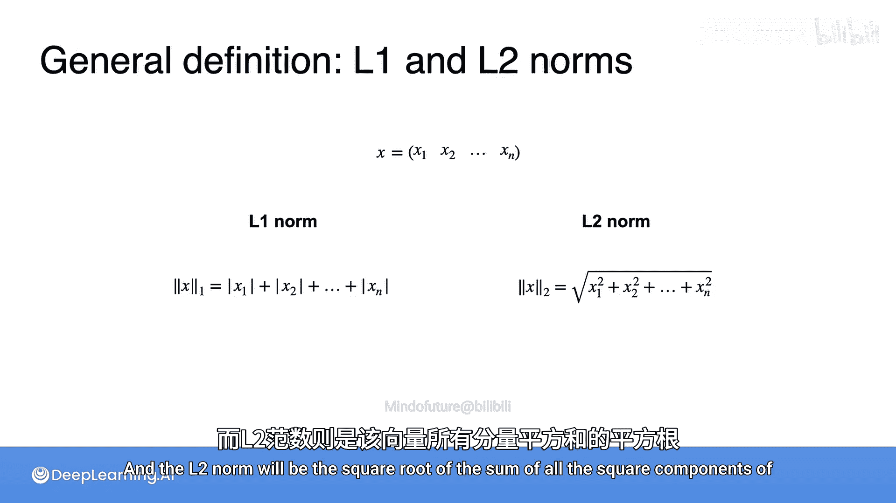

# 【Deeplearning】吴恩达：机器学习和数据科学线性代数1 ｜ Machine Learning Linear Algebra p28 P28_向量及其性质_03_01_03 -BV1Pp6VBjE29_p28-

In the previous weeks you've learned matrices as a array of numbers。

 a vector is a simpler array of number， one that only has one column。

 it turns out that vectors can be seen as arrows in the plane or in a higher dimensional space。

Two very important components of vectors are their magnitude， namely their size and their direction。

This is what you'll learn next。A vector is simply a tu of numbers it could be two numbers。

 three numbers， anything the number of coordinates in the vector is the dimension of the spa in which it leaves。

 for example， the vector with coordinates 43 leaves in the plane and is preciselyarrow that points at the point with horizontal coordinate 4 and vertical coordinate 3。

You can have vector space of higher dimensions， for example， in 3D。

 the vector which coordinates 431 lives in this space and is the arrow pointing at the point which coordinates 4。

3， and 1 with respect to the axis x， Y， and z。A vector has two very important components。

 the magnitude or size， and the direction which I will show you next。

The magnitude size of the vector can be defined in several ways。

 but the great news is that all of them emulate the distances you use in real life。

The first way to measure distance is imagine that you live in a city with lots of buildings and blocks formed by streets that are either horizontal or vertical。

 you need to go from home to the store but you can only go on the streets。Therefore。

 the distance between points say there are four blocks horizontally and three blocks vertically between your house and the store is the sum 4 plus 3。

This is called a taxiab distance and no matter what route you take。

 you will always end up at a distance of seven blocks。

The other way you can go to the store is to forget your car and actually hop into a helicopter。

 the helicopter doesn't need to follow the streets or corners and it can simply fly directly。

 the best you can do with a helicopter is the square root of3 squared plus4 squared which is precisely5 This is because of the Pythagoreian theorem that takes at the length of the hypotenus in a right triangle is the square root of the sum of the squares of both sides Now why these distances because both give us ways to find the size of the vector with coordinates AB。

 The first one， the L1 norm is defined as the taxiicab distance between the origin and the point AB。

 which is precisely sum of the absolute values of A and。

 Y absolute values because Amb can be positive or negative but the distance to walk is always positive。

The second measure on the size of vector is theL2 norm defined by the helicopter distance between the origin and the point AB。

 as you've seen this is the square root of the sums of the squares of the coordinates。By default。

 when you specify with node to use we are using the L2 norm。

 the reason is that it's the more natural one because precisely it is the length。Of the arrow。

 the direction of a vector can also be deduced from its coordinates。 For example。

 for this vector with coordinates 43， if the angle with the horizontal axis is theta。

 then the tangent of theta is precisely 3 over 4。 This means that theta is the arc 10 or the inverse tangent of 3 quarters。

 That is 0。64 in radance。 Or if you prefer，36。87 degrees。

 vectors can have different norms while pointing in the same direction。 For example。

 notice that the vector 21。5， pointing the same direction as the vector 43。

 while having a smaller norm。There are many notations for referring to vectors。

 some of which you'll see in this course and others that you may see in textbooks or resources you find online。

Let's show many ways of representing a vector simply called X。

Vectctorors can be written horizontally as row vectors or vertically as column vectors。

The components of a vector are numbered with subscripts。

 so the second component in X is called x2 In other resources you may see vector names written with a little arrow or em bold font to color out that they're a vector。

 but in this course I'll just stick the plain old X。

Vectctors can also be written with square brackets instead of parentheses。

 Square brackets can sometimes be a helpful reminder that a vector is part of a matrix or is simply a small skinny matrix。

 but there is absolutely no conceptual difference between these notations。

 you'll see both parenthesesis and brackets used in this course depending on context。

 So let's use that vector notation to generalize the definition of the L1 and L2 norms to any vector with n total components。

 In general， the L1 norm will be the sum of the absolute values of all the components。

 and the L2 norm will be the square root of the sum of all the square components of the vector。

