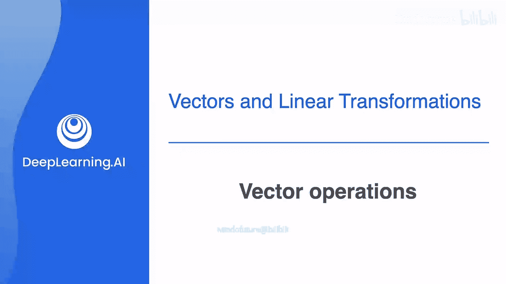
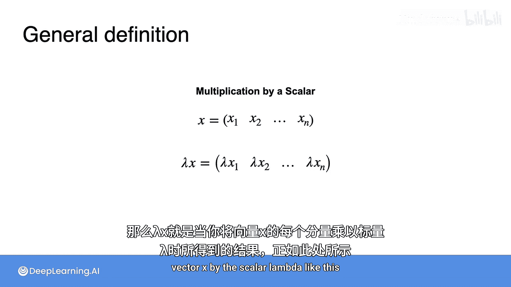

# 【Deeplearning】吴恩达：机器学习和数据科学线性代数1 ｜ Machine Learning Linear Algebra p29 P29_向量运算_03_01_04 -BV1Pp6VBjE29_p29-

Just like numbers can be added and subtracted to obtain other numbers。

 vectors can also be added and subtracted to obtain other vectors。

 and this can be done in a very natural way， here it is。If you'd like to add two vectors。

 for example， the vectors U with coordinates 41 and v with coordinates 13。

 all you've got to do is add the coordinates to get the vector 54。

Now this is a nice geometric interpretation， the sum vector is precisely diagonal in a parallelogram formed by the vectors U and V。

Something similar happens with the difference， except with the other diagonal of the parallelogram。

 so the difference between the vectors 1，3 and 41 is also taking component wise to be 3 minus2。

That is this vector over here， which doesn't look like anything special except if you were to translate it。

 it matches precisely with the vector obtained by joining the points 1，3 and 41。

 Here is the general case definition for the sum and difference of vectors。

 Suppose you have two vectors x and y。The sum can be expressed as a sum component by component。

 This means that the first component of the new vector will be the sum of the first component of x and the first component of y and so on。

 notice that with this definition， x and y must have the same number of components。 Similarlyly。

 the difference between two vectors is defined as the component y is difference。

The difference between two vectors is helpful to tell how far apart two vectors are from each other。

 for example， how different is the vector 15 from the vector 62。

 one way to tell is by the L1 distance or the L1 norm of their difference。

 this is the sum of the absolute values of the components。

which is 8 Another way to tell is by the L2 distance or the L2 normal their difference which in this case is 5。

83 in machine learning is very useful to know distances between vectors because many times you want to calculate different similarities between data points and these measures are very useful。

Another very useful and simple operation you can do on vectors is multipplied them by a scalar。

 for example， if the vector is 12 and you like to multiply it by the scalar lambda equals 3。

 then the result is the element wise product that means you multiply each of the elements of the vector by 3 to obtain the vector 36。

Graphically means you stretch the vector 12 by a factor of  three。

What if the scalar is negative no problem what happens here is that the vector gets again stretched by the factor but also reflected about the origin。

 so for example if the vector is again 12 and the scalar is minus2。

 then the product of the scalar time the vector is minus2 minus4。

 which also corresponds to the entrywise product as expected。Let's formalize the definition。

 consider once again an n dimensionsional vector x， and let lambda be a scalar。

 Then lambda x is simply what you obtain when you multiply each component of the vector x by the scalar lambda like this。

