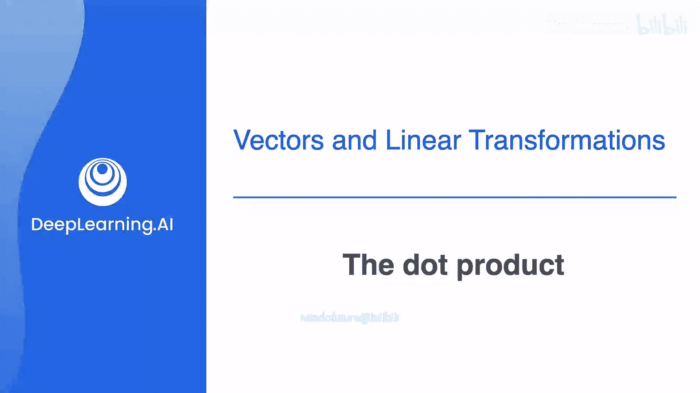
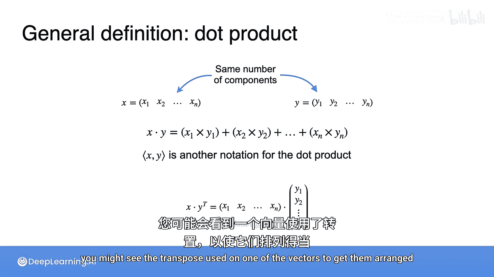

# 【Deeplearning】吴恩达：机器学习和数据科学线性代数1 ｜ Machine Learning Linear Algebra p30 P30_点积_03_01_05 -BV1Pp6VBjE29_p30-

In this video you will learn a very nice and compact way to express systems of linear equations using matrices and vectors called a dot product。

 The dot product is a very important operational linear algebra。

 In fact you've already learned the dot product， but here you will learn it formally。

This is how it works。So imagine that you have the following problem， you buy some fruit。

 let's say two apples for bananas and one cherry， and each apple costs 3。

 each banana costs $5 and each cherry costs $2 and the question is how much does everything costs？

So that's an easy problem， but the point is the way to express it。

The way to express the number of fruits is using a vector， which is simply a column of numbers 2。

4 and1。That's the amount of fruits we bought of each。

And the prices can also be expressed as the vector with entries 3，5 and 2。

 that's the price of each of the fruits。In order to find the price of all the fruits。

 you can find the price of each fruit individually， namely2。Apples multiplied by three。

 which is the price of each apple to get two times  three equals $6 that's the amount of money you spent on apples。

Then you can do the same thing for bananas and get4 times5 equals 20。

And I'm the same thing for cherries， so 1 times 2 equals 2。

 so6 is the amount of money you spent on apples，2 n on bananas， and two on cherries。

And the total price of fruit is 6 plus 20 plus 2， which is 28。Now。

 what you just did was the dot product because you can abbreviate it like this。

And that means2 times 3 plus 4 times 5 plus 1 times 2 and that's 28 we can actually express it like this it's more common to have the first vector as a row and the second vector as a column and then forget about the fruits and get the dot product。

 so dot product of the vectors 241 and 352 is the sum of each corresponding pair of entries。

And that's it， the dot product is very， very often used a linear algebra。

 and next you'll see some of its uses。There's a nice connection between dot product and norm。

 let's go back to the vector it coordinates 43 whose norm was5。

And notice one thing and it's that four square plus3 square is actually the dot product of the vector in itself。

 so it's 4 times 4 plus 3 times 3 which is 25 and this is always the case the L2 norm is always the square root of the dot product between the vector and itself and sometimes you'll see it written in this notation with an angle bracket on the left and an angle bracket on the right let's go back to that operation I showed you before where the column vector was transformed into a row vector。

This is called a transpose and it essentially transforms columns into rows。

You denote the operation by a superscript T。And the result will convert this column vector into a row vector。

 you can also apply the transpose to a row vector and it works exactly in the same way。

Except now the row vector has been converted into a column vector。You can also transpose a matrix。

 Let me show you how by adding a second column。This is now a 3 by two matrix。To transpose the matrix。

 simply transpose each of the columns。First， you will get the first column of the original matrix and transpose it to get the first row of the transpose matrix。

 and then you do the same thing with the second column。Again， you are turning columns into rows。

 notice that dimensions of the matrix swap， so if you start with a 3 by2 matrix。

 its transpose will be at 2 by 3 matrix。Let's conclude by looking at the formal definition of the dot product。

Start with two vectors x and y with the same number of components。

 then the doc product is just x1 times y1 plus x2 times y2。

 and you add these products over all n components。Notice that angled brackets are another notation for the dot product。

 In some context， it is expected that the dot product has a row vector on the left and a column vector on the right。

 In those cases， you might see the transpose used on one of the vectors to get them arranged properly。

