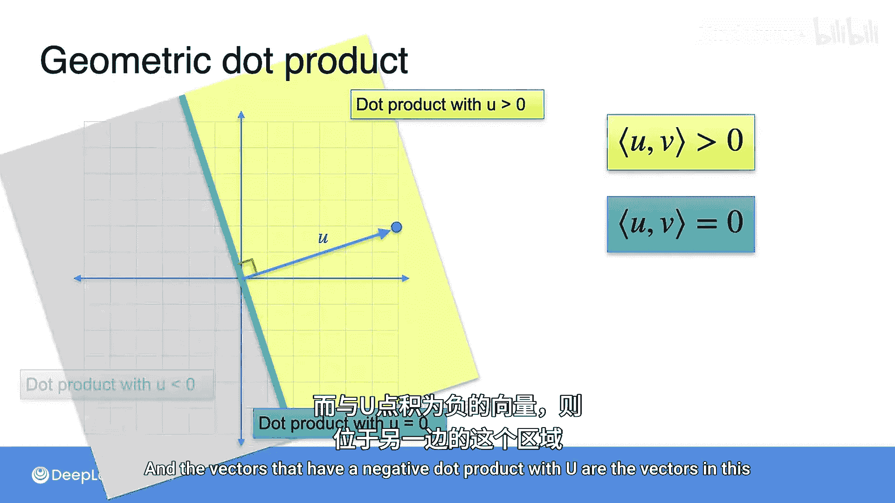

# 【Deeplearning】吴恩达：机器学习和数据科学线性代数1 ｜ Machine Learning Linear Algebra p31 P31_几何点积_03_01_06 -BV1Pp6VBjE29_p31-

As you can imagine， the angle between two vectors is very important。

 There are some nice relations between the angle and the dot product。

 which I'll show you in this video。To begin， take a look at these two perpendicular also called orthogonal vectors with entries minus 1。

3 and 62。Now take the dot product and notice that the dot product is6 times minus1 plus 2 times 3。

 which is0。This always happens， in fact， two vectors are ortho if finally their dot product is zero。

Now for a recap of whative' seen。The do between a vector itself is precisely the norm squared or the length of the vector squared；

 the do between two perpendicular or orthogonal vectors is always0。

What about the dot product between two random vectors U and V is there a nice way to write this and it turns out that there is。

 so let's look it from a slightly different way you saw the dot product to the vector itself is the norm squared over the product of the norm and itself。

The between a vector and a longer vector in the same direction is very similar it's simply the product of the two norms。

 norm V times normal V。Now what vectors have an angle in between。

 it's almost the same except you have to perpendicular project one vector onto the other one is precisely the shade that one vector leaves on the other one。

 so if this vector is u prime， then the do product between U and V is the product of the magnitude of u prime and the magnitude of V。

The interesting thing is that it doesn't matter if you project U to V or VN you。

 you still get the same dot product。An easier way to see this is this if the angle between the vectors is theta。

 then the dot product of U and V is。Magnitude of u times the magnitude of v times the cosine of the angle。

Using what you know about the dot product， you can tell if the dot product between two vectors is positive negative or0。

 for example， take a look at the vector 6 comm2。A vector perpendicular to it such as minus 13 has a dot product of 0 with the vector 62。

I actually to the right of it such as 24， for example， has that product of 20， which is positive。😊。

A actually to the left of it， such as minus41 has a do product of negative 22， which is negative。

Now why is the dot product with two comma 4 positive？Well。

 the reason is because the projection of this vector 262 has positive length。

And why is the dot product with negative 41 negative and the reason is because the projection onto the vector 6 comma 2 is negative because you have to go in the opposite direction of the vector 6 comma 2。

So therefore， the sign of the dot product of a vector。

Corresponds to being on one side or the other one of that perpendicular vector In other words。

 this happens in general， So if the vector is U， then the vectors that have dot product of 0 with U are all the perpendicular vectors to U the vectors that have a positive dot product with U are all the vectors in this region and the vectors that have a negative dot product with U are the vectors in this region over here。

