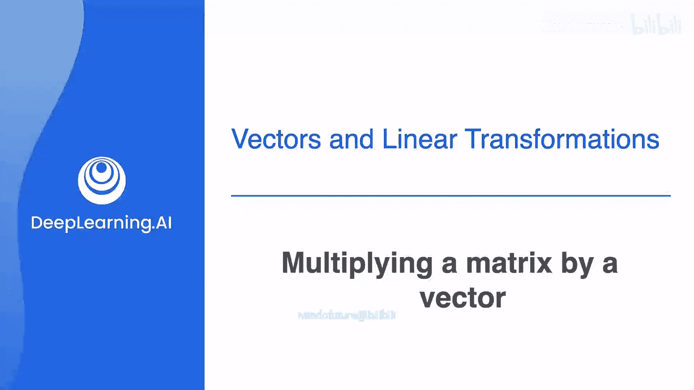
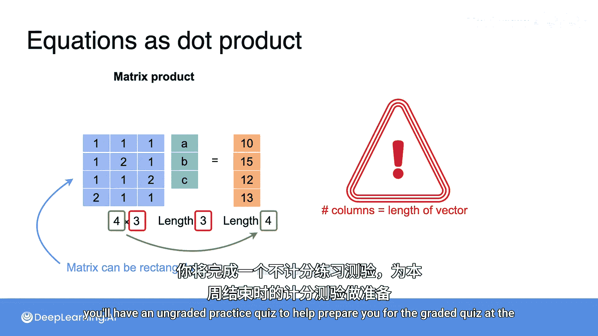
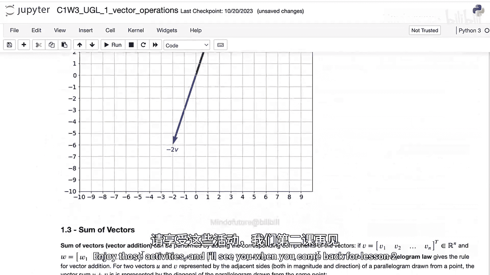

# 【Deeplearning】吴恩达：机器学习和数据科学线性代数1 ｜ Machine Learning Linear Algebra p32 P32_矩阵乘以向量_03_01_07 -BV1Pp6VBjE29_p32-

In this video you will learn how to multiply a matrix and a vector this is also something you've already learned as it is precisely how a system of linear equations looks。

😊，Here's how it works。Recall from previous videos that the dot product between two vectors is the sum of the products of the corresponding entries。

 so an equation with a known variable such as for example。

 2a+ 4b plus C equals 28 can be written as a product of the row vector with entries 241。

And a column vector with the unknown entries， A， B and C， so vectors can have variables on。

This represents an equation where the unknowns in the column vector represent the price of each of the fruits and the number in the row vector represents the amount of each fruit that you bought。

The $28 represents the do product of the two vectors。

So now imagine that you have a system of three equations with three unknowns。

Each one of these equations can be expressed as a dot product， for example。

 the first  one A plus b plus c equals 10 can be expressed as the dot product of the vector 111。

 which is the coefficients of A B and C。And the vector with the variables A B and C。

 and that's equal to 10。The equation a plus 2 b plus equals 15 can be seen as a dot product of 1，2。

1 and ABC， and that's 15。And finally， equation A plus b equals 2c can be seen as a doc product of vector 112 and the vector ABc。

 and that's equal to 12。Now it seems kind of clumsy to represent this with three different thought products is there a nicer way and the answer is yes。

 first thing we do is put them like this。So on the left we have our system of three equations and three unknown variables。

 and on the right we have three dot products。Now notice that the column vector is the same so we can simply unite the three vectors and get a matrix。

 so now we get the product of a matrix and a vector。

And the product of a matrix and a vector is nothing more than three dot products stacked together。

And if you have more equations in your system， then you have a bigger matrix， but from now on。

 we're going to be expressing systems of equations as a product of a matrix times a vector。

Note that this is a 3 by3 matrix with three rows and three columns。

 and this vector has a length of three。 the number of columns in the matrix must equal the length of the vector if they don't match。

 you are essentially trying to take the dot product of vectors with different lengths。

 which is undefined。The interesting thing， however。

 is that the matrix should be rectangular as long as these two circle dimensions match。For example。

 you could add a fourth linear equation creating a4 by three matrix and still multiply it by the vector containing the three components。

 A， B and C。 notice that the results of vector with length 4。

 which will match the number of rows in the matrix That brings us to the end of the first lesson of this week After this。

 youll have an ungraded practice quiz to help prepare you for the graded quiz at the end of the week。

There is also an und lab in which you will learn how to perform the dot product in Python using the NmPI Library。

 you'll need the skills youll learn there on the programming assignment you'll complete at the end of this week。

 enjoy those activities， and I'll see you when you come back for lesson two。

