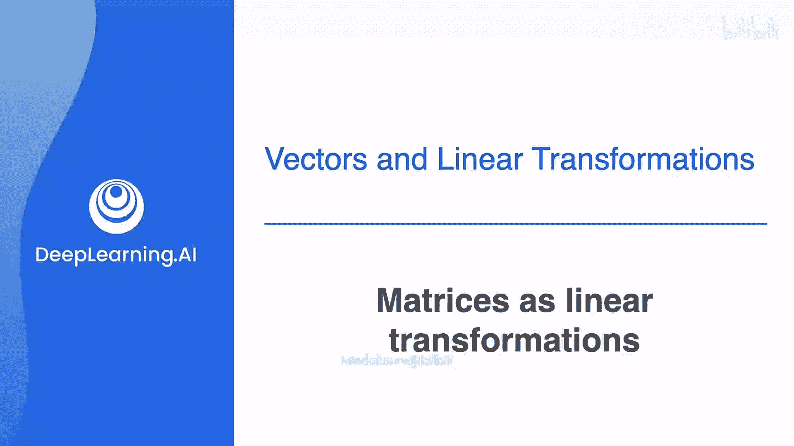
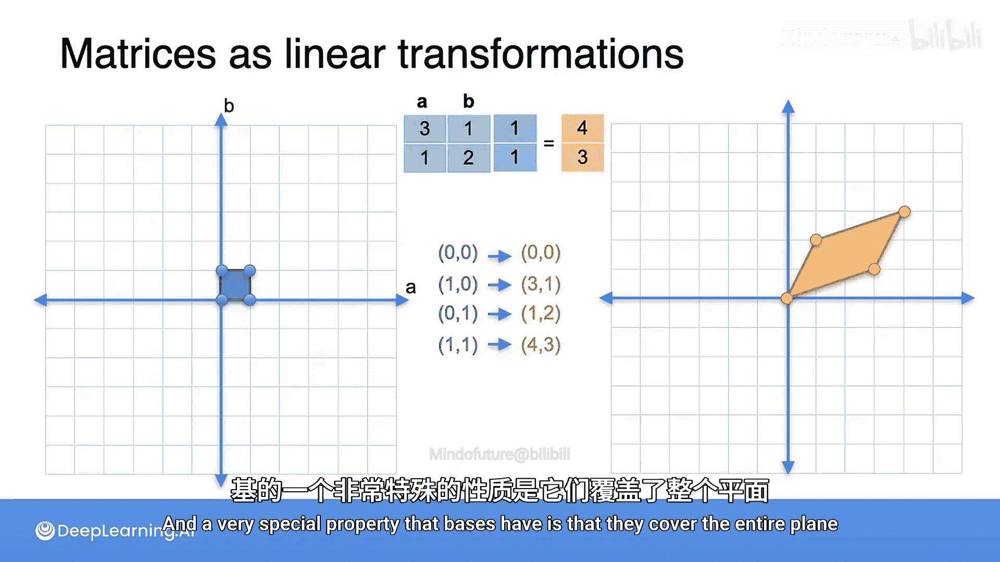
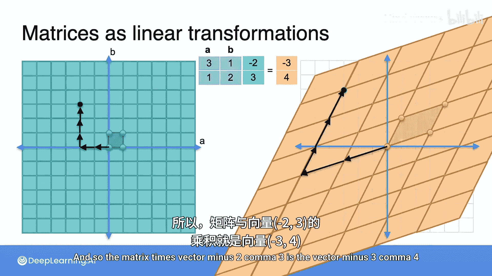

# 【Deeplearning】吴恩达：机器学习和数据科学线性代数1 ｜ Machine Learning Linear Algebra p33 P33_矩阵作为线性变换_03_02_01 -BV1Pp6VBjE29_p33-

In the previous videos， you have seen matrices as a race of numbers that represent systems of linear equations。

 but there is another very powerful and very useful representation of matrices and it is as linear transformations。

A linear transformation is a way to send each point in the plane into another point in the plane in a very structured way here I show you how。

In this video you'll see an illustration of how a matrix is a linear transformation in two dimensions。

 but I invite you to imagine it in more dimensions such as a three dimensional space， for example。

 say you have this two by two matrix of entries 3，1，1， and 2。

So here's the linear transformation it corresponds to first consider two planes with axis labeled A and B。

The transformation will send every point on the plane in the left to a point in the plane in the right in the following way。

Any point has two coordinates， those two coordinates form a column vector。

To get the vector in the right， we multiply the first vector by the matrix and whatever we get is the point in the right。

 so this will be easier with some examples first let's look at the point in the origin the point00。

That becomes the vector 00， which will multiply by the matrix， we get the vector 00。

 so 00 goes to 00。This actually always happens with linear transformation。

 the origin gets sent to the origin Now let's look at the 0。

10 so the matrix times the vector 10 gives us the vector 31 so 10 goes to 31 now let's look at 01 the matrix times 01 is equal to 12 so 01 goes to 12。

And finally， let's look at 11 matrix time the vector 11 is the vector 43， so 11 goes to 43。

 and actually this defines the entire transformation so let's look at this little square form of these four points。

 it goes to this parallelogram。The square on the left is called a basis and so is a parallelogram on the right and theyre very。

 very important concepts in linear algebra you'll know why they're called basises in a little bit and a very special property that bases have is that they cover the entire plane So actually since this square actually tesselates the whole plane and the parallelogram teslateates the whole plane as well。

 then the linear transformation is simply defined as a change of coordinates。 So for example。

 if we want to find where the point。

us 2 comma 3 goes well， the point minus 2 comma 3 on the left is obtained by starting at the origin。

 walking two blocks to the left and three blocks up。

So to find where that point goes in the linear transformation。

 we simply started the origin and walk two blocks to the left and three blocks up in these new coordinates。

And we get the point minus3 comma 4。And so the matrix times vector minus2coma 3 is the vector minus 3 comma 4。

