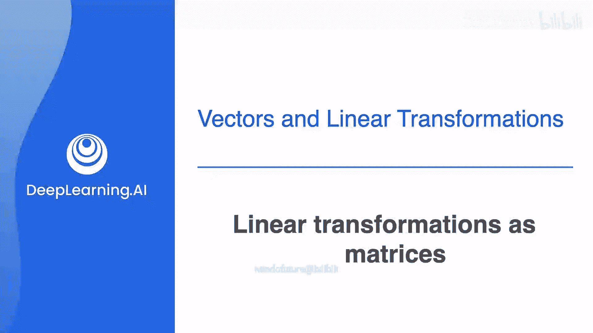
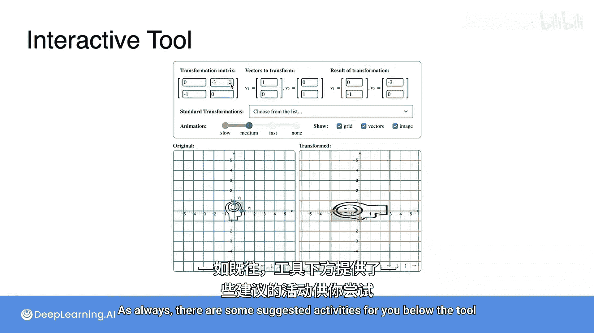

# 【Deeplearning】吴恩达：机器学习和数据科学线性代数1 ｜ Machine Learning Linear Algebra p34 P34_线性变换作为矩阵_03_02_02 -BV1Pp6VBjE29_p34-

In the previous video you learn how to turn a matrix into a linear transformation。

 but going the other way around is just as easy here I'll show you how to start with a linear transformation and then find the corresponding matrix。

 so let's say we have some inconognito matrix and we know it sends this fundamental square or basis into this one over here and the goal is to find the entries of the matrix so let's look at where it's sent each of the points The 0。

00 gets sent to 00 which always happens The 0。10 gets sent to 3 minus1 which is the bottom corner。

The 001 gets sent to 23 and the 0。11 gets sent to 52。

 so it turns out we don't need that much information， we only need these two points over here。

And I'm going to use arrows to denote this point since vectors tend to be denoted by an arrow growing from the original the way to the point so the vector which coordinates 10 gets sent to the vector with coordinates 3 minus1 and the one that coordinates 01 gets sent to when we coordinates 2。

3 Now I invite you to take a piece of paper and do the math and convince yourself that that's how matrix multiplication works。

 but the matrix that sends the vector 10 and 01 to 3 minus-1 and 2。

3 is precisely the one that has columns3 minus-1 and2a 3 and so that is how you turn a linear transformation into its corresponding matrix you only look at where the two fundamental vectors 10 and 01 go and those are your columns of the matrix。

Next you'll have a chance to use an interactive tool to explore the relationship between matrices and linear transformations。

 This is probably my favorite one in the course。 you'll be able to choose different values for a2 by two matrix and watch the way it squeezes and rotates a two dimensional space when viewed as a linear transformation As always。

 there are some suggested activities for you below the tool enjoy。

