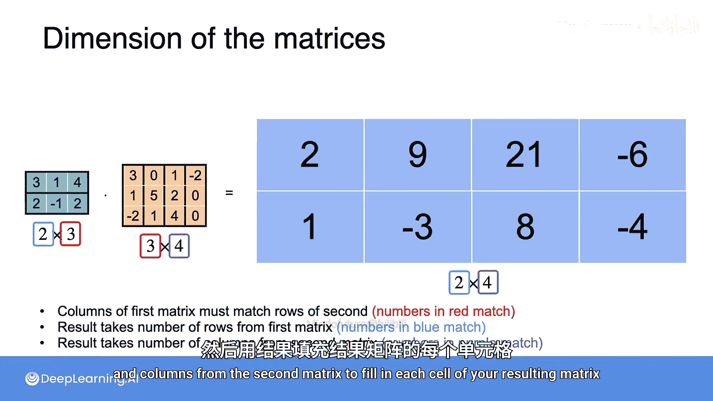

# 【Deeplearning】吴恩达：机器学习和数据科学线性代数1 ｜ Machine Learning Linear Algebra p35 P35_矩阵乘法_03_02_04 -BV1Pp6VBjE29_p35-

Previously you've learned how to multiply matrices and vectors in this video you'll learn how to multiply matrices and matrices the product formula is very intuitive but what I really enjoy is how it looks like for linear transformations。

😊。

In short， matrix multiplication corresponds to combining two linear transformations into a third one。

folllow me and'll show you下。So imagine that you have a matrix with n3311，2。

 the one you've already seen， so let's quickly take a look at the linear transformation here。

 the vector 10 goes to 31， which gets plotted here。And the vector 01 goes to the vector 12。

 which gets plotted here。And then the fundamental basis on the left gets sent to this basis on the right。

So let's do another one， but let's start with the basis on the right。

 so let's see what linear transformation corresponds to the matrix 2 minus 102。

So let's see how it acts on the two basis vectors which now are the vector 31， 31 goes to 25。

 therefore this vector over here goes to the 0。25 on the right and the other vector is 12。

 this matrix times 12 becomes the vector 04 so we plot 04。

And then this parallelogram on the left turns into this parallelogram on the right。

 so that is a way to see that linear transformation。And now let's put them together。😊。

So we have the first linear transformation corresponding to the matrix 3112 and the second one corresponding to the matrix 2 minus 102 Now if we forget about the middle one。

 then theres a linear transformation between the first and the third and that has to correspond to some matrix the question is what matrix corresponds to that linear transformation so lets simplify a bit and only look at the basis vectors。

So by looking only at the left and the right， wed see that the vector 10 on the left gets sent to52 on the right。

 therefore as we saw before the first column of the matrix is 52。

And the other basis vector vector 01 gets sent to the vector 04。

 therefore the second column of the matrix is 04。 so the combination of the tuian transformation gives us the linear transformation corresponding to the matrix 5024 Now is there any way we can obtain the matrix from the first to the third from the other two matrixrices and the answer is yes we can and that's what matrix multiplication is。

This operation over here is matrix of the left times matrix in the right equals the third matrix Now notice something that the matrix got flipped。

 this corresponded to the first linear transformation the one on the left and this corresponded to the second one so that' something very important to keep in mind。

And the reason is because the linear transformations act on the vector on the left so you multiply matrix times vector。

 therefore you first multiply the matrix 3112 and then multiply the matrix 2 minus102 so they go in the opposite direction。

Now is there a fast way to see matrix not without having to draw linear transformations。

 The answer is yes and you've pretty much seen it already because it's a lot of dot products basically look at the matrix on the left as two rows and the matrix on the right as two columns and take every possible combination of dot products between row and columns so for example the first row and the first column go in the top left corner and the first row of the first and the second column on the right go in the top right corner Now let's calculate these dot products like we already know the first one is5 the second one is0 the third one is two and the fourth one is4 so the matrix 5024 is the product of these other two matrices。

So in summary， you can look at a matrix product this way as multiplying two matrices。

 but you can also see it as combining two linear transformations into a third linear transformation Every matrix in this example is a 2 by2 matrix。

 but multiplication is also defined when your matrices aren't square like this。

Let me show you an example。This time I'll multiply a 2 by 3 matrix and a 3 by 4 matrix。

 the result will be a 2 by4 matrix。Before I multiply these matrices。

 see if you can predict what value would be in the bottom left cell of the result。

Let's see if your prediction was correct。 Remember， to multiply a matrix。

 you take rows from the first matrix and columns from the second。

The first dot product is a dot product of 314 and 31 minus2。 The result is 2。

 The next dot product is 314 and 0，51 giving a result of 9。

Completing this row of the matrix gives the dot products of 21 and minus6。

Now let's check that bottom left cell of the matrix following the pattern。

 I'll take the dot product of the second row of the first matrix and the first column of the second matrix。

So that's 2 times 3 plus minus1 times 1 plus 2 times minus2。Which gives a final answer of one。

Continue with the same pattern， you can solve for the remaining values of the matrix。

So this example show you that it's possible to multiply matrices， even if they're both rectangular。

 here are the key takeaways from the example。First。

 the number of columns of the first matrix musts match the number of rows of the second matrix。

 In other words， these numbers circled in here need to match。Second。

 the result matrix takes the number of rows from the first matrix。 In other words。

 these numbers circle in blue need to match。And finally。

 the result takes the number of columns from the second matrix。

 so these numbers circled in purple need to match。 Otherwise。

 though this works just like the two by two examples you saw before。

 you are simply taking the dot product of rows from the first matrix and columns from the second matrix to fill in each cell of your resulting matrix。

