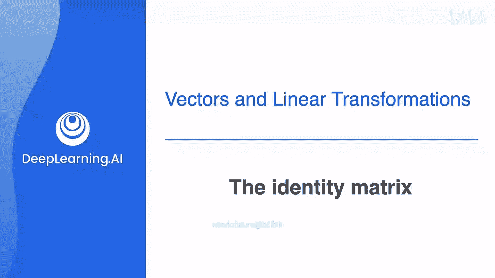
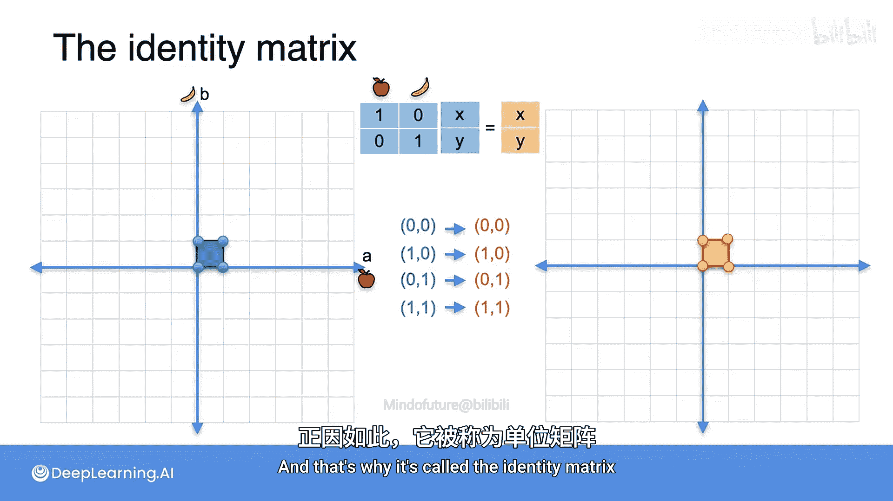

# 【Deeplearning】吴恩达：机器学习和数据科学线性代数1 ｜ Machine Learning Linear Algebra p36 P36_单位矩阵_03_02_05 -BV1Pp6VBjE29_p36-

When I think of numbers and multiplication， I think of the number one as a very special number。

See1 is special because when you multiply any number by one。

 you get the same number you started with the identity matrix satisfies this exact same role among the matrices。

 The identity matrix is the matrix that when multiplied by any other matrix。

 it gives the same matrix。And as corresponding linear transformation is very simple。

 it is the one that leaves the plane intact， here's how it looked。

The identity matrix has a very simple look， it has one in the diagonal and zeros everywhere else。

 and why does it work because when you multiply it by any vector say of entries A， B， C， D and E。

 you can verify that the resulting vector is also the one with entries A， B， C， D， and E。

I encourage you to verify this with pen and paper， for example。

 the first entry gets calculated as follows the dot product between the first row and the vector。

 which you can check that it's a and the identity matrix in a linear transformation is very simple as it sends each point precisely to itself。

As you can see this metric sends the vector 00 to 00， the vector 10 to 10， etc。

 and that's why it's called the identity matrix。

