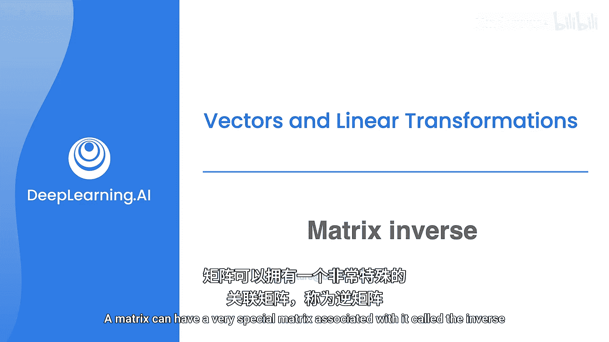
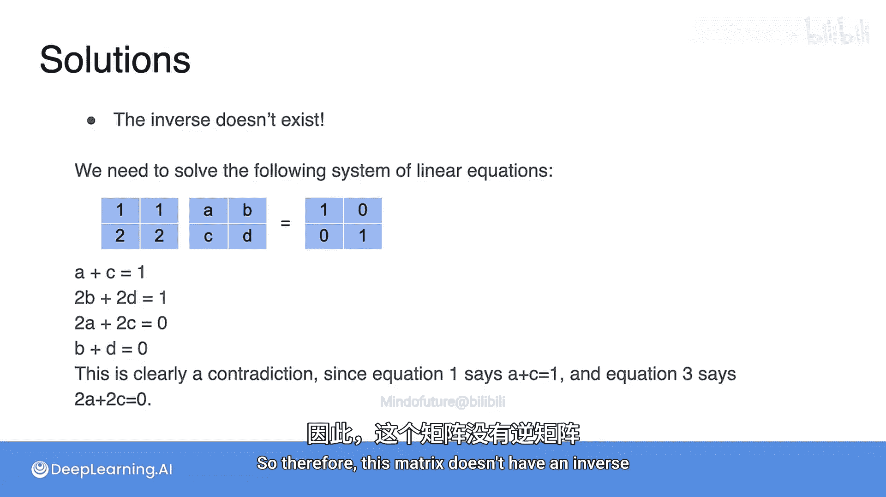

# 【Deeplearning】吴恩达：机器学习和数据科学线性代数1 ｜ Machine Learning Linear Algebra p37 P37_矩阵逆_03_02_06 -BV1Pp6VBjE29_p37-

A matrix can have a very special matrix associated with it called the inverse When I think of the inverse of a matrix。

 I think of the inverse of a number， namely the number that when multiplied to it gives us one。

For example， the inverse of the number two is the number 12 and the inverse of minus5 is minus 15；

 The inverse matrix is precisely that matrix for which the product of the mates is the identity matrix。

In a linear transformation， the matrixtri is the one that undo the job of the original matrix。

 namely the one that returns the plane to where it was at the beginning。

And here's how an inverse matrix works。 Imagine that you have a linear transformation corresponding to the usual matrix with entries 311 and 2 and that turns the square into this parallel over here Now there system some transformation that would turn this parallelogram back into the original square and don't worry about the entrance of the matrix we'll find them later just know that there is one。

And that would mean that the composition of the two transformations is the one corresponding to the identity matrix the one that does nothing to the plane it leaves it by itself。

 so the inverse matrix is the one with entries A， B， C and D。

 that means that when we multiply the original matrix by the inverse we get the identity。Now。

 just like with numbers， we're going to call the inverse。

 the original matrix elevated to the power of minus1。

In the same way that you say2 to the minus1 is 12， then this matrix to the minus1 is the inverse matrix。

 and this happens to have these entries and you can verify that if you were to multiply the original matrix by this one。

 you get the identity matrix。Now how do we find the entries in this inverse matrix。

 the answer is by solving a system of linear equations。

 so notice that if we take the entries in this matrix on the left to be equals to this counterpart on the right。

 then we really have the following for dot products。

Each one of these dot products gives us some linear equation now you have a system of four linear equations with four unknowns。

 A， B， C and D， we can use our usual methods of elimination to solve it to get a equals 25。

 B equals minus15， C equals minus15 and D equals 35。So now here's a quiz。

Find the inverse of the following matrix。 If you find that task is impossible。

 feel free to click on I couldn't find it。So by solving the corresponding system of linear equations。

 we get the following。We get that the answers are a equals one quarter， b equals minus1 quarter。

 C equals minus 18， and D is equal to 58s。Now here's another quiz。

 find the inverse of the following matrix， and if you find that the task is impossible。

 feel free to click on on reaching a dead end。😊，And it turns out that the image doesn't exist。

 we need to solve the following system of linear equations a plus C equals 1。2 b plus 2 d equals 0。

 2 a plus 2 c equals 0 and b plus d equals1。 Now is clear the contradictions is the first equation says a plus c equals 1 and the third equation says 2 a plus 2 c equals 0。

 but if a plus c equals 1 and 2 a plus 2 C has to be 2 it cannot be0。

 so therefore this matrix doesn't have an inverse。

