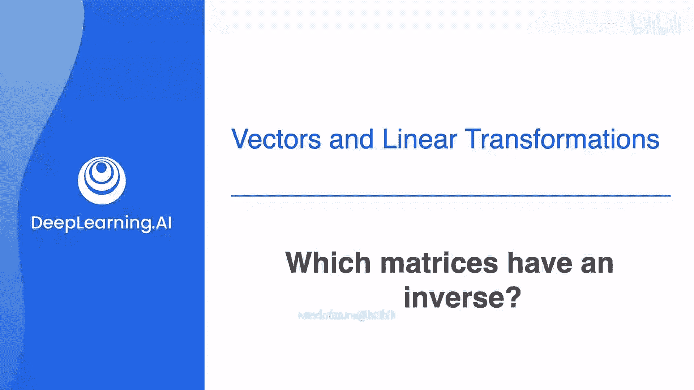
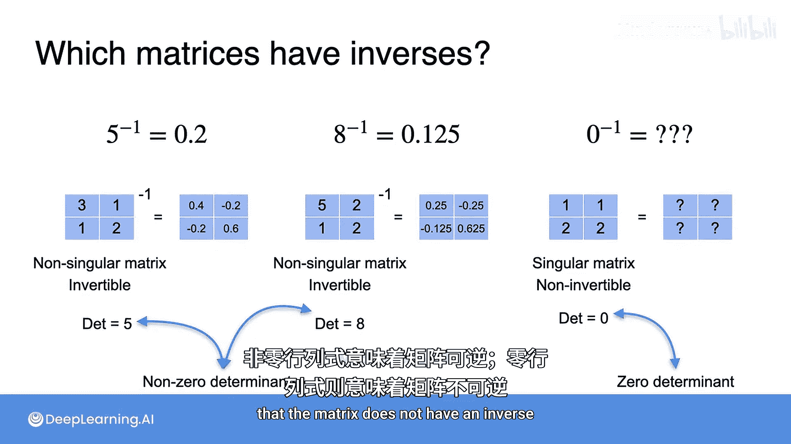

# 【Deeplearning】吴恩达：机器学习和数据科学线性代数1 ｜ Machine Learning Linear Algebra p38 P38_哪些矩阵有逆矩阵_03_02_07 -BV1Pp6VBjE29_p38-

In the last video you learn how to find matrix inverses and also that some matrices have no inverse。

 what is the rule then for a matrix to have an inverse or not？

You will be happy to find that the rule is something you've already learned See matrices behave a lot like numbers。

 you just realize that some matrices have multiplicative inverses in the same way that some numbers have multiplicative inverses。

 for example the inverse of 5 is 15 or 0。2 the inverse of 8 is 18 or 0。125。However。

 not all numbers have multiplicative inverses， for example， what is the inverse of0？

The inverse of 0 is not defined as there is no number which when multiplied by0 gives us 1 Now from the last video in the previous quizzes。

 you know that this is also the case with matrices。

 some matrices have inversees like this two over here and some don't like this one over here。

So what is special about these three matrices， can you look at something special well as you've seen before。

 the first two are non singularing and the third one is singular。

 could it be that this is the requirement and you'll be happy to see that this is exactly the requirement nonsingular mates always have an inverse and that's why we also call them invertable mat。

And singular matrices never have a universeverse， which is what we call them non inverttable。

And something interesting happens when you look at the determinant。

 the determinant is non0 for inverttable matcheses in the same way that nonzero numbers have an inverse and the determinant is0 for noninverttable matcheses in the same way that0 doesn't have a multiplicative numbers。

 so I like to remember that way。Nonze determinants mean that the matrix has an em and a zero determinant that the matrix does not have an em。

